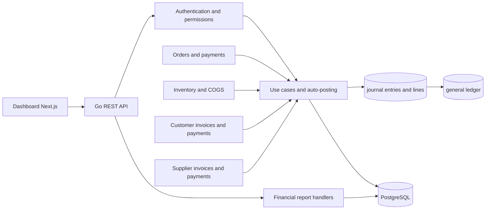

# Financial architecture map

**Status: PARTIAL — repository and one manual posting traced; the full event matrix is not runtime-proven.**

Flow: Dashboard Next.js → Go REST API → authentication/permission wrappers → use cases and auto-posting → PostgreSQL journal header/lines → general ledger → report handlers. POS orders, inventory/COGS, supplier invoices/payments, and customer invoices/payments have source paths into accounting, but only the manual journal flow was traced at runtime.

Evidence:
- Journal create/post handlers: backend/internal/handler/http/journal_entry_handler.go:122,278.
- Route permission wrappers: backend/cmd/api/main.go:1051-1058.
- Auto-posting: backend/internal/usecase/auto_posting_engine.go.
- Financial reports: backend/internal/handler/http/financial_report_handler.go; routes main.go:1406-1412.
- Journal schema migration 137; general-ledger schema migration 154.
- Runtime verified one manual journal through DB rows, trial balance, P&L, Balance Sheet, and cash flow.

Payment processors/webhooks, workers, order transaction boundaries, refunds, settlements, idempotency storage, and ledger recovery were not fully traced. A source process map does not prove each provider/order event reaches the ledger.

