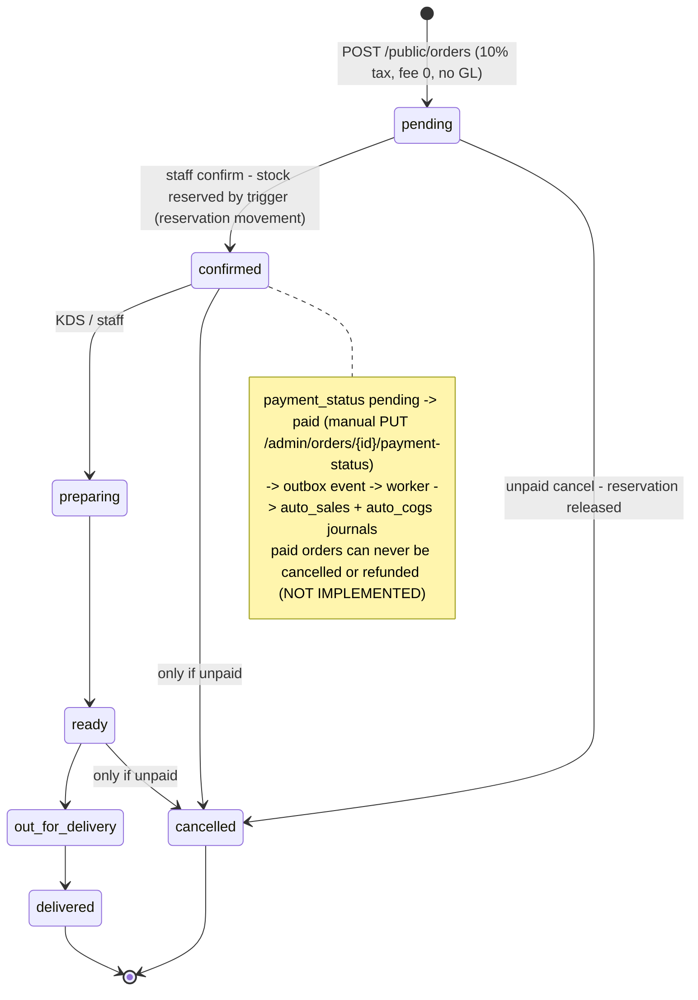
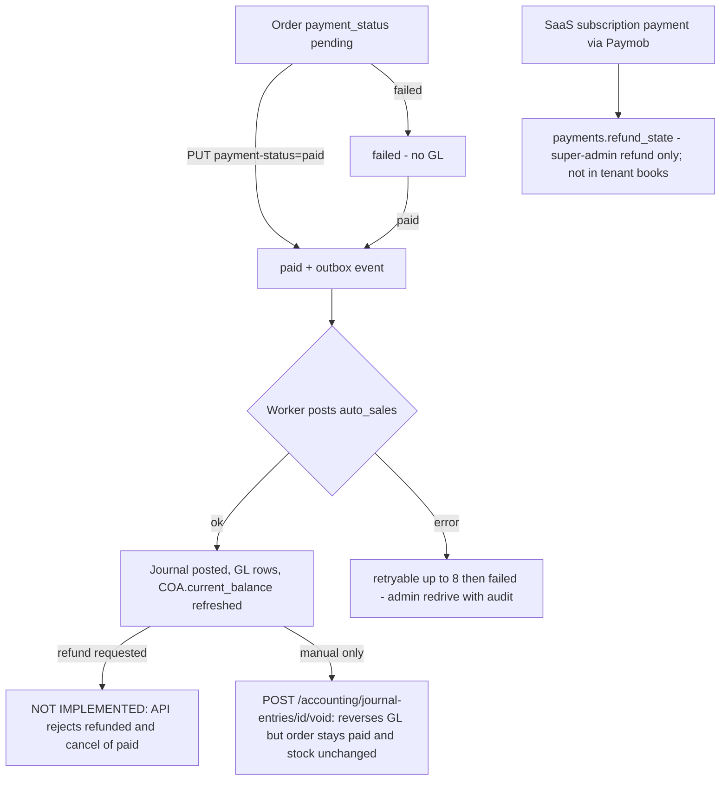
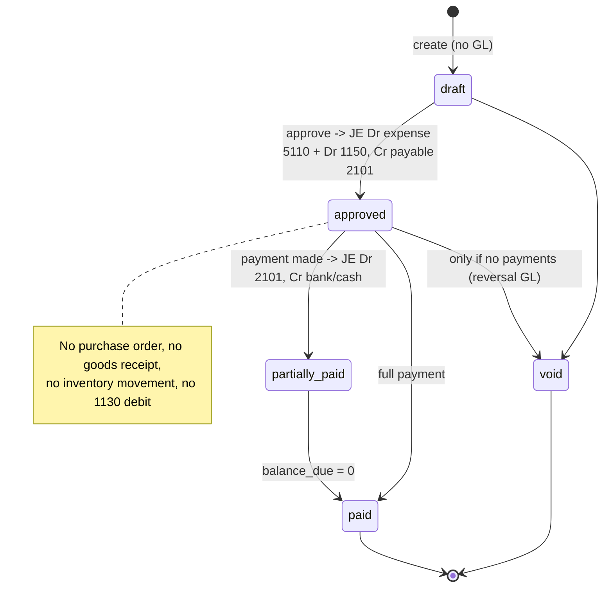
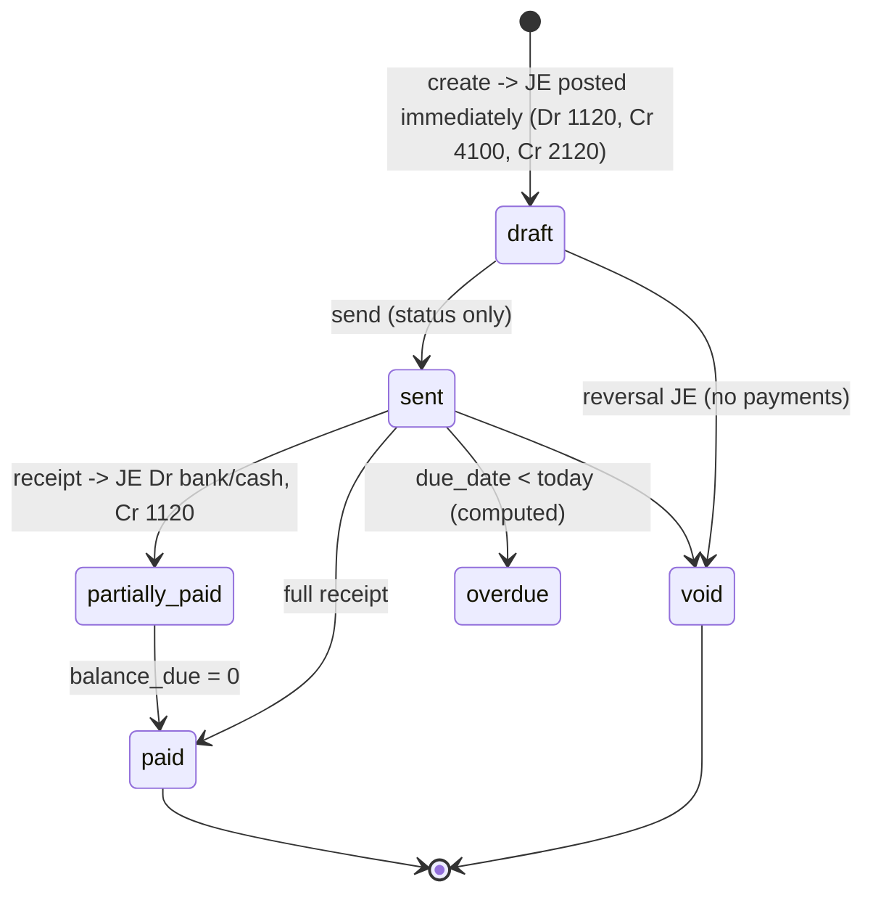
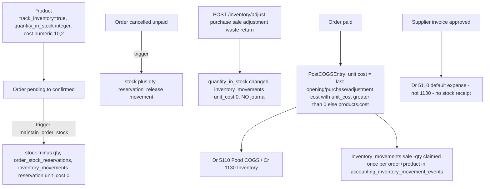
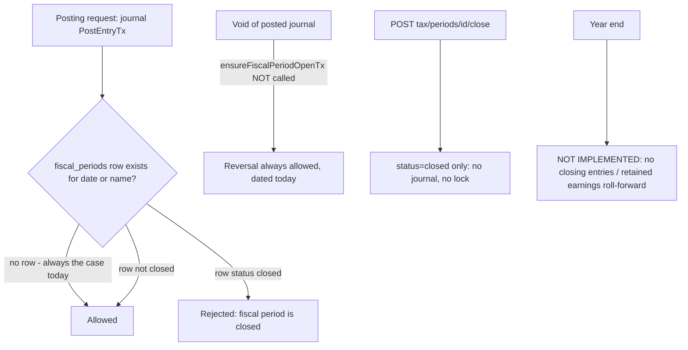

# 10 - Financial transaction lifecycles

Baseline SHA 133260db66b1143c254d79476daa7650b41a33f0. Paths relative to `backend/internal/` unless stated. Every diagram is also saved under `diagrams/` (`pos-order-lifecycle.md`, `online-order-lifecycle.md`, ...). "GL" = journal entry + general_ledger rows. Items not found are marked NOT IMPLEMENTED; items not proven are UNVERIFIED.

## 1. Orders

### 1.1 Order state machines
Fulfilment status (`orders.status`, CHECK chk_order_status; transition table `domain/order.go:236-268`):
`pending -> confirmed -> preparing -> ready -> out_for_delivery -> delivered`; `cancelled` is reachable from ANY non-terminal status (domain/order.go:238-240: allowed unless old status is delivered or cancelled), but paid/refunded orders are blocked at the repository (order_repo.go:633-635). Terminal: delivered, cancelled.

Payment status (`orders.payment_status`, CHECK chk_payment_status; `CanTransitionOrderPaymentStatus` `domain/order.go:219-233`): `pending -> paid | failed`, `failed -> paid | pending`; `paid` is terminal (cannot go back); `refunded` can NEVER be set through the API and, if present, cannot be left; paid not allowed on cancelled orders.

| Transition | Code | Financial / inventory consequence |
|---|---|---|
| create (website) | `usecase/order_usecase.go:62-224`, pricing `usecase/order_pricing.go:44-56` | Totals computed server-side: `tax = round(subtotal*10%)`, `delivery_fee=0`, `total = subtotal+tax-discount`. No journal, no stock change. |
| create (POS) | same + `handler/http/order_source_guard.go:13` | Same; then auto `pending -> confirmed` (order_usecase.go:198-205) |
| pending -> confirmed | `repository/order_repo.go:611-657` + trigger `maintain_order_stock` (DB) | For `track_inventory` products: lock product, fail if stock < qty ("Insufficient inventory"), INSERT `order_stock_reservations`, `products.quantity_in_stock -= qty`, INSERT `inventory_movements(movement_type='reservation', quantity=-qty, unit_cost=0)`. KDS enqueue (order_usecase.go:296-308). No GL. |
| confirmed/preparing/ready/out_for_delivery | `UpdateOrderStatus` order_usecase.go:283-324; KDS bump/recall | status + `order_status_history` row only |
| -> delivered | `CompleteOrder/DeliverOrder` order_usecase.go:373-449 | No GL; no stock change (already reserved). |
| -> cancelled (unpaid) | `order_repo.go:611-650`; trigger | Releases reservations: `quantity_in_stock += unreleased`, movement `reservation_release`. Table freed (UNVERIFIED). No GL. |
| -> cancelled (paid/refunded) | `order_repo.go:633-635`, `order_usecase.go ~340-345` | REJECTED ("cannot cancel paid or refunded order before a supported refund and accounting reversal workflow exists"). |
| delivered -> cancelled | trigger `maintain_order_stock` | REJECTED ("Delivered stock requires an explicit physical return adjustment"). |
| payment pending/failed -> paid | `repository/order_repo.go:545-600`; endpoint `PUT /admin/orders/{id}/payment-status` (main.go:1437) | Same transaction writes `accounting_event_outbox` row (`EnqueuePaidOrderTx` :595). GL is posted LATER by the worker (15 s tick, `service/accounting_event_worker.go`): sales entry + COGS entry (see 1.3). |
| payment -> refunded | `domain/order.go:220` | REJECTED. NOT IMPLEMENTED (no refund/return/credit note flow; no stock return; no reversal). |
| partial item cancel | `migrations/181_partial_order_cancellations.sql:105-172` | Only unpaid + unfulfilled + undiscounted; recomputes subtotal/tax/total in SQL, releases partial reservation. |
| DELETE order (`DELETE /admin/orders/{id}`) | `handler/http/admin_order_handler.go:420-460` | Actually maps to CancelOrder (same rules as above), not a physical delete. Physical delete is blocked by trigger only if reservations exist. |

Gaps: payments are one text field per order (no tender records, no partial/split payments, no tips, no change, no payment timestamp); POS has no session/shift/cash-drawer; online payment of orders has no gateway integration (Paymob handles SaaS subscriptions only); paid is set by a separate client call after POS creation (`frontend/apps/dashboard/src/lib/api/posApi.ts:255-270`), so a crash between create/confirm and the paid call leaves stock reserved with no revenue.

### 1.2 Online (storefront) order lifecycle


### 1.3 POS order lifecycle
```mermaid
%% file: pos-order-lifecycle
sequenceDiagram
  participant UI as POS UI (posApi.ts)
  participant API as POST /api/v1/pos/orders
  participant DB as orders + trigger
  participant OB as accounting_event_outbox
  participant W as AccountingEventWorker (15s)
  participant GL as journal_entries / general_ledger
  UI->>API: create order (order_source forced to pos)
  API->>DB: INSERT order pending, payment pending
  API->>DB: auto-confirm (pending->confirmed)
  DB-->>DB: reserve stock, inventory_movements reservation
  API-->>UI: order id
  UI->>API: PUT /admin/orders/{id}/payment-status = paid (separate call)
  API->>DB: UPDATE payment_status=paid
  API->>OB: INSERT paid_order event (same tx)
  W->>OB: ClaimNext (lease, attempts+1)
  W->>GL: PostSalesEntry (Dr cash/bank/card, Dr 4150; Cr 4100, 4120, 2120) date=order.created_at
  W->>GL: PostCOGSEntry (Dr 5110, Cr 1130) + inventory_movements sale
  W->>OB: Complete (or Fail -> retryable, max 8, then failed + redrive audit)
  Note over UI,GL: No session/shift, tender, change, tip, refund or void flow exists
```

### 1.4 Payment & refund


## 2. Supplier invoice (purchase) lifecycle
Status CHECK `chk_supplier_invoice_status`: draft, approved, partially_paid, paid, overdue, void.
| Transition | Code | Consequence |
|---|---|---|
| create (draft) | `repository/invoice_supplier_repo.go:130-203`; triggers `trg_invoice_supplier_line_total/totals` recompute line totals and header totals | No GL. |
| update (draft only) | :205-293 | No GL. |
| approve (draft -> approved, or paid if balance_due <= 0) | :295-348 | Posts journal: Dr expense per line account (default 5110) = line_total - line tax; Dr 1150 Input VAT = tax; Cr payable (supplier.payable_account_id else 2101) = total. Atomic with status. No inventory movement, no stock increase. |
| payment (POST /accounting/payments/made) | `repository/payment_acct_repo.go:175-319`, apply :585-600 | Posts Dr payable / Cr bank-GL or 1110/1113/1111; invoice `amount_paid += x`, `balance_due`, status partially_paid/paid; bank `current_balance` adjusted; over-payment rejected. |
| overdue | computed on read (queries use `due_date < CURRENT_DATE`) | none |
| void | :350-386 (only if amount_paid = 0) | Void journal -> inverse GL rows dated today; invoice status void. Supplier `current_balance` not adjusted (UNVERIFIED elsewhere). |
| payment void/reversal | NOT IMPLEMENTED (status 'void' exists in CHECK only) | |


## 3. Customer (AR) invoice lifecycle
Status CHECK: draft, sent, partially_paid, paid, overdue, void.
| Transition | Code | Consequence |
|---|---|---|
| create | `repository/invoice_customer_repo.go:128-159, 452-537` | Journal POSTED AT CREATION (even while status draft): Dr receivable (customer account else 1120) = total; Cr revenue per line account (default 4100) = line_total - tax; Cr 2120 = tax. Customer `current_balance += balance_due`. |
| update | :161-298 (blocked if void or amount_paid>0) | Voids old journal, posts a new one, adjusts customer balance delta. |
| send / send-email | `MarkAsSent` :300-321; `POST .../send(-email)` | Status sent (or overdue); no GL. |
| receipt | `payment_acct_repo.go:29-173` | Dr bank/cash, Cr receivable; invoice paid fields and customer balance updated; over-payment rejected. |
| void | :323-362 (blocked if amount_paid>0) | Void journal; customer balance reduced by balance_due. |
| receipt void / credit note | NOT IMPLEMENTED | |

Risk: invoice with `order_id` set plus the order's own `auto_sales` journal can recognise the same sale twice (no cross-check).

## 4. Payroll lifecycle
`salaries.status` CHECK: pending, processing, paid, cancelled, on_hold; booleans `is_approved`, `is_paid`.
| Transition | Code | Consequence |
|---|---|---|
| create | `handler/http/hr_salary_handler.go:154-290`; DB trigger `calculate_salary_totals` recomputes gross/deductions/net; `set_salary_period` | none (no accrual); creating directly as paid is refused (:193) |
| update (unpaid only) | :291-431 (paid is read-only :319; status=paid refused :339) | none |
| approve | fields only (`is_approved`) - not enforced before payment | none |
| mark-paid | :471-563, `repository/salary_repo.go MarkAsPaidTx`, `usecase/auto_posting_engine.go:268-460` | One DB transaction: salary -> paid (+audit log) and journal posted: Dr 5210 (gross - overtime - tips), Dr 5220 overtime, Dr 2140 tips; Cr 2110 for tax/insurance/pension/loan/other deductions, Cr 1121 for advances; Cr 1110 (cash) or 1111 (bank) = net_salary. Fails (rolls back payment) if rule disabled/account missing. |
| delete | `DeleteUnpaidSalary`; paid rows rejected | |
| reversal / void of paid payroll | NOT IMPLEMENTED | |

```mermaid
%% file: payroll-flow
stateDiagram-v2
  [*] --> pending: create (triggers calc gross/net; NO accrual JE)
  pending --> processing
  pending --> on_hold
  pending --> cancelled
  pending --> paid: mark-paid (atomic) -> JE Dr 5210/5220/2140, Cr 1110|1111 net, Cr 2110/1121 deductions
  processing --> paid
  paid --> [*]
  note right of paid
    expense recognised on payment date (cash basis)
    2130 Salaries Payable unused; no reversal flow
  end note
```


## 5. Inventory and COGS

Notes: stock decrement (confirmation) and COGS recognition (payment) are decoupled; movement table holds two negative rows per sold unit (reservation + sale); `GetProductCost` ignores manual/purchase movements that carry unit_cost 0, so `/inventory/adjust` purchases never update cost; no recipes/BOM/yield; no waste or shrinkage journal; no stock count; legacy `inventory` table unused.

## 6. Period closing and tax periods
Current behaviour:
- `fiscal_periods` rows are never created or closed by application code (only SELECTed by `repository/journal_entry_repo.go:813-842` and diagnostics). With no row, posting is allowed; with a row whose status equals "closed" (case-insensitive) new posts are rejected (:838-840). Voids are not checked.
- `POST /accounting/tax/periods/{id}/close` (`repository/tax_repo.go:293-318`) only sets `tax_periods.status='closed'`, `closed_at`, `closed_by`; no VAT settlement journal, no lock on invoices/GL.
- Year-end: NO closing entries; Balance Sheet omits P&L accounts (see 12 F3); `current_earnings_diagnostic.go` reports POLICY_PENDING.


## 7. Journal posting lifecycle (applies to all events)

```mermaid
%% file: journal-posting-flow
stateDiagram-v2
  [*] --> draft: INSERT (trigger requires draft; restaurant belongs to tenant)
  draft --> posted: PostEntryTx - balance check, GL rows appended, COA.current_balance recomputed
  draft --> void: requires void audit fields and reason
  posted --> void: audit-only change; inverse GL rows appended; original rows kept
  void --> [*]
  note right of posted
    DB: deferred constraint triggers verify balanced lines,
    header totals and exactly one GL row per line at COMMIT.
    general_ledger UPDATE/DELETE always rejected.
    migration 190: account normal_balance frozen once GL history exists.
  end note
```

