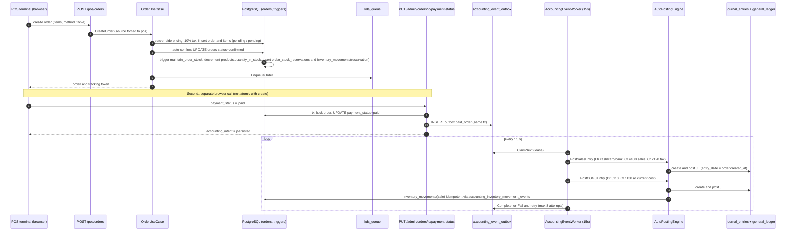
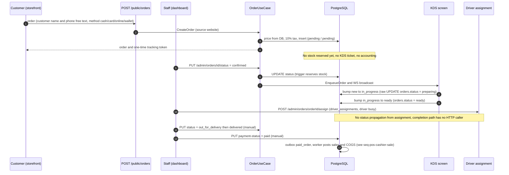

# 26 - Business workflow catalog

Baseline SHA 133260db66b1143c254d79476daa7650b41a33f0. Static source reading and SELECT-only catalog queries (`docker exec pos-postgres psql ... pos_saas`); no endpoint called, no row written. Runtime data is almost empty (2 tenants, 6 products, 0 orders, 0 journal entries), so nothing here was observed executing: every workflow is "CBS" for what the code does and "REQUIRES-EXECUTION" (REX) for how it behaves live.

Labels: CBS = CONFIRMED-BY-SOURCE, CBR = CONFIRMED-BY-READONLY-RUNTIME, DI = DOCUMENTED-INTENT, INF = INFERRED, UNKNOWN, REX = REQUIRES-EXECUTION.
Status per workflow: IMPLEMENTED / PARTIAL / NOT IMPLEMENTED.

Route paths are from `08-api-inventory.csv` (handler file:line). Permission modules referenced by number: 10 = orders, 15 = accounting (per inventory).

## 0. Index and status

| # | Workflow | Status |
|---|---|---|
| 1 | Restaurant initialization / tenant registration | PARTIAL (no accounting bootstrap) |
| 2 | Opening balances | NOT IMPLEMENTED as a workflow (fields and manual JE only) |
| 3 | Capital contribution | NOT IMPLEMENTED |
| 4 | Product creation | IMPLEMENTED (no cost-to-GL) |
| 5 | Supplier purchase | PARTIAL (invoice only, no PO) |
| 6 | Inventory receiving | NOT IMPLEMENTED as purchase receiving (manual adjust only) |
| 7 | Supplier payment | IMPLEMENTED |
| 8 | Cashier sale (POS) | PARTIAL (no shift/session) |
| 9 | Online order | PARTIAL (no online payment capture) |
| 10 | Kitchen processing | IMPLEMENTED (non-financial) |
| 11 | Delivery / driver | PARTIAL |
| 12 | Customer invoice | IMPLEMENTED (accounting-only, unlinked to orders) |
| 13 | Customer payment | IMPLEMENTED (invoices); order payments = status toggle |
| 14 | Discounts | NOT IMPLEMENTED (price-list discount only) |
| 15 | Taxes | PARTIAL (hard-coded 10%) |
| 16 | Refunds | NOT IMPLEMENTED |
| 17 | Cancellations | PARTIAL (unpaid only) |
| 18 | Stock adjustments | PARTIAL (no GL) |
| 19 | Waste | PARTIAL (stock only; no GL) |
| 20 | Attendance | IMPLEMENTED (HR) |
| 21 | Payroll calculation | PARTIAL (manual inputs; trigger sums) |
| 22 | Payroll settlement | IMPLEMENTED |
| 23 | Expenses | NOT IMPLEMENTED as a module |
| 24 | Bank transfers | NOT IMPLEMENTED |
| 25 | Financial period closing | NOT IMPLEMENTED |

Count: 25 workflows documented.

Cross-cutting facts used below:
- Tenant scoping: every handler reads tenant/restaurant ids from the authenticated context (`middleware.GetTenantID`), repositories filter on both (CBS across the files cited per workflow). Isolation verdicts belong to other phases and are not asserted here.
- Money types: `float64` in Go, NUMERIC(15,2) mostly in DB (see `04-financial-model-and-policies.md` section 1).
- Posting engine: all auto entries go through `JournalEntryRepository`/`GeneralLedgerRepository` and are guarded by DB integrity triggers `cfr002_*`, `trg_journal_balance` (CBR trigger catalog). Closed-period guard: `journal_entry_repo.go:813-831` (post path only).

---

## 1. Restaurant initialization / tenant registration — PARTIAL

- **Entry point:** `POST /api/v1/auth/register` -> `authHandler.Register` (`backend/internal/handler/http/auth_handler.go:47`) -> `AuthUseCase.RegisterContext` (`auth_usecase.go:99`) -> `AuthRepository.CreateTenantWithUserContext` (`auth_repo.go:42`). Subdomain pre-check `GET /api/v1/auth/check-subdomain` (`auth_handler.go:377`). CBS
- **Preconditions:** unique slug/subdomain and email rules (`domain/registration_validation.go`, `auth_usecase.go:448-466`). No authentication. CBS
- **Required data:** tenant name, slug, owner email/password/name/phone, restaurant name (`domain.RegisterRequest`). CBS
- **State transitions:** none beyond creation; tenant starts on trial (columns `trial_days`, `subscription_plan`; insert at `auth_repo.go:86`, trial seeding by migrations 110-112). CBS
- **Business rules:** slug retry loop up to 20 attempts (`auth_repo.go:84`); password hashed; RBAC default roles seeded (`auth_repo.go:405-436`). CBS
- **DB changes:** INSERT `tenants`, `users`, `restaurants`, `themes_v2`, `roles`, `role_permissions`, `user_roles` (`auth_repo.go:86,125,140,178,200,405,436`). CBS
- **Events:** none (no outbox, no notification trigger traced). UNKNOWN for email side-effects.
- **Financial effects:** **none.** No `chart_of_accounts`, `auto_posting_rules`, `fiscal_periods`, `bank_accounts_ledger`, opening balances (grep: no such insert in `auth_repo.go`, `restaurant_repo.go`, `auth_usecase.go`). Migrations 152 and 156 seed only the restaurants that existed when they ran (`156_seed_chart_of_accounts.sql:1-2`; `152_create_auto_posting_rules.sql` `FROM restaurants r`). CBS
  CBR: tenant 1/restaurant 1: 62 accounts, 6 rules, 0 fiscal periods; tenant 2/restaurant 2: 0 accounts, 0 rules, 0 fiscal periods.
- **Error paths:** duplicate slug/email -> validation error; transaction rollback on any insert failure (single tx, `auth_repo.go:42-210`). CBS
- **Recovery:** none specific. There is no tenant bootstrap/repair endpoint for accounting data (API inventory has no such route). Accounts can be created one by one (`POST /accounting/accounts`) or by CSV import (`POST /accounting/csv/chart-of-accounts/import`, `accounting_advanced_handler.go:1012`). Posting rules have no create route in the inventory (UNKNOWN whether updatable through another path). CBS
- **Final state:** tenant with users/roles/restaurant but without any accounting setup. INF consequence: the first paid order cannot post (see seq diagram); REX.
- Diagram: `diagrams/seq-tenant-registration.md` (below).

## 2. Opening balances — NOT IMPLEMENTED as a workflow

- **Entry point:** none dedicated. Candidates: (a) bank account fields via `POST /accounting/bank-accounts` (`bank_account_handler.go:97`) writing `opening_balance`, `current_balance`, `opening_date`; (b) customer/supplier `current_balance` via create/update (`customer_acct_repo.go:160`, `supplier_repo.go:112-191`); (c) product initial stock (`product_repo.go:154`); (d) manual journal `POST /accounting/journal-entries` (`journal_entry_handler.go:122`) or CSV import `POST /accounting/csv/journal-entries/import` (`accounting_advanced_handler.go:1067`). CBS
- **Preconditions/required data:** none enforced (no source reference, no approval fields): `opening_balance_diagnostics.go` comment states `bank_accounts_ledger` has no source-reference or approval fields; diagnostic returns `POLICY_PENDING`/`SOURCE_UNAVAILABLE`. CBS; policy OPEN-01 is pending (DI per `04-...`).
- **State transitions / rules:** none.
- **DB changes:** (a)-(c) change operational columns only; (d) posts to GL. No link between them: bank `opening_balance` never creates a journal (`bank_account_repo.go:95-135`); the `opening` inventory movement type is defined (`domain/auto_posting.go:27`) but never written (grep: only read in `GetProductCost`, `inventory_movement_repo.go:175`). CBS
- **Events:** none. **Financial effect:** only if the user hand-posts an opening JE; the balance sheet then relies on that JE. Product initial stock produces `inventory_movements(adjustment, unit_cost=product.cost)` but no JE (`product_stock_movement.go:16-38`). CBS
- **Error/recovery:** none; read-only diagnostic exists, never writes. **Final state:** parallel unreconciled balances (see 27 S3-S5).

## 3. Capital contribution — NOT IMPLEMENTED

- Evidence of absence: grep `capital_contribution|owner_equity|drawings|share_capital` over `backend/internal`, `backend/cmd`, `backend/migrations` returns no file (CBS). Equity accounts exist in the seeded chart (3xxx, e.g. retained earnings 3200 `156_seed_chart_of_accounts.sql:58`) and could be used by a manual JE only. No route, table, state or event.
- Financial effect available only through manual journal (M3 in 25). Final state: n/a.

## 4. Product creation — IMPLEMENTED

- **Entry point:** `POST /api/v1/products` -> `productHandler.CreateProduct` (`product_handler.go:53`), module-gated; repo `ProductRepository.CreateProduct` (`product_repo.go:25-160`). CBS
- **Preconditions:** authenticated tenant/restaurant; category must exist in scope (`errors "restaurant or category not found in the requested scope"` `product_repo.go:145`). **Required data:** names (en/ar), price, category, optional `cost`, `track_inventory`, `quantity_in_stock`, SKU (duplicate SKU -> error `:148`). CBS
- **State transitions:** `status` active/inactive/deleted (valid states per `domain/product.go`; reports treat `deleted` specially). CBS (partial read).
- **Business rules:** `discount_price` > 0 overrides `price` at order time (`order_pricing.go:21-24`). Cost has no validation link to purchases. CBS
- **DB changes:** INSERT `products`; if initial stock != 0 INSERT `inventory_movements(adjustment, quantity, unit_cost=product.cost, total_cost)` in the same tx (`product_repo.go:153-157`, `product_stock_movement.go`). Audit log migration `017_create_product_audit_log.sql` (usage not traced: UNKNOWN). CBS
- **Events:** none (low-stock notification path exists in the usecase, not traced). **Financial effect:** none (no inventory JE, no opening posting). CBS
- **Error paths:** actor must belong to scope (`product_stock_movement.go:32-37`). **Recovery:** edit via `PUT /products/{id}` (`product_update_repo.go:107` records an adjustment movement for stock deltas); no cost history. **Final state:** product with stock and a cost value that feeds COGS/valuation (see 27 S8).

## 5. Supplier purchase — PARTIAL (invoice only)

- **Entry point:** `POST /api/v1/suppliers` (master, `supplier_handler.go:97`) then `POST /api/v1/accounting/supplier-invoices` (`invoice_supplier_handler.go:93`) then `POST .../{id}/approve` (`:204`). CBS
- **Preconditions:** supplier exists in scope; for approval, status = draft (`invoice_supplier_repo.go:295-312`) and accounts 5110/1150 and payable (2101 or supplier's `payable_account_id`) must exist (`:498-596`). CBS
- **Required data:** supplier, invoice date/due date, lines (description, quantity, unit price, tax rate, optional `account_id`), currency. No product link. CBS
- **State transitions:** draft -> approved (or paid if balance_due <= 0 at approval, `:325-331`) -> partially_paid/paid via payments -> void (blocked if `amount_paid > 0`, `:350-366`). CBS
- **Business rules:** totals computed by trigger from lines (`142_create_invoices_supplier.sql:95`); input VAT posted separately to 1150; zero/negative net lines skipped. CBS
- **DB changes:** INSERT `invoices_supplier`, `invoice_supplier_lines`; on approve INSERT journal + GL rows, UPDATE invoice (`journal_entry_id`, status). CBS
- **Events:** none (no outbox). **Financial effect:** Dr expense (default **5110 = food COGS account**), Dr 1150, Cr AP. Inventory asset (1130) is not debited unless the user picks it per line. CBS / the 5110 default's accounting meaning is a policy matter (INF).
- **Error paths:** missing accounts -> "account not found"; closed fiscal period -> posting refused (only if a `fiscal_periods` row exists: none can be created, see 25). **Recovery:** void while unpaid; no credit note. **Final state:** approved invoice + posted JE; `suppliers.current_balance` unchanged (see 27 S5).
- Purchase orders / goods receipt: NOT IMPLEMENTED (grep none; CBR no `%purchase%` table).
- Diagram: `diagrams/seq-supplier-purchase-payment.md`.

## 6. Inventory receiving — NOT IMPLEMENTED (as receiving)

- No goods-receipt object, route or table (grep `goods_receipt|grn|purchase_order` none). The only way stock increases outside order cancellation is: product edit (`PUT /products/{id}`, `product_update_repo.go:107`) or `POST /api/v1/inventory/adjust` with `reason='purchase'` (`inventory_adjustment_handler.go:29-130`). CBS
- Adjust: requires `track_inventory`, reject negative result, writes `products.quantity_in_stock` and `inventory_movements(movement_type=reason, unit_cost default 0)` atomically; no cost input, no supplier/invoice reference, no journal. So a "purchase" receipt neither updates the product cost, nor feeds `GetProductCost` (requires `unit_cost > 0`, `inventory_movement_repo.go:158-175`), nor debits inventory. CBS
- Final state: quantity up, value unchanged in GL (see 27 S7).

## 7. Supplier payment — IMPLEMENTED

- **Entry point:** `POST /api/v1/accounting/payments/made` -> `payment_acct_handler.go:128` -> `PaymentAccountingRepository.CreatePaymentMade` (`payment_acct_repo.go:175-318`). CBS
- **Preconditions:** amount > 0, method present; supplier or invoice resolvable; amount <= invoice balance + 0.009 (`:57,203`; invoice-bound only); collection account from `bank_account_id`'s `gl_account_id` else code by method (`:546-566`). CBS
- **State transitions:** invoice `approved/partially_paid -> partially_paid/paid` (`:585-600`); payment status `completed`. **Rules:** over-payment rejected only when tied to an invoice. CBS
- **DB changes (one tx):** INSERT `payments_made`; JE (Dr payable, Cr bank/cash) posted; UPDATE invoice amounts; `suppliers.current_balance -= amount`; `bank_accounts_ledger.current_balance -= amount` if `bank_account_id`. CBS
- **Events:** none. **Financial effect:** AP decreases; cash/bank GL decreases; payments-made table feeds predictive cash flow (27). CBS
- **Error paths:** any step error rolls back; period closed -> posting refused (if period row exists). **Recovery:** no void/reversal endpoint for payments in the API inventory (only invoices and journals can be voided: UNKNOWN whether payment rows can be reversed via journal void; the `payments_made.status` `void` value is read by predictive cash flow, `accounting_advanced_repo.go:1105-1135`, but no writer found by grep: INF). **Final state:** paid invoice, reduced balances.
- Not-wired alternative: `PostSupplierPaymentEntry` has no callers (`auto_posting_engine.go:477`).

## 8. Cashier sale (POS) — PARTIAL

- **Cashier session / shift / drawer:** **NOT IMPLEMENTED.** Grep `cash_shift|shift_id|cash_session|cash_drawer|register_session` over `backend/internal`, `backend/cmd`, `backend/migrations`: no match; frontend POS directory grep for `shift|drawer|till|z-report`: only the label "Cashier" showing `user.name` (`frontend/apps/dashboard/src/app/[locale]/dashboard/pos/components/POSHeader.tsx:131`, `pos/page.tsx:268`). CBR: no table matching `%shift%`. No opening float, cash count, close-out, or reconciliation to bank/cash GL.
- **Entry point:** `POST /api/v1/pos/orders` (`cmd/api/pos_routes.go:16`, module 10 WRITE, tenant-status guard) -> `OrderUseCase.CreateOrder` (`order_usecase.go:62`); then `PUT /api/v1/admin/orders/{id}/payment-status` (`admin_order_handler.go:466`). Front-end calls: `posApi.ts:248,266`. CBS
- **Preconditions:** customer name; phone optional only for source `pos`; payment method in {cash, card, online, wallet}; at least one item; products active, in stock when tracked; table (if given) exists and not under maintenance; `ExpectedTotal` within 0.004 of server total (`order_usecase.go:117-163,587-640`). CBS
- **Required data:** items (product, qty), method, optional table, notes.
- **State transitions:** order `pending -> confirmed` immediately for POS (`order_usecase.go:197-214`; failure fails the sale, `:203-206`); then KDS statuses; `payment_status pending -> paid` (second call). Allowed order transitions in `domain/order.go:236-260`; payment transitions `CanTransitionOrderPaymentStatus` (`:205-232`): refunded can never be set via this path, paid can never revert, cancelled cannot become paid. CBS
- **Business rules:** server-side pricing from DB, 10% tax, delivery 0 (`order_pricing.go:44-56`); stock check at create and again at confirm under row lock (trigger `180_*.sql:30-45`). CBS
- **DB changes:** orders, order_items, `order_status_history`, table status -> occupied, `kds_queue`, then on confirm: `products.quantity_in_stock -= qty`, `order_stock_reservations`, `inventory_movements(reservation)`; on paid: outbox row; later two journals + `inventory_movements(sale)` (idempotent). CBS
- **Events:** outbox `paid_order`; KDS WebSocket `order_new`. CBS
- **Financial effect:** Dr cash(1110)/card clearing(1113)/bank(1111) = `total_amount`; Cr 4100 = `subtotal`; Cr 2120 = `tax_amount`; (Dr 4150 discount if `discount_amount>0`: never true today, see 14); COGS Dr 5110 / Cr 1130 for tracked products with cost>0. Entry date = `order.CreatedAt`, not payment time (`auto_posting_engine.go:137,233`). CBS
- **Error paths:** insufficient stock -> confirm fails -> sale rejected; rule disabled -> sales/COGS silently return nil (`auto_posting_engine.go:58-61,151-154`); missing account -> event retryable then failed after 8 attempts (`181_*.sql`); closed period -> post error. CBS
- **Recovery:** worker replay (15 s) + reconciliation + admin redrive (`POST /accounting/paid-order-events/{id}/redrive`, `accounting_event_admin_handler.go:53`). Create and pay are separate browser calls, so a confirmed/unpaid POS order with reserved stock can remain if the second call is lost; cancel is possible only while unpaid (see 17). CBS
- **Final state:** order paid/confirmed (later delivered), 2 posted journals, stock reduced once in `products`, twice in `inventory_movements` (27 S6).
- Diagram: `diagrams/seq-pos-cashier-sale.md`.

## 9. Online order — PARTIAL

- **Entry point:** `POST /api/v1/public/orders/quote` (`order_quote_handler.go:13`) then `POST /api/v1/public/orders` (`public_order_handler.go:39`); tracking `GET /public/orders/{id}/track|status`, lookup by number+phone, `DELETE /public/orders/{id}` (customer cancel, `public_order_handler.go:421`). Unauthenticated; rate/abuse controls not assessed here. CBS
- **Preconditions/data:** as POS but phone required; `order_source` defaults to `website` and the value `pos` is rejected on public routes (`order_source_guard.go:11-24`). CBS
- **States:** `pending/pending` at creation; staff confirm (`PUT /admin/orders/{id}/status`, `admin_order_handler.go:357`) triggers stock reservation + KDS enqueue (`order_usecase.go:309-322`). CBS
- **Payment:** no online payment capture for orders. Paymob code is SaaS subscription billing only (`payment_usecase.go`, table `payments`). Order `payment_method online/card/wallet` is a label; `payment_status` is set manually by staff via the same endpoint as POS. CBS
- **DB changes/events/financial effects/recovery:** identical to workflow 8 from `confirmed` onwards; before confirmation there is no stock reservation, no KDS ticket, no journal. CBS
- **Error paths:** quote mismatch (`ExpectedTotal`) rejected; unavailable/insufficient inventory; public access to orders requires tracking token or phone match (`AuthorizePublicOrderAccess` `order_usecase.go:225`). **Final state:** order in kitchen pipeline, unpaid until staff mark paid. Diagram: `diagrams/seq-online-order-kitchen-delivery.md`.

## 10. Kitchen processing — IMPLEMENTED (non-financial)

- **Entry point:** `GET /api/v1/kds/queue`, `PUT /kds/orders/{id}/bump` (`kds_handler.go:91`), `PUT .../recall` (`:144`), WebSocket `/kds/ws`, settings/analytics. CBS
- **Preconditions:** KDS ticket exists (created on order `confirmed`: `kds_repo.go:74-85`). **State transitions (queue):** new -> in_progress -> ready -> completed, recall back to ready (`kds_repo.go:190-290`). Orders sync only for new->in_progress (order `confirmed -> preparing`) and in_progress->ready (order `preparing -> ready`) (`:700-740`); `ready -> completed` does not change the order. CBS
- **Rules:** row locking `FOR UPDATE`; concurrent change detection; writes `order_status_history`. The sync uses a raw `UPDATE orders` guarded by the expected status, bypassing `CanTransitionStatus` (INF consequence: none observed). CBS
- **DB changes:** `kds_queue`, `orders.status`, `order_status_history`. **Events:** WS broadcast. **Financial effect:** none. **Errors:** "kds order not found", "status changed concurrently, retry". **Recovery:** retry/recall. **Final state:** ready order awaiting handover/delivery.

## 11. Delivery / driver — PARTIAL

- **Entry point:** drivers CRUD `/api/v1/admin/drivers*` (`admin_driver_handler.go:129-362`), assignment `POST /admin/orders/{orderId}/assign` (`:407`), availability `GET /admin/drivers/available`. CBS
- **Preconditions:** order and driver in same tenant/restaurant, locked `FOR UPDATE`, only one assignment per order (`driver_repo.go:411-460`, `ErrOrderAlreadyAssigned`). CBS
- **State transitions:** assignment row `status` supplied by caller; driver -> `busy`, `active_orders_count + 1`. `UpdateAssignmentStatus` (`driver_repo.go:558`) and `UpdateDeliveryMetrics` (`:701`) have no non-test callers (grep), so assignment completion, driver metrics and `driver_location_history` updates through the API are NOT IMPLEMENTED. Order status to `out_for_delivery`/`delivered` is changed manually via the order status endpoint. CBS
- **Financial effects:** none: delivery fee forced to 0 (`order_pricing.go:52`), no COD handover, no driver pay/commission; sales posting's delivery-revenue line unreachable (`auto_posting_engine.go:100-111`). CBS
- **Errors:** already assigned, cross-tenant -> not found. **Recovery:** manual. **Final state:** order delivered by manual status change; driver stays busy unless status endpoint used (INF).

## 12. Customer invoice — IMPLEMENTED (accounting-only)

- **Entry point:** `POST /api/v1/accounting/customer-invoices` (`invoice_customer_handler.go:93`), `PUT /{id}` (`:137`), `POST /{id}/send` (`:204`), `POST /{id}/void` (`:237`), PDF/email (`accounting_advanced_handler.go:629,663`), e-invoice submit (`:833`). CBS
- **Preconditions:** customer exists in scope (insert is conditional `WHERE EXISTS`, `invoice_customer_repo.go:462-486`), optional `order_id` must exist in scope. CBS
- **Data:** lines (description, qty, unit price, tax rate, discount), currency default EGP, due date default = invoice date. CBS
- **States:** draft -> sent / overdue -> partially_paid -> paid; void (blocked when `amount_paid > 0`; update also blocked when paid/void, `:182`). CBS
- **Rules:** trigger computes line tax on gross `qty*unit_price` and totals (`141_create_invoices_customer.sql:80-99`); journal created and **posted at creation** while status is `draft` (`createInvoiceTx` `:452-536`). Update voids the old JE and posts a new one (`:240-296`). CBS
- **DB changes:** `invoices_customer`, `invoice_customer_lines`, JE+GL, `customers_accounting.current_balance += balance_due`. CBS
- **Events:** none. **Financial effect:** Dr AR (customer account or 1120) / Cr revenue (per line `account_id` or 4100) / Cr output VAT 2120 (`:561-636`). Order link is a reference only (no dedupe against the order's own revenue posting). CBS
- **Errors:** missing accounts; closed period. **Recovery:** void; no credit note/write-off. **Final state:** posted AR; see 27 S4.
- Diagram: `diagrams/seq-customer-invoice-receipt.md`.

## 13. Customer payment — IMPLEMENTED

- **Entry point (accounting):** `POST /api/v1/accounting/payments/received` (`payment_acct_handler.go:57`) -> `CreatePaymentReceived` (`payment_acct_repo.go:29-172`). **Entry point (orders):** `PUT /admin/orders/{id}/payment-status` only. CBS
- **Rules (accounting):** amount > 0, method required, customer or invoice required, amount <= invoice balance + 0.009 when invoice given; payment without invoice allowed (unapplied). Collection account from bank account's GL account else by method code. CBS
- **DB changes:** `payments_received`, JE (Dr bank/cash, Cr AR), invoice amounts/status, `customers_accounting.current_balance -= amount`, `bank_accounts_ledger.current_balance += amount` (if bank_account_id), all one tx. CBS
- **Order payments:** no tender/receipt/split/change records; only `orders.payment_status` and `payment_method`. Online gateway capture for orders is absent (workflow 9). CBS
- **Errors/recovery:** rollback on any failure; no payment void/refund endpoint (see 7). **Final state:** AR reduced; for unapplied receipts GL AR and customer balance fall but no invoice balance changes (27 S4).

## 14. Discounts — NOT IMPLEMENTED (only price-list override)

- Mechanisms that exist: product `discount_price` replaces `price` at quote/create (`order_pricing.go:21-24`). `Order.DiscountAmount` field exists and is subtracted from the total (`:53`) but nothing assigns it: grep for assignments of `DiscountAmount` finds none in `backend/internal` (UNVERIFIED by exhaustive search; as recorded in `04-...` section 3). `order_items.discount_amount` column exists (CBR column list) but pricing never sets it. Partial cancellation refuses discounted orders (`181_partial_order_cancellations.sql:131`). Invoice lines have `discount_rate/discount_amount` but VAT is computed on gross before discount (`141_...:80-82`).
- Coupons/promo/loyalty: grep `coupon|promo_code|promotion|loyalty|voucher` finds only seed/performance-review text (no feature). Manual cashier discounts: no field in POS request. Sales posting would debit 4150 if a discount existed (`auto_posting_engine.go:76-91`) but is currently unreachable (INF).
- No state, event or approval flow.

## 15. Taxes — PARTIAL

- **Order tax:** fixed 10% on subtotal, half-up on integer cents (`order_pricing.go:46`), not configurable per tenant (CBS; `04-...` section 3). Posted to 2120 (`auto_posting_engine.go:71,115-123`). **Invoice tax:** per-line rate typed by user; trigger on gross (`141_...:80-82`); output VAT 2120 (`invoice_customer_repo.go:570,615`), input VAT 1150 (`invoice_supplier_repo.go:507`). CBS
- **Tax periods:** `POST/PUT/DELETE /accounting/tax/periods`, `POST .../{id}/close` (`tax_handler.go:83-194`), `GET /accounting/tax/vat-report` (`:168`): VAT summary from invoice tables only; period rows hold a snapshot; close flips status only (`tax_repo.go:171-185,260-318`). CBS
- **Not implemented:** configurable rates/jurisdiction, tax-inclusive pricing, order tax in VAT report, VAT settlement/clearing JE, period lock on GL, withholding. Policy TAX-01 pending (DI).
- **Final state:** tax recorded on documents and GL; VAT report incomplete relative to GL 2120 (27 S9).

## 16. Refunds — NOT IMPLEMENTED

- `payment_status = refunded` is rejected on the only payment-status route (`domain/order.go:216-232`: `nextPaymentStatus == "refunded"` returns false). Cancelling a paid or refunded order is refused with message "cannot cancel paid or refunded order before a supported refund and accounting reversal workflow exists" at both usecase and repo (`order_usecase.go:326-352`, `order_repo.go:634`). Delivered orders cannot be cancelled (DB trigger: "Delivered stock requires an explicit physical return adjustment", `180_*.sql:35-37`). No refund table, route, gateway call, journal reversal, credit note (grep `credit_note|refund` over product code only finds these guards and subscription payment `refund` state, `175_durable_payment_refund_state.sql`, which concerns SaaS billing). CBS
- Policy REFUND-01 is pending (DI). Financial effect today: a paid order's revenue can only be undone by manual JE (M3). Diagram: `diagrams/seq-order-cancel-refund.md`.

## 17. Cancellations — PARTIAL

- **Entry points:** admin `DELETE /api/v1/admin/orders/{id}` (`admin_order_handler.go:421`), customer `DELETE /api/v1/public/orders/{id}` (`public_order_handler.go:421`), generic status `PUT .../status = cancelled`, item-level `POST /admin/orders/{id}/items/{item_id}/cancel` (`order_cancellation_handler.go:16`) -> SQL function `cancel_order_item_quantity` (`181_partial_order_cancellations.sql:105-172`). CBS
- **Preconditions/rules:** full cancel: not delivered/cancelled, payment_status not paid/refunded; transition rules in `CanTransitionStatus` (cancel allowed from every status except delivered and cancelled, `domain/order.go:236-240`; other transitions per `:243-260`). Item cancel: order status pending/confirmed, payment pending/failed, **no order discount**, idempotency key, actor must be active user in scope. CBS
- **DB changes:** status + history; trigger releases reservations and restores `products.quantity_in_stock` with `inventory_movements(reservation_release)` (`180_*.sql:56-68`, `181_*.sql:85-100`); item cancel updates `cancelled_quantity`, `total_price`, recomputes order subtotal/tax/total, adds `order_item_cancellations` receipt. CBS
- **Financial effect:** none, by construction (only unpaid orders can be cancelled, and nothing is posted before payment). Reports differ in how they treat cancelled/partially cancelled orders: profitability ignores `cancelled_quantity` while menu-profitability subtracts it (27 section 1). CBS
- **Recovery:** none (cancelled is terminal). **Final state:** cancelled order, stock released.

## 18. Stock adjustments — PARTIAL

- **Entry point:** `POST /api/v1/inventory/adjust` (`inventory_adjustment_handler.go:29`); also product update stock delta (`product_update_repo.go:107`). CBS
- **Preconditions/data:** `product_id`, non-zero integer `quantity_change`, `reason` in {purchase, sale, adjustment, waste, return}; product must be inventory-tracked and in scope; result cannot go negative (409). CBS
- **DB changes (one tx):** `products.quantity_in_stock` and `inventory_movements(movement_type=<reason>, quantity=<signed>, notes, created_by)`; no `unit_cost`, no reference. CBS
- **Events/financial effect:** none; no JE (CBS by absence in the handler). RBAC module for this route: UNKNOWN here (see API inventory row). **Errors:** 400 invalid input, 404 product, 409 negative. **Recovery:** counter-adjustment. **Final state:** quantity changed, cost/GL unchanged (27 S6/S7). Diagram: `diagrams/seq-stock-adjustment-waste.md`.
- Stocktake / physical count workflow: NOT IMPLEMENTED (grep `stocktake|physical_count|cycle_count` none).

## 19. Waste — PARTIAL (stock record only)

- Waste is one of the allowed `reason` values of the adjust endpoint (`inventory_adjustment_handler.go:106-113`); stored as `inventory_movements.movement_type='waste'`. No dedicated route, reason codes, approvals, cost capture or journal (Dr waste expense / Cr inventory): grep `wastage|spoilage|goods_issue` none. CBS
- The turnover report computes waste from the legacy `inventory` table (`report_handler.go:2509-2519`), which is never written (CBS grep, CBR 0 rows); waste in reports is therefore structurally empty (INF). Recipes/BOM/ingredient consumption: NOT IMPLEMENTED (grep: only a free-text `ingredients` mention in `005_create_products.sql`), so waste cannot be derived from kitchen usage.

## 20. Attendance — IMPLEMENTED

- **Entry point:** `POST /api/v1/hr/attendance/clock-in` (`hr_attendance_handler.go:132`), `POST /hr/attendance` (`:188`), `PUT/DELETE /hr/attendance/{id}` (`:280,371`), list/get. Leaves `POST /hr/leaves`, approve/reject (`hr_leave_handler.go:412,448`). CBS
- **Rules:** DB triggers compute hours (`trigger_calculate_attendance_hours`, CBR trigger catalog; migration 023), leave days and overlap prevention (CBR). Overtime flags `is_overtime`, `overtime_approved` exist on attendance (`023_create_attendance_table.sql:38-41`). CBS
- **DB changes:** `attendance`, `leaves`, `hr_audit_logs`. **Financial effect:** none directly; **no consumer** feeds payroll (grep: no `attendance` reference in `salary_repo.go` / `hr_salary_handler.go`). Only HR reports read attendance (`hr_report_handler.go:397-622`). CBS
- **Errors/recovery:** standard validation; edit/delete records. **Final state:** attendance rows for HR reports.

## 21. Payroll calculation — PARTIAL

- **Entry point:** `POST /api/v1/hr/salaries` (`hr_salary_handler.go:154`), `PUT /hr/salaries/{id}` (`:291`), delete unpaid (`:433`, `salary_repo.go:304`). CBS
- **Preconditions:** employee exists in scope (insert from `employees` join, `salary_repo.go:222-240`); unique (employee, period_start, period_end) (`024_*.sql`); `status=paid` at creation rejected (409, `hr_salary_handler.go:193`). CBS
- **Data:** everything typed by the user: base, overtime hours/rate, bonus, commission, allowances, tips, other earnings, tax, social/health/pension, loan, advance, other deductions, days worked/absent, hours. No automatic read of attendance, leaves, contract, employee base salary, loans or advances. CBS
- **Rules:** trigger `calculate_salary_totals` computes `gross = base + overtime_amount + bonus + commission + allowances + tips + other_earnings`, total deductions and `net` (`024_*.sql` trigger; CBR `trigger_calculate_salary_totals` exists); constraints `net >= 0`, period order, payment_date >= period_end. Default currency in the handler is `USD` while the DB default is `EGP` (`hr_salary_handler.go:235` vs `024_*.sql`): INF inconsistency. CBS
- **States:** pending/processing/paid/cancelled/on_hold; approval columns exist (`is_approved`, `approved_by`) and are not enforced at payment (`salary_repo.go:344-400`). CBS
- **Financial effect:** none until paid (no accrual). **Final state:** salary row ready for settlement.

## 22. Payroll settlement — IMPLEMENTED

- **Entry point:** `POST /api/v1/hr/salaries/{id}/mark-paid` (`hr_salary_handler.go:471`). CBS
- **Preconditions:** posting service available and transaction-capable (503 otherwise, `:505-510`); salary not cancelled/on_hold; if already paid the call returns the existing record without re-posting (`salary_repo.go:350-355`). Rule `SALARY_PAID` must be enabled, else the payment is refused (`auto_posting_engine.go:284-292`). CBS
- **State transition:** unpaid -> paid (`is_paid`, `paid_at`, `paid_by`, `payment_reference`) in the same tx as the journal; paid salaries are immutable (update/delete 409, `hr_salary_handler.go:320,413,451`). CBS
- **DB changes:** `salaries`, `hr_audit_logs`, journal + GL. **Bank ledger balance is not changed**; payment account is resolved by method key (cash -> 1110, else bank -> 1111; `auto_posting_engine.go:295-304`), not by a chosen bank account. CBS
- **Financial effect:** Dr salary expense 5210 (gross - overtime - tips), Dr overtime 5220, Dr tips payable 2140; Cr tax/social/health/pension/loan/advance/other payables (fallback 2110, advance 1121), Cr cash/bank = net; entry date = payment_date else paid_at else now (`:657-668`). Employer-side contributions not modelled. Attendance/leave/loan/advance balances are not decremented elsewhere. CBS
- **Errors/recovery:** failure of posting rolls back the paid flag (atomic); no reversal/correction path for paid payroll except manual JE (policy pending, PAY-01). **Final state:** paid salary + balanced posted JE. Diagram: `diagrams/seq-payroll-settlement.md`.

## 23. Expenses — NOT IMPLEMENTED as a module

- No expense table, route, approval, receipt attachment, petty-cash voucher or reimbursement flow: grep `expense_claim|petty_cash_voucher` none; CBR table filter `%expense%` none; API inventory has no expense route. Expenses reach the ledger only through (a) supplier invoices (workflow 5), (b) payroll (22), (c) manual / CSV / recurring journals (M3), (d) depreciation (dead code `PostDepreciationEntries`, and table `fixed_assets` exists (CBR) without any Go reader/writer). Recurring journals run only on manual `POST /accounting/recurring-journals/{id}/run` (`accounting_advanced_repo.go:396-484`), no scheduler (CBS grep of tickers in `cmd/api/main.go`). CBS
- Dashboard "expense" figures are computed from journals (27 S2).

## 24. Bank transfers — NOT IMPLEMENTED

- No transfer route/table (grep none, CBR `%transfer%` none). Bank accounts: CRUD + `GET /accounting/bank-accounts/{id}/transactions` (derived from `general_ledger`, `bank_account_repo.go:208-280`), reconciliation sessions (`accounting_advanced_handler.go:43-151`; `book_balance` supplied by the client at create, recomputed from user lines, never read from GL or `current_balance`: `:64-96`, `accounting_advanced_repo.go:2126-2150`). Money moves between bank/cash accounts only by manual JE (which does not update `bank_accounts_ledger.current_balance`). CBS

## 25. Financial period closing — NOT IMPLEMENTED

- `fiscal_periods` exists (migration 153; CBR 0 rows for both restaurants) and is read by the post guard (`journal_entry_repo.go:813-831`): "no row = open". No Go code or route inserts/updates it (grep: only three readers). No close/reopen/lock, no closing entries, no retained earnings roll-forward (account 3200 is only read by `current_earnings_diagnostic.go:123-140`). Void path has no period check and dates the reversal now (`journal_entry_repo.go:441-520`). Tax periods can be closed (`tax_repo.go:293-318`) but this affects neither GL nor fiscal periods. CBS
- Policies CLOSE-01, EARN-01 pending (DI, `04-...`). Diagram: `diagrams/seq-financial-period-close.md`.

---

## 26. NOT IMPLEMENTED capability register (evidence of absence)

| N | Capability | Evidence of absence |
|---|---|---|
| N1 | POS cashier shift / session / cash drawer / Z-report | grep `cash_shift|shift_id|cash_session|cash_drawer|register_session` none in backend; frontend POS only displays cashier name (`POSHeader.tsx:131`); CBR no `%shift%` table |
| N2 | Order/payment refunds and reversal journals | `domain/order.go:216-232`, `order_usecase.go:326-352`, `order_repo.go:634` (guards only) |
| N3 | Cancellation of paid orders | same guards |
| N4 | Capital contribution / owner equity workflow | grep none |
| N5 | Guided opening-balance workflow | fields + diagnostic only (`opening_balance_diagnostics.go`) |
| N6 | Purchase orders / goods receipt | grep none, CBR none |
| N7 | Supplier invoice -> inventory/cost link | no `product_id` in supplier tables (grep); `invoice_supplier_repo.go:498-572` |
| N8 | Expense module (claims, petty cash) | grep none, CBR none |
| N9 | Bank transfers between accounts | grep none, CBR none |
| N10 | Fiscal period create/close/reopen, year-end closing entries | only readers of `fiscal_periods` (grep), CBR 0 rows |
| N11 | Attendance -> payroll computation | no attendance reference in salary code (grep) |
| N12 | Payroll approval gating | `is_approved` not checked (`salary_repo.go:344-400`) |
| N13 | Waste/shrinkage/return accounting entries | `inventory_adjustment_handler.go:29-130` has no GL call |
| N14 | Stocktake / physical count | grep none |
| N15 | Recipes / BOM / ingredient depletion | grep none |
| N16 | Credit notes (customer/supplier) | grep none |
| N17 | Order discounts / coupons / manual cashier discounts | `DiscountAmount` never assigned (`04-...`), grep coupon none |
| N18 | Tips and service charge on orders | no fields in `domain/order.go`; tips only on payroll |
| N19 | Configurable tax rate / tax-inclusive pricing | `order_pricing.go:11,46` |
| N20 | Driver completion, COD settlement, delivery fee | `UpdateAssignmentStatus`/`UpdateDeliveryMetrics` no callers; fee forced 0 |
| N21 | Order payment records (tender, split, change) and gateway capture for orders | no table; Paymob only for subscriptions |
| N22 | Storefront/POS customer -> accounting customer (AR) link | no `customer_id` in `orders` (CBR) |
| N23 | Scheduled recurring journals / depreciation / fixed-asset API | no scheduler; `fixed_assets` table without Go use (CBR + grep); `PostDepreciationEntries` dead |
| N24 | Foreign-currency posting (FX gain/loss, non-EGP ledgers) | exchange-rate table/convert endpoints exist (`accounting_advanced_handler.go:452-510`) but posting engines use account codes in a single ledger with `Currency` stored only (FIN-020 per `04-...`) |
| N25 | Accounting bootstrap for new tenants | registration path has no seeding (`auth_repo.go:86-200`); CBR tenant 2 empty |

Count: 25 NOT IMPLEMENTED capabilities (N1-N25). Dead-code posting paths (`PostSupplierInvoiceEntry`, `PostSupplierPaymentEntry`, `PostDepreciationEntries`) are counted inside N7/N23, not separately.

---

## 27. Sequence diagrams (also saved as `diagrams/seq-*.md`)

Files: `diagrams/seq-tenant-registration.md`, `seq-pos-cashier-sale.md`, `seq-online-order-kitchen-delivery.md`, `seq-supplier-purchase-payment.md`, `seq-customer-invoice-receipt.md`, `seq-payroll-settlement.md`, `seq-stock-adjustment-waste.md`, `seq-order-cancel-refund.md`, `seq-financial-period-close.md`. Their Mermaid sources follow verbatim.

### seq-tenant-registration

```mermaid
sequenceDiagram
    autonumber
    participant UI as Landing app
    participant H as AuthHandler.Register
    participant UC as AuthUseCase.RegisterContext
    participant R as AuthRepository.CreateTenantWithUserContext
    participant DB as PostgreSQL
    UI->>H: POST /api/v1/auth/register
    H->>UC: validate (registration_validation.go)
    UC->>R: create
    R->>DB: INSERT tenants (slug retry loop, trial fields)
    R->>DB: INSERT users (owner, password hash)
    R->>DB: INSERT restaurants
    R->>DB: INSERT themes_v2
    R->>DB: INSERT roles + role_permissions + user_roles (RBAC seed)
    R-->>UC: user
    UC-->>H: tokens / session
    Note over DB: NOT created: chart_of_accounts, auto_posting_rules, fiscal_periods, bank_accounts_ledger, opening balances, tax periods
    Note over DB: Runtime catalog: tenant 2 has 0 accounts, 0 rules, 0 fiscal periods; tenant 1 (migration seeded) has 62, 6, 0
```

### seq-pos-cashier-sale



### seq-online-order-kitchen-delivery



### seq-supplier-purchase-payment

```mermaid
sequenceDiagram
    autonumber
    participant U as Accountant
    participant SI as Supplier invoice API
    participant DB as PostgreSQL
    participant JR as JournalEntryRepository
    participant PM as POST /accounting/payments/made
    U->>SI: POST /accounting/supplier-invoices (lines: description, qty, price, tax, optional account_id)
    SI->>DB: INSERT invoices_supplier (draft) and lines (trigger computes totals); no journal, no stock
    U->>SI: POST /supplier-invoices/id/approve
    SI->>JR: tx: Dr expense (default 5110), Dr input VAT 1150, Cr AP (supplier payable account or 2101)
    JR->>DB: post JE and general_ledger rows; invoice.journal_entry_id, status approved
    Note over DB: suppliers.current_balance NOT incremented; products and inventory untouched
    U->>PM: POST payment (invoice_id, amount, method, bank_account_id optional)
    PM->>DB: tx: INSERT payments_made, JE Dr AP / Cr bank-or-cash GL account
    PM->>DB: invoices_supplier.amount_paid, balance_due, status; suppliers.current_balance -= amount
    PM->>DB: bank_accounts_ledger.current_balance -= amount (if bank_account_id)
```

### seq-customer-invoice-receipt

```mermaid
sequenceDiagram
    autonumber
    participant U as Accountant
    participant CI as Customer invoice API
    participant DB as PostgreSQL
    participant PR as POST /accounting/payments/received
    U->>CI: POST /accounting/customer-invoices (customer_id, optional order_id, lines)
    CI->>DB: tx: INSERT invoice (status draft) and lines (trigger totals)
    CI->>DB: tx: JE Dr AR (customer receivable account or 1120), Cr revenue, Cr output VAT, POSTED immediately
    CI->>DB: customers_accounting.current_balance += balance_due
    U->>CI: POST /id/send (status sent or overdue; no accounting)
    U->>PR: POST payment (invoice_id or customer_id, method, bank_account_id optional)
    PR->>DB: tx: INSERT payments_received; JE Dr bank/cash, Cr AR
    PR->>DB: invoice amount_paid, balance_due, status; customers_accounting.current_balance -= amount
    PR->>DB: bank_accounts_ledger.current_balance += amount (if bank_account_id)
    U->>CI: POST /id/void (only if amount_paid = 0): void JE (reversal dated now), balance -= balance_due
```

### seq-payroll-settlement

```mermaid
sequenceDiagram
    autonumber
    participant HR as HR user
    participant SH as HRSalaryHandler
    participant DB as PostgreSQL
    participant AP as AutoPostingEngine
    HR->>SH: POST /hr/salaries (base, overtime hrs and rate, bonus, deductions typed by hand)
    SH->>DB: INSERT salaries (status pending); trigger computes gross, deductions, net
    Note over SH,DB: No read of attendance, leaves, contracts or employee base salary
    HR->>SH: POST /hr/salaries/id/mark-paid
    SH->>DB: BEGIN; SELECT salary FOR UPDATE; UPDATE is_paid, status=paid, paid_at; INSERT hr_audit_logs
    SH->>AP: PostPayrollEntryTx(tx) (rule SALARY_PAID must be enabled, else refuse)
    AP->>DB: JE Dr 5210, 5220, 2140; Cr tax, social, health, pension, loan, advance, other payables; Cr cash 1110 or bank 1111 for net
    SH->>DB: COMMIT (paid state and journal atomic)
    Note over DB: bank_accounts_ledger.current_balance NOT changed; is_approved not checked
```

### seq-stock-adjustment-waste

```mermaid
sequenceDiagram
    autonumber
    participant U as Stock user
    participant A as POST /inventory/adjust
    participant DB as PostgreSQL
    U->>A: product_id, quantity_change, reason in purchase, sale, adjustment, waste, return
    A->>DB: BEGIN; SELECT quantity_in_stock FOR UPDATE (track_inventory products only)
    A->>A: reject if result below zero
    A->>DB: UPDATE products.quantity_in_stock
    A->>DB: INSERT inventory_movements(movement_type = reason, quantity, unit_cost default 0)
    A->>DB: COMMIT
    Note over DB: No journal entry for waste, shrinkage, purchase or return; legacy table inventory (read by turnover report) is not written
```

### seq-order-cancel-refund

```mermaid
sequenceDiagram
    autonumber
    participant U as Staff or customer
    participant UC as OrderUseCase.CancelOrder
    participant DB as PostgreSQL
    U->>UC: cancel (admin DELETE /admin/orders/id or public DELETE /public/orders/id)
    UC->>UC: reject delivered or already cancelled
    alt payment_status paid or refunded
        UC-->>U: error cannot cancel paid or refunded order before a supported refund and accounting reversal workflow exists
    else unpaid
        UC->>DB: tx: UPDATE orders status=cancelled and order_status_history
        DB->>DB: trigger releases reservations, stock += qty, inventory_movements(reservation_release)
    end
    Note over DB: payment_status refunded is rejected by CanTransitionOrderPaymentStatus; no reversal of auto_sales or auto_cogs journals exists
```

### seq-financial-period-close

```mermaid
sequenceDiagram
    autonumber
    participant U as Accountant
    participant JE as PostEntry
    participant FP as fiscal_periods table
    participant TX as tax_periods
    U->>JE: post journal (any path)
    JE->>FP: SELECT status for period or date
    alt no row (every tenant today)
        FP-->>JE: no rows, posting allowed
    else status closed
        FP-->>JE: error fiscal period is closed
    end
    Note over FP: No API or Go code inserts or updates fiscal_periods; void path has no period check
    U->>TX: POST /accounting/tax/periods/id/close
    TX->>TX: UPDATE status=closed only (no journal, no lock on GL)
    Note over U: Year-end closing entries and retained earnings roll-forward: NOT IMPLEMENTED
```

