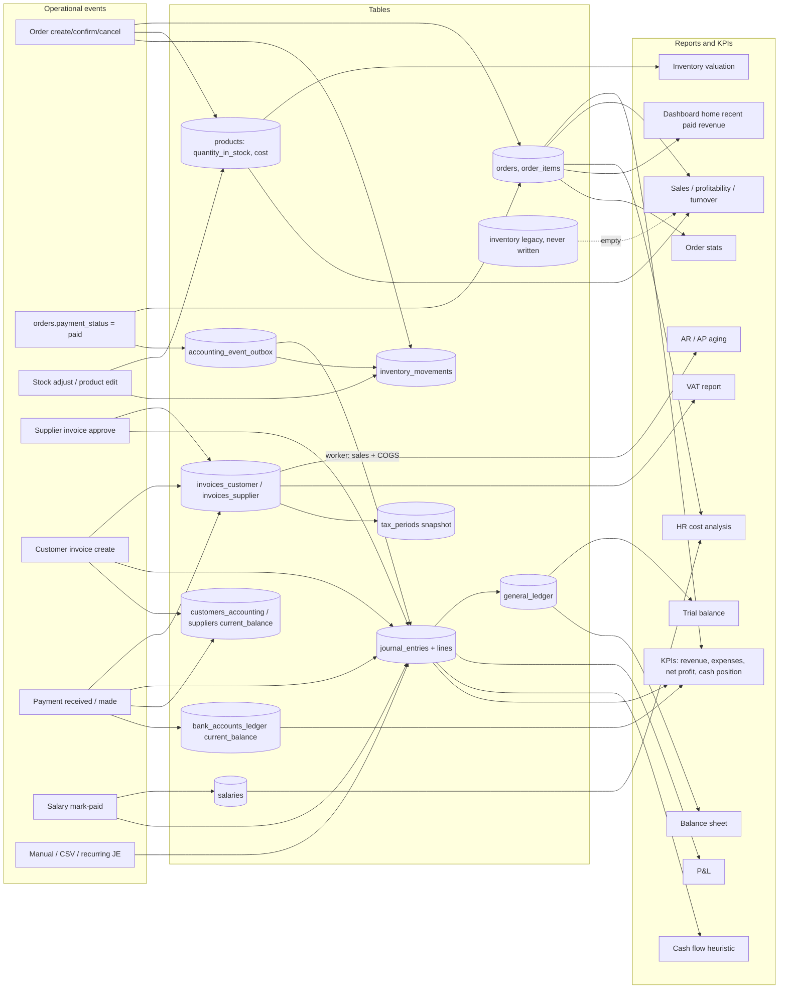

# 27 - Financial data lineage

Baseline SHA 133260db66b1143c254d79476daa7650b41a33f0. Static source reading plus SELECT-only catalog queries on `pos_saas`. Runtime data is essentially empty (0 orders, 0 journal entries, 0 inventory movements; `pg_stat_user_tables`), therefore **no figure was computed from the live system**; "can disagree" statements are derived from the formulas, and the numeric size of any disagreement is REQUIRES-EXECUTION.

Labels: CBS = CONFIRMED-BY-SOURCE, CBR = CONFIRMED-BY-READONLY-RUNTIME, DI = DOCUMENTED-INTENT, INF = INFERRED, REX = REQUIRES-EXECUTION.

## 1. Lineage by report / KPI

Endpoints are from `08-api-inventory.csv`. "Feeds" = the operational or journal event that creates the data.

### 1.1 Financial reports (`/api/v1/reports/financial/*`, handler `financial_report_handler.go`, logic `usecase/financial_report_usecase.go`)

| Metric | Source tables / columns | Filter and formula (file:line) | Feeding event(s) | Label |
|---|---|---|---|---|
| Profit & Loss: revenue lines, expense lines, net profit | `journal_entry_lines.debit_amount/credit_amount` JOIN `journal_entries(status, entry_date, posted_at, voided_at)` JOIN `chart_of_accounts.account_type IN ('revenue','expense')` | Posted entries plus voided-but-once-posted entries on `entry_date`, plus reversal rows on `voided_at::date`; revenue = credit - debit, expense = debit - credit; net = revenue - expenses. `financial_report_usecase.go:173-250` | Paid-order auto-post (4100/4150/4120 revenue, 5110 COGS), customer invoice create, supplier invoice approve, payroll mark-paid, manual/imported/recurring JE | CBS |
| Trial balance | `general_ledger.debit_amount/credit_amount/entry_date` x `chart_of_accounts` (all non-header active accounts) | Signed sum by normal balance to `asOf`; `IsBalanced = round2(totalDebits)==round2(totalCredits)` `financial_report_usecase.go:252-274`, `general_ledger_repo.go:411-486` | Every posted JE and every void reversal (GL rows appended at post/void: `journal_entry_repo.go:420,507`) | CBS |
| Balance sheet | `general_ledger` x `chart_of_accounts.account_type IN ('asset','liability','equity')` | `financial_report_usecase.go:276-353`; only asset/liability/equity accounts; equation `round2(A) == round2(L+E)`. Revenue/expense accounts are excluded and no current-earnings line is added, so any period with net income shows `UNRECONCILED` (also noted in `04-financial-model-and-policies.md` section 7). | Same as TB | CBS (formula) / REX (observed status) |
| Cash flow | `journal_entry_lines` x `chart_of_accounts` | Operating = SUM(credit-debit) over revenue+expense accounts; investing = SUM(debit-credit) over codes `12%`; financing = SUM(credit-debit) over equity or codes `22%`; net = sum. Not derived from cash/bank accounts. `financial_report_usecase.go:366-398` (classification at :389-391) | Same as P&L | CBS |
| Receivables aging | `invoices_customer.balance_due, due_date, status` + `customers_accounting.customer_name` | `status <> 'void' AND balance_due > 0`; buckets by `due_date` vs `asOf`. `:402-486` | Customer invoice create/update (`invoice_customer_repo.go:128-300`), payment received (`payment_acct_repo.go:568-583`), void | CBS |
| Payables aging | `invoices_supplier.balance_due, due_date, status` + `suppliers.company_name` | Same query shape, `:415-486`. Includes `draft` supplier invoices (no filter on status other than void) although drafts have no journal (`invoice_supplier_repo.go:130-203` vs approve `:295`). | Supplier invoice create, payment made (`payment_acct_repo.go:585-600`) | CBS |
| Inventory valuation | `products.quantity_in_stock`, `products.cost`, `products.track_inventory` | `SUM(quantity_in_stock::double * cost::double)` live; `asOf` only labels the report. `:488-526` | Trigger on order confirm/cancel, product create/update, `/inventory/adjust`, cost edits | CBS |

### 1.2 Advanced financial endpoints (`accounting_advanced_handler.go`, `accounting_advanced_repo.go`)

| Metric | Source | Formula | Label |
|---|---|---|---|
| KPIs: revenue | `orders.total_amount` | `payment_status='paid' AND created_at in range`: includes tax. `accounting_advanced_repo.go:837-851` | CBS |
| KPIs: expenses, expense breakdown | `journal_entry_lines` x `chart_of_accounts.account_type='expense'` | `je.status='posted'` only (voided originals disappear entirely, no reversal rows), `entry_date in range`. `:853-868,:925-947` | CBS |
| KPIs: net_profit | derived | `revenue - expenses` mixing an operational source (gross of tax) with a ledger source. `:957-962` | CBS |
| KPIs: cash_position | `bank_accounts_ledger.current_balance` | `SUM` over active accounts. `:871-878` | CBS |
| KPIs: revenue trend | `orders` | monthly `SUM(total_amount)` paid. `:880-905` | CBS |
| Menu-item profitability | `order_items`, `orders`, `products.cost_price` | `payment_status='paid'`; cost uses `p.cost_price`. `:966-1000` (column ref at :976) | CBS; column does not exist (CBR `ERROR: column p.cost_price does not exist`; REX for the HTTP response) |
| Break-even | `orders`, `order_items`, `products.cost_price`, journal expenses | revenue (paid orders), variable cost via `cost_price` (:1045), fixed = journal expenses - variable. `:1027-1100` | CBS; same missing column |
| Predictive cash flow | `payments_received`, `payments_made` | monthly cash in/out history, status <> void. `:1105-1215` | CBS |
| HR cost analysis | `orders` (revenue), `salaries.net_salary/overtime_amount` where `status='paid'` and `pay_period_end` in range, `insurance_tracking.monthly_premium` | labor % = (net payroll + insurance x months) / revenue. `:1218-1316` | CBS |
| Social insurance report | `salaries` join employees | `:1421-1490` (not traced in detail) | UNKNOWN beyond source tables |
| VAT report / tax periods | `invoices_customer.tax_amount`, `invoices_supplier.tax_amount` | `status <> 'void'`, `invoice_date` in range; net VAT = output - input; stored on `tax_periods` as a snapshot at create/update. `tax_repo.go:171-185,260-291` | CBS |

### 1.3 Operational reports and dashboards (`report_handler.go`, `order_repo.go`, dashboard page)

| Metric | Source | Formula | Label |
|---|---|---|---|
| Sales report: total_revenue, orders, avg_ticket, trend, hourly | `orders.total_amount, created_at, status` | `status <> 'cancelled'`; **payment status is not considered**; revenue includes tax. `report_handler.go:2174-2194` and trend/hourly `:2195-2282` | CBS |
| Sales: top items / categories | `order_items.total_price` x `orders` x `products`/`categories` | `o.status <> 'cancelled'` `:2283-2362` | CBS |
| Profitability summary/items | `order_items.total_price` (revenue, pre-tax), `order_items.quantity * products.cost` (COGS, current cost), flags missing cost | `o.status <> 'cancelled'`, filters on `oi.created_at`; ignores `cancelled_quantity`. `:2364-2478` | CBS |
| Inventory turnover / waste | `products.quantity_in_stock`, `products.cost`, `order_items`, **legacy table `inventory`** | opening qty = last `inventory.quantity_after` before range else current qty; waste = `inventory.reason='waste'`. `:2480-2587` | CBS; `inventory` is never written (grep: no INSERT; CBR 0 rows) so waste = 0 and opening = current by construction (INF) |
| Overview | composes the above | `GetOverviewReport` `:646` | CBS |
| Order stats (`GetOrderStats`) | `orders.total_amount` | `COUNT(*)`, `SUM(total_amount)` over **all** orders in range, no status filter (includes cancelled and unpaid). `order_repo.go:860-885` | CBS |
| Dashboard home "Recent Paid Revenue" | `GET /admin/orders` first 5 rows | client-side sum of `total` where payment_status in (paid, success). `frontend/.../dashboard/page.tsx:281-300,374-377,502-506`; labelled "From the latest loaded orders" | CBS |
| HR reports (headcount, absenteeism, overtime, ...) | `employees`, `attendance`, `leaves`, `training_records` | no money metrics except the cost-analysis endpoint above | CBS (table list `hr_report_handler.go:105-622`) |

## 2. Lineage diagram

Also saved as `diagrams/financial-data-lineage.md`.

## 3. Same concept, different sources (competing sources of truth)

Each row: can the figures disagree, and why. "Can disagree" is derived from the formulas (CBS), with magnitude REX.

| ID | Concept | Competing sources / formulas (file:line) | Can they disagree? Mechanism | Label |
|---|---|---|---|---|
| S1 | **Revenue** | (a) P&L: GL revenue accounts, credit-debit on journal entry date `financial_report_usecase.go:173-250` (sales JE credits `subtotal`, excludes tax, dated `order.CreatedAt`: `auto_posting_engine.go:93-137`). (b) Sales report: `SUM(orders.total_amount)` non-cancelled, includes tax and unpaid orders `report_handler.go:2174`. (c) KPIs: `SUM(total_amount)` of paid orders, includes tax `accounting_advanced_repo.go:837`. (d) Profitability: `SUM(order_items.total_price)` non-cancelled, pre-tax `report_handler.go:2364`. (e) Order stats: all orders incl. cancelled `order_repo.go:860`. (f) Dashboard tile: last 5 orders paid, client side `page.tsx:374`. (g) Invoice revenue via GL for customer invoices (not orders) `invoice_customer_repo.go:585-612`. | Yes, structurally: tax inclusion (10%), paid vs unpaid, cancelled inclusion, order date vs payment date, outbox lag/failure (a paid order without a posted journal is in (b)-(f) but not (a); reconciliation counts such events `accounting_event_repo.go:101-120`), customer invoices in (a) only, and double revenue if an invoice references an order that was also paid (no suppression; `invoice_customer_repo.go:475-486`). | CBS |
| S2 | **Net profit / expenses** | P&L `NetProfit` (void-aware) vs KPIs `net_profit` = paid-order revenue (with tax) - posted-only expense journals `accounting_advanced_repo.go:957-962`; break-even "fixed costs" = journal expenses - cost_price variable cost | Yes: tax in revenue, void handling (KPIs drop voided originals), COGS counted in expenses (5110) and again as variable cost in break-even. | CBS |
| S3 | **Cash / bank balance** | GL cash/bank accounts (`general_ledger` via TB/BS; bank "transactions" view `bank_account_repo.go:208-280`) vs `bank_accounts_ledger.current_balance` (KPI cash_position, adjusted only by customer/supplier payments `payment_acct_repo.go:164,310`) vs cash-flow heuristic `:386-391` vs reconciliation `book_balance` (user-entered) `accounting_advanced_repo.go:2126-2150`. Order cash/card/online receipts post to GL but never touch `current_balance`; payroll cash-out posts to GL but never touches `current_balance`; `opening_balance` is never journaled (`bank_account_repo.go:95-135`). | Yes, by design of the writers. | CBS |
| S4 | **Accounts receivable** | GL AR accounts (1120 or per-customer `receivable_account_id`) vs `invoices_customer.balance_due` (aging) vs `customers_accounting.current_balance` | Yes: unapplied customer payments (no `invoice_id`) credit GL AR and reduce `current_balance` but not any invoice's `balance_due` (`payment_acct_repo.go:156-163,437-490`); manual JEs hit GL only; manual customer edit hits `current_balance` (`customer_acct_repo.go:160`); invoice void touches balance and GL differently (`invoice_customer_repo.go:323-362`). | CBS |
| S5 | **Accounts payable** | GL AP (2101 or supplier `payable_account_id`) vs `invoices_supplier.balance_due` (AP aging includes draft invoices) vs `suppliers.current_balance` (not incremented on approval; decremented on payment) | Yes: drafts in aging but not GL; supplier balance asymmetry (`payment_acct_repo.go:302-308` vs no increment in `invoice_supplier_repo.go:295-348`; sole other writer `supplier_repo.go:172`). | CBS (writers) / INF (effect) |
| S6 | **Inventory quantity** | `products.quantity_in_stock` (authoritative for ordering) vs `SUM(inventory_movements.quantity)` vs `order_stock_reservations` vs legacy `inventory.quantity_after` | Yes: each sale writes a `reservation` movement at confirmation (trigger, `180_*.sql:51-56`) and a second `sale` movement at payment (`auto_posting_engine.go:253`); only one decrement hits `products`. Adjust endpoint stores free-text `reason` as `movement_type`. Legacy table unwritten. | CBS (inserts) / INF (aggregate); REX with order data |
| S7 | **Inventory value** | `products.quantity_in_stock * products.cost` (valuation report) vs GL account 1130 balance vs average-inventory value in turnover report | Yes: 1130 is credited by COGS but no purchase/receiving path debits it (supplier invoices debit 5110 by default `invoice_supplier_repo.go:503`); valuation uses current cost, ignores `asOf`. | CBS / INF |
| S8 | **Product unit cost / COGS** | COGS journal: latest `inventory_movements.unit_cost` (types opening/purchase/adjustment, qty>0, cost>0) else `products.cost` `inventory_movement_repo.go:158-198`; profitability/valuation: `products.cost` live; menu-profitability/break-even: `products.cost_price` (nonexistent). Items with cost <= 0 are silently skipped in COGS (`auto_posting_engine.go:181-188`). | Yes: cost edits change report COGS retroactively but not posted COGS; movements without unit_cost never set cost. | CBS / CBR (column absence) |
| S9 | **Tax / VAT** | Order tax: fixed 10% of subtotal to GL 2120 `order_pricing.go:46`, `auto_posting_engine.go:117-123`. Invoice tax: per-line rate, trigger `141_create_invoices_customer.sql:80-82`, GL output VAT account (`invoice_customer_repo.go:570,615`). Supplier invoice VAT to 1150. VAT report reads invoice tables only `tax_repo.go:260-291`; `tax_periods` stores a snapshot. | Yes: VAT report omits all order tax; GL 2120 holds order tax and customer-invoice output VAT together (both hard-code 2120: `auto_posting_engine.go:71`, `invoice_customer_repo.go:570`), so the 2120 balance cannot be split by source without reference_type; snapshot goes stale. | CBS |
| S10 | **Payroll cost** | GL salary expense (gross components, 5210/5220/2140) at paid time vs `salaries.net_salary` (HR cost analysis) vs `insurance_tracking.monthly_premium x months` vs `salaries.gross_salary` | Yes: net vs gross; accrual absent; HR-cost uses `pay_period_end` window, GL uses payment date (`payrollEntryDate`, `auto_posting_engine.go:657-668`); insurance premiums counted in HR-cost but not journaled anywhere. | CBS |
| S11 | **Customer identity** | `orders.customer_name/email/phone` free text vs `customers_accounting` | Yes: no FK; AR customers and storefront customers can never be reconciled. | CBR + CBS |
| S12 | **Payment records** | `orders.payment_status` (no record) vs `payments_received/made` (accounting) vs `payments` (SaaS subscription billing) | Yes: three disjoint stores called "payments"; sales receipts have no payment row at all. | CBS / CBR |

Count of competing-source concepts: 12 (S1-S12).

Additional single-report integrity observations (not competing sources, but affecting trust):
- Cross-report diagnostics exist (`backend/internal/repository/cross_report_diagnostics.go`, `usecase/current_earnings_diagnostic.go`) but are read-only helpers; their use in routes is UNKNOWN (not traced).
- P&L, TB and BS all rely on GL/journal, so S1/S2 disagreements are between ledger reports and operational reports, not among ledger reports, except BS vs TB (BS omits revenue/expense). CBS.
- `round2` truncation for negatives is in the equation check (`financial_report_usecase.go:528`); see `04-...` finding 4.

## 4. Journal feed completeness (what reaches the ledger at all)

| Business event | Reaches GL? | Evidence |
|---|---|---|
| Order paid (sales, tax, discount line if any) | Yes (async, outbox) | `auto_posting_engine.go:50-141` |
| Order COGS | Yes only for tracked products with cost > 0 | `:143-260` |
| Order refund/cancel after payment | No (blocked) | `order_usecase.go:326-352` |
| Customer invoice / receipt | Yes (sync) | see 25 |
| Supplier invoice / payment | Yes (sync) | see 25 |
| Payroll payment | Yes (sync, atomic) | see 25 |
| Stock adjustment, waste, purchase receipt, return | **No** | `inventory_adjustment_handler.go:29-130` |
| Depreciation | **No** (dead code) | `auto_posting_engine.go:492` |
| Bank opening balance, bank transfer | **No** | `bank_account_repo.go:95-135` |
| Period close / retained earnings | **No** | see 26 |
| Subscription (SaaS) revenue | Not applicable to tenant GL | `payments` table is SaaS billing |

## 5. Open items (REQUIRES-EXECUTION)

1. Size of S1 disagreement for a fixture with unpaid, cancelled and tax-bearing orders (needs isolated write-capable stack; none touched here).
2. HTTP result of `/reports/financial/menu-profitability` and `/break-even` given the missing `cost_price` column (SQL error is confirmed; wrapper behaviour not observed).
3. Aggregate effect of double `inventory_movements` rows (S6) on a real paid order.
4. First-order behaviour for a freshly registered tenant with no chart of accounts (see 25 section 7).
