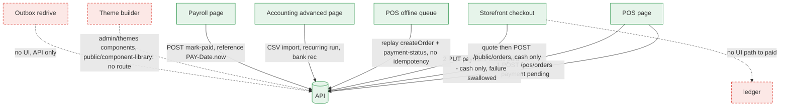

# Diagram 02 - Frontend to backend communication

Legend: green = verified; red dashed = missing or broken connection.

```mermaid
sequenceDiagram
  autonumber
  participant UI as Page/component (dashboard)
  participant Hook as hook / lib/api/*.ts
  participant AX as axios api.ts (withCredentials, 6s timeout)
  participant MW as Go middleware (auth, tenantContext, statusGuard, requirePermission)
  participant H as Handler
  participant R as Repository
  participant DB as Postgres
  UI->>Hook: user action (e.g. post journal)
  Hook->>AX: api.post /accounting/journal-entries/{id}/post
  AX->>MW: HTTPS + HttpOnly session cookie (unsafe method requires trusted Origin)
  MW->>MW: session resolve (Redis) to claims; tenant from claims; tenant status; RBAC level
  MW->>H: request with tenant/restaurant/user in context
  H->>R: PostEntry(tenant, restaurant, id, user)
  R->>DB: BEGIN; SELECT FOR UPDATE; INSERT general_ledger; UPDATE status; COMMIT
  DB-->>H: ok
  H-->>AX: success envelope
  AX-->>UI: data (extractData)
  Note over UI,AX: No Idempotency-Key header on any money POST (verified). Client timeout 6000ms may abort while server commits (consequence UNVERIFIED).
  Note over UI: Client checkPermission only hides UI. Financial report pages have no client check; backend module check is the control.
```


