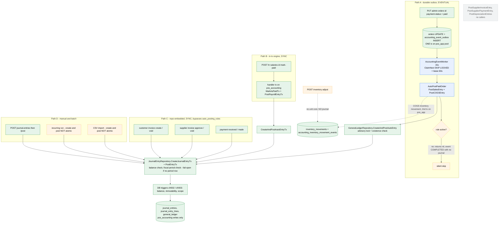

# Diagram 04 - Financial posting architecture (all paths to the ledger)

Legend: green = verified sync path; blue = async/eventual; orange dashed = risk/non-atomic; grey dashed = dead code.

Not posting to the ledger at all: card/online/wallet POS orders, storefront orders, dine-in orders (no UI path to `paid`), inventory adjustments, tax period close, bank reconciliation completion, SaaS subscription payments (platform ledger, separate).
