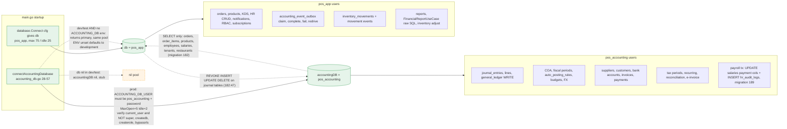

# Diagram 05 - Accounting DB connection boundaries

Legend: green = verified; orange dashed = fallback / unverified.

Cross-pool sequences that cannot be one transaction: outbox claim (pos_app), journal (pos_accounting), outbox complete (pos_app); COGS journal (pos_accounting), inventory movement (pos_app).
