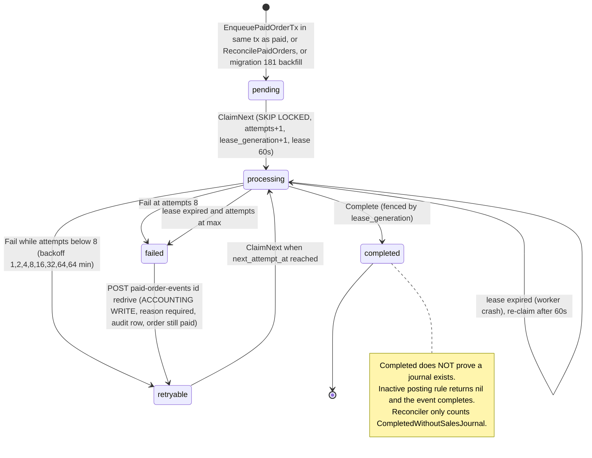

# Diagram 06 - Accounting outbox and recovery lifecycle

All transitions verified in `backend/internal/repository/accounting_event_repo.go` and `accounting_event_admin_repo.go`.



```mermaid
sequenceDiagram
  participant API as UpdatePaymentStatusAs (pos_app)
  participant OB as accounting_event_outbox
  participant WK as Worker (every replica, 15s)
  participant UC as OrderUseCase
  participant EN as AutoPostingEngine
  participant GL as Ledger (pos_accounting)
  API->>OB: BEGIN; lock order; UPDATE paid; INSERT intent ON CONFLICT DO NOTHING; COMMIT
  WK->>OB: ReconcilePaidOrders (insert missing intents, count states)
  WK->>OB: ClaimNext
  WK->>UC: ProcessNextAccountingEvent
  UC->>EN: PostSalesEntry
  EN->>GL: advisory lock; existing posted returns id, else create and post
  UC->>EN: PostCOGSEntry
  EN->>GL: create and post COGS journal
  EN->>OB: (pos_app) inventory movement + movement-event key
  UC->>OB: Complete or Fail (lease fenced)
```
