# Financial ERD (running schema, pos_saas dev DB, baseline 133260d)

Source: `evidence/database/constraints.txt` (pg_constraint). Only financial/operational tables are drawn. All FKs shown exist in the running DB unless marked "soft".

```mermaid
erDiagram
  tenants ||--o{ restaurants : "tenant_id"
  restaurants ||--o{ orders : "fk_orders_restaurant CASCADE"
  tenants ||--o{ orders : "fk_orders_tenant CASCADE"
  orders ||--o{ order_items : "fk_order_items_order CASCADE"
  products ||--o{ order_items : "fk_order_items_product RESTRICT"
  orders ||--o{ order_status_history : "order_id"
  orders ||--o{ order_stock_reservations : "order_id"
  orders ||--o{ order_item_cancellations : "order_id"
  orders ||--o{ accounting_event_outbox : "RESTRICT"
  accounting_event_outbox ||--o{ accounting_event_redrive_audit : "RESTRICT"
  orders ||--o{ accounting_inventory_movement_events : "RESTRICT"
  orders ||--o{ inventory_movements : "SET NULL"
  products ||--o{ inventory_movements : "product_id"
  products ||--o{ inventory : "CASCADE (legacy, no writers)"
  categories ||--o{ products : "SET NULL"
  orders ||--o{ invoices_customer : "order_id (nullable)"
  customers_accounting ||--o{ invoices_customer : "customer_id"
  invoices_customer ||--o{ invoice_customer_lines : "CASCADE"
  invoices_customer ||--o{ payments_received : "invoice_id (nullable)"
  customers_accounting ||--o{ payments_received : "customer_id"
  suppliers ||--o{ invoices_supplier : "supplier_id"
  invoices_supplier ||--o{ invoice_supplier_lines : "CASCADE"
  invoices_supplier ||--o{ payments_made : "invoice_id (nullable)"
  suppliers ||--o{ payments_made : "supplier_id"
  bank_accounts_ledger ||--o{ payments_made : "bank_account_id"
  bank_accounts_ledger ||--o{ payments_received : "bank_account_id"
  chart_of_accounts ||--o{ bank_accounts_ledger : "gl_account_id"
  chart_of_accounts ||--o{ customers_accounting : "receivable_account_id"
  chart_of_accounts ||--o{ suppliers : "payable_account_id"
  chart_of_accounts ||--o{ chart_of_accounts : "parent_id"
  chart_of_accounts ||--o{ journal_entry_lines : "account_id"
  chart_of_accounts ||--o{ general_ledger : "account_id"
  chart_of_accounts ||--o{ invoice_customer_lines : "account_id"
  chart_of_accounts ||--o{ invoice_supplier_lines : "account_id"
  journal_entries ||--o{ journal_entry_lines : "CASCADE (blocked after post by trigger)"
  journal_entries ||--o{ general_ledger : "journal_entry_id"
  journal_entry_lines ||--o{ general_ledger : "journal_line_id"
  journal_entries ||--o| invoices_customer : "journal_entry_id"
  journal_entries ||--o| invoices_supplier : "journal_entry_id"
  journal_entries ||--o| payments_made : "journal_entry_id"
  journal_entries ||--o| payments_received : "journal_entry_id"
  employees ||--o{ salaries : "CASCADE"
  restaurants ||--o{ fiscal_periods : "restaurant_id"
  restaurants ||--o{ tax_periods : "restaurant_id"
  tenants ||--o{ payments : "SaaS subscription billing only"
  journal_entries }o..o{ orders : "SOFT: reference_type='order', reference_id (no FK)"
  journal_entries }o..o{ salaries : "SOFT: reference_type='salary', reference_id (no FK)"
  journal_entries }o..o{ invoices_customer : "SOFT: reference_type='customer_invoice' (plus invoice.journal_entry_id FK)"
```

Notes
- `journal_entries.reference_type/reference_id` is a soft (polymorphic) link: no FK, no UNIQUE index. Idempotency is enforced in application code only (advisory lock, see 11-financial-posting-matrix.csv).
- No composite (tenant_id, restaurant_id) foreign keys exist anywhere; cross-tenant integrity relies on application predicates and the CFR-002 triggers on journal tables (see 09 section 5).
- `payments` is the SaaS subscription ledger (Paymob), not order payments. Orders carry `payment_method/payment_status` inline.
