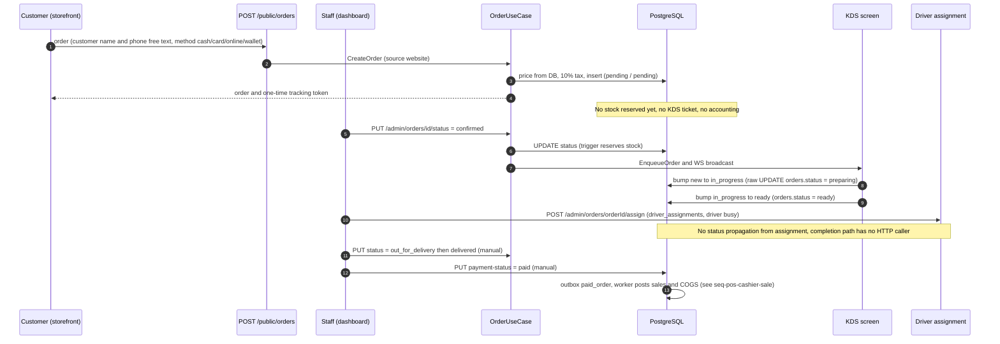

# Sequence: online (storefront) order, kitchen, delivery, payment

Sources: `backend/internal/handler/http/public_order_handler.go:39`; `order_usecase.go:62-222,283-324`; `backend/internal/repository/kds_repo.go:190-262,700-740`; `backend/internal/repository/driver_repo.go:411-470`; `admin_order_handler.go:357,466`; `backend/internal/domain/order.go:205-260`. Label: CONFIRMED-BY-SOURCE.

