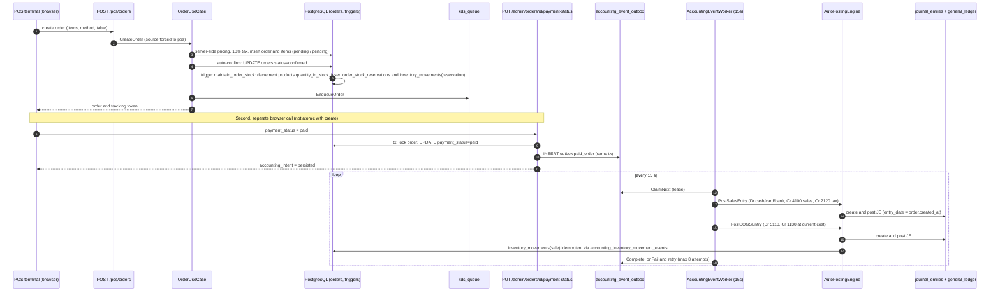

# Sequence: POS cashier sale (create, confirm, pay, accounting)

Sources: `frontend/apps/dashboard/src/lib/api/posApi.ts:248,266`; `backend/cmd/api/pos_routes.go:16`; `backend/internal/usecase/order_usecase.go:62-222,283-324,455-480`; `backend/internal/repository/order_repo.go:545-605`; `backend/migrations/180_order_stock_reservations.sql`, `181_partial_order_cancellations.sql`; `backend/internal/usecase/auto_posting_engine.go:50-260`; `backend/internal/service/accounting_event_worker.go`. Label: CONFIRMED-BY-SOURCE (execution not performed: REQUIRES-EXECUTION).

