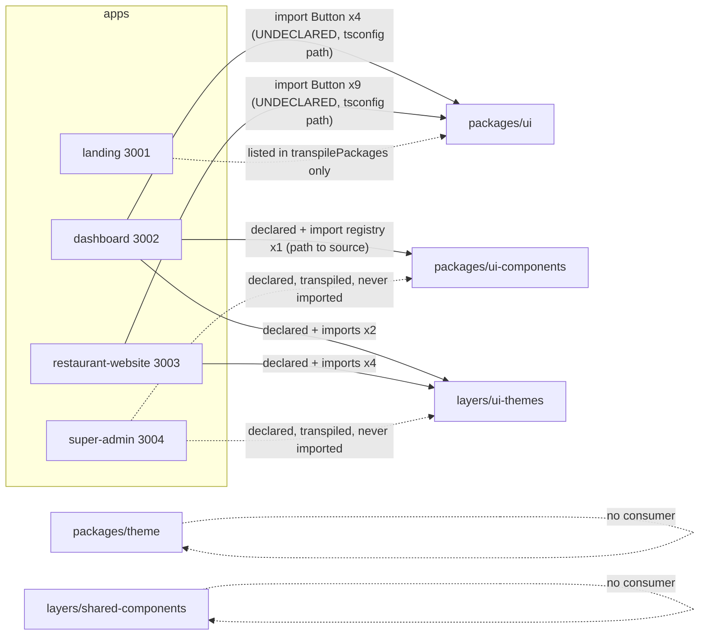

# 04 - Frontend Architecture

Scope: `frontend/` pnpm + turbo monorepo (`pnpm-workspace.yaml`: `apps/*`, `packages/*`, `layers/*`). Dashboard detail is covered by another auditor; it is summarised here only from `package.json`/config. Static analysis, read-only.

## 1. Apps summary
| App | Port | Router/root | Pages | Middleware | State | Data fetching | i18n | Tests |
|---|---|---|---|---|---|---|---|---|
| dashboard (`@pos-saas/dashboard`) | 3002 | App Router `src/app` (+ legacy `components/`, `lib/` at app root) | 79 `page.tsx` | none found (`src/middleware*` absent) | zustand | @tanstack/react-query, axios | next-intl (`src/i18n`) | vitest (several configs) |
| landing | 3001 | `src/app` | 4 effective (+6 redirect stubs) | locale redirect | zustand | axios (+1 raw fetch) | custom translations (en/ar) | vitest, 4 files |
| restaurant-website | 3003 | `app/` | 12 + 1 route handler | tenant slug + status + locale | zustand (cart, theme, prefs) | react-query, axios, server fetch with ISR | custom translator (+ next-intl stub) | jest, 8 files |
| super-admin | 3004 | `src/app` | 9 | none | zustand | axios in effects | none (English) | vitest, 1 file |

All apps: Next ^15.1, React ^18.3, Tailwind 3, `output: 'standalone'` (disabled on Windows), single `frontend/Dockerfile.prod` parameterised by `ARG APP`, `NEXT_PUBLIC_*` inlined at build. Landing/restaurant/super-admin throw in production when their `NEXT_PUBLIC_*` URLs are missing (landing: API, dashboard, restaurant domain; restaurant: API base; super-admin: super-admin API + dashboard).

Cross-app flows: landing -> dashboard `/auth/callback?token&user` (token in URL); super-admin -> dashboard `?impersonation_token` or `/auth/super-admin-login?token`; restaurant-website -> backend public API only; restaurant-website middleware -> `/public/tenant-status/{slug}`.

## 2. Shared code inventory
| Package | Name | Kind | Files | Public API | Notes |
|---|---|---|---|---|---|
| packages/ui | `@pos-saas/ui` | shadcn-style primitives | button, card, input, label, `cn` | `index.ts` + subpath exports | Only `Button` is imported by apps |
| packages/theme | `@pos-saas/theme` | theme config + provider (uses localStorage, next-themes, zod) | 4 | index + `./config` `./provider` `./hooks` | Imported by no app; not declared by any app |
| packages/ui-components | `@pos-saas/ui-components` | atomic components + registry + industry theme presets | 34 | `exports` point to `./dist/*` (no dist present) | Used only by dashboard theme-builder (`/registry`) via tsconfig path to source |
| layers/ui-themes | `@pos-saas/ui-themes` | runtime section renderer, Header/Footer, hooks, analytics SDK | 40 | `.`, `./types`, `./components`, `./sections` (source TS) | Used by dashboard preview and restaurant-website |
| layers/shared-components | `@pos/shared-components` | component registry templates (hero, cta, contact, products, testimonials, why_us) | 24 | build disabled (`echo`) | Imported by nobody (dashboard `next.config.js:87` only names a chunk) |
Also referenced but non-existent: `packages/types`, `packages/constants` (in `frontend/tsconfig.json` paths, app tsconfigs, `transpilePackages`).

## 3. Dependency graph (verified by grep of imports and package.json)

| Package | Declared by (package.json) | Actually imported by | Verdict |
|---|---|---|---|
| @pos-saas/ui | none | dashboard (4 imports), restaurant-website (9) | works only via tsconfig paths; undeclared |
| @pos-saas/ui-themes | dashboard, restaurant-website, super-admin | dashboard (2 files), restaurant-website (4) | super-admin declaration unused |
| @pos-saas/ui-components | dashboard, super-admin | dashboard (1 file: `/registry`) | super-admin declaration unused; `exports` need unbuilt `dist` |
| @pos-saas/theme | none | none | orphan |
| @pos/shared-components | none | none | orphan |
Circular dependencies: none found (internal imports in packages are relative; packages do not import each other; apps do not import app code from packages).

## 4. Findings on shared code (see issues FE-OTH-026..028)
- Bypassing/uneven public APIs: apps import only package roots (`@pos-saas/ui`, `@pos-saas/ui-themes`, `@pos-saas/ui-components/registry`); no deep relative imports into `packages/*` or `layers/*` found. The bypass is at the dependency-declaration level (undeclared `@pos-saas/ui`).
- Duplication: landing keeps its own `components/ui/{button,input,label}`; dashboard has its own `src/components/ui/*`; three parallel Hero/CTA/Testimonials/Contact libraries (ui-components organisms, shared-components, ui-themes sections).
- Business logic in UI packages: `ui-themes` hooks `useABTest`, `useAssetUrl` and `services/analyticsSDK` perform network calls (`/v1/admin/ab-tests/*`, `/v1/admin/assets/*`, `/v1/events`), read `localStorage`, and use `REACT_APP_API_BASE_URL`; none of those routes are in `main.go` and no app imports these hooks. `packages/theme/theme-provider.tsx` also reads/writes localStorage.
- Build coupling: `Dockerfile.prod` runs `pnpm --filter ./apps/${APP} build` only; packages are consumed as TS source (ui-themes `exports` -> `src/index.ts`) except ui-components (`dist`), which is only reachable through a tsconfig path alias in the dashboard. `restaurant-website/next.config.js` has no `transpilePackages` for `@pos-saas/ui-themes`/`ui` (build behaviour not executed; unverified).
- Tooling drift: landing/super-admin/dashboard use vitest, restaurant-website uses jest; root `package.json` also carries jest/testing-library deps and no `test` script although `turbo.json` defines tasks.

## 5. Cross-cutting
- Auth tokens: localStorage in all four apps (landing `token`/`auth-storage`; restaurant `auth-token`; super-admin `super-admin-token`).
- Config pattern: each app has its own `config` module with production-throw semantics; names differ (`NEXT_PUBLIC_API_URL` vs `NEXT_PUBLIC_API_BASE_URL` vs `NEXT_PUBLIC_SUPER_ADMIN_API_URL`).
- i18n approaches differ in all four apps (next-intl, custom context, custom translator, none) - see `LOCALIZATION-RTL-LTR.md`.

## 6. Unverified
No build or runtime was executed; whether Next transpiles aliased workspace sources in each app (restaurant-website) and whether `dist` for ui-components is produced anywhere in CI/Docker was not verified.
