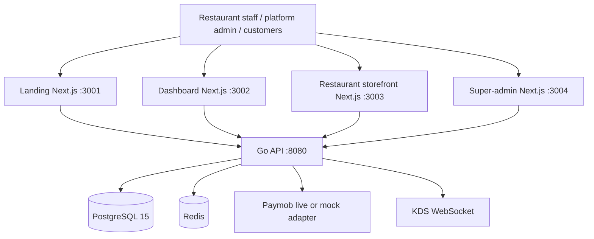
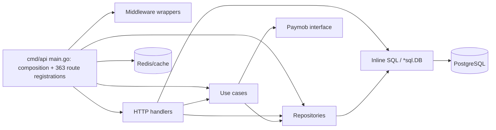
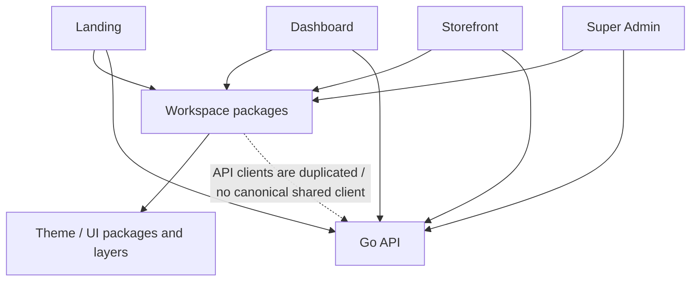
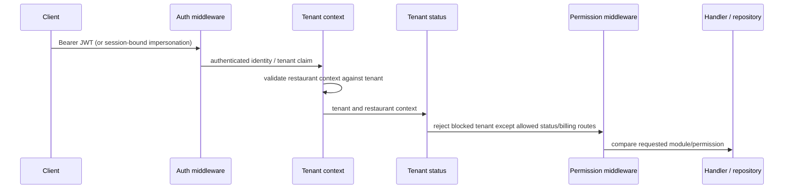
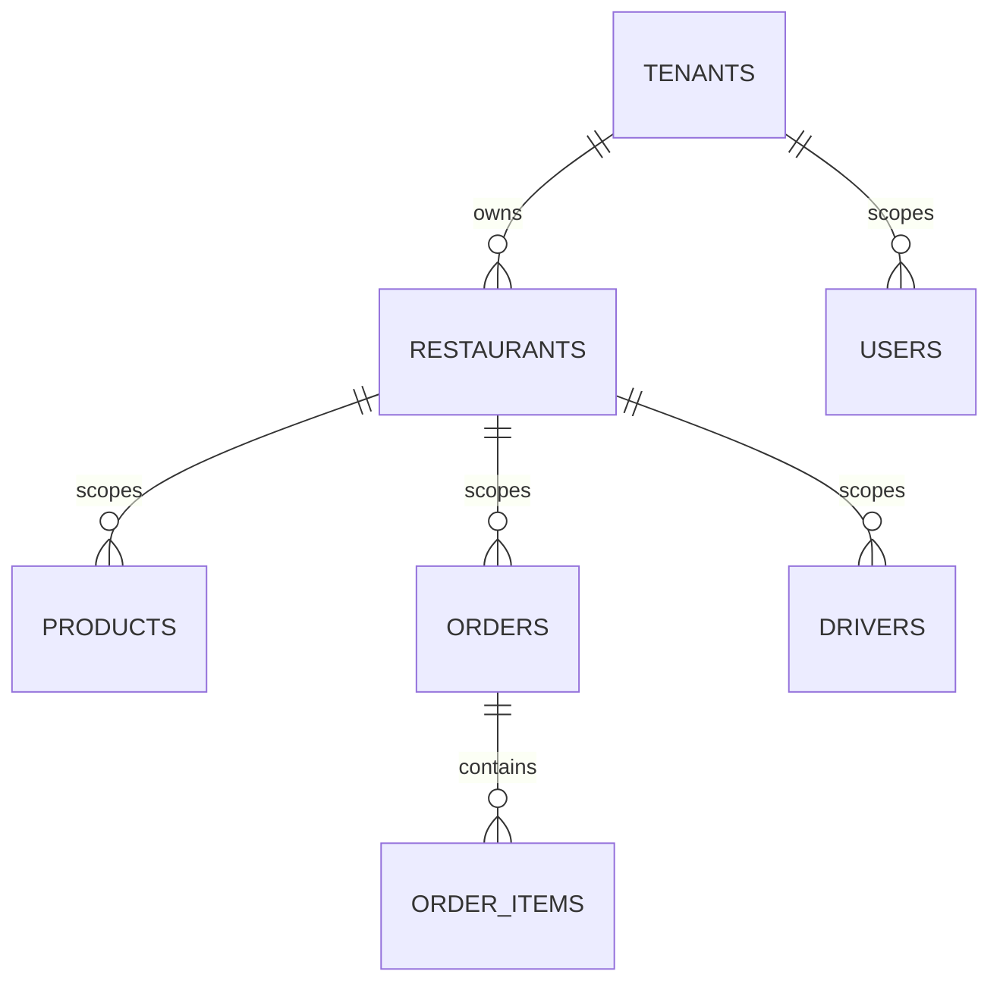
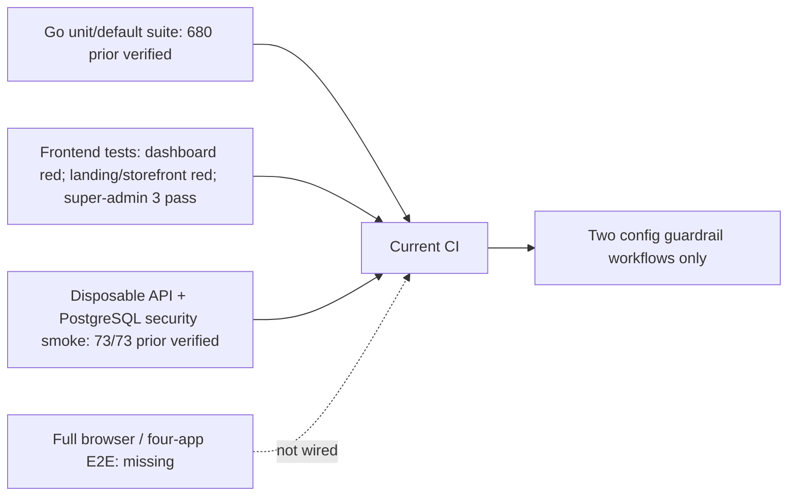

# Current architecture diagrams

Diagrams describe observed source/runtime boundaries, not a desired target.

## A. System context

## B. Backend dependency shape

Direct handler→repository and SQL paths remain; target layering is not universal.

## C. Frontend workspace

## D. Identity and tenant flow

Resource ownership remains a separate check and is not globally verified.

## E. Database tenancy

This is representative. Existing schema has 91 tables, many derived by foreign keys. RLS is enabled on zero live tables; the relation diagram is not a complete schema map.

## F. Testing architecture

CI currently lacks Go/frontend regression and disposable security jobs. Counts are from current checkpoint reports except the fresh landing/storefront runs recorded in `09_TEST_INFRASTRUCTURE_AUDIT.md`.
