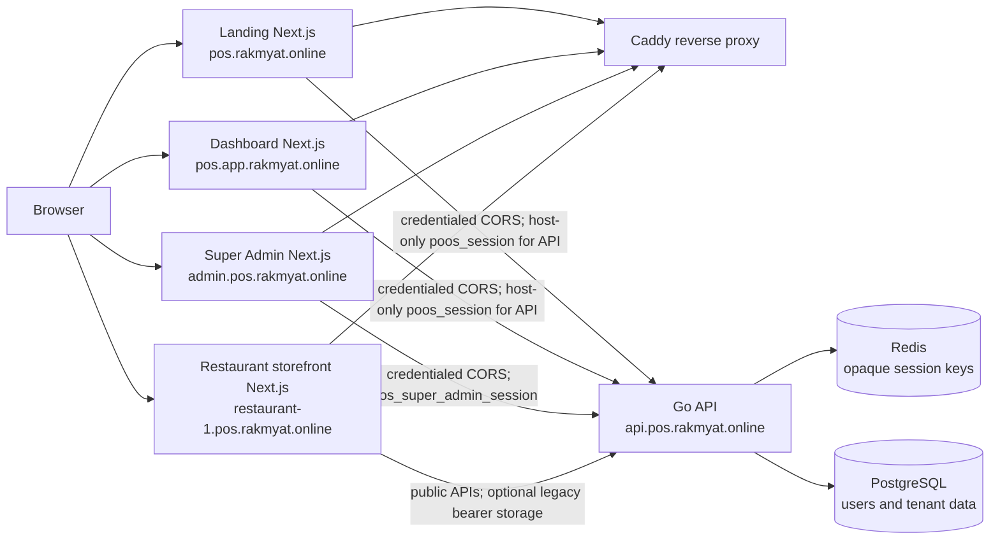
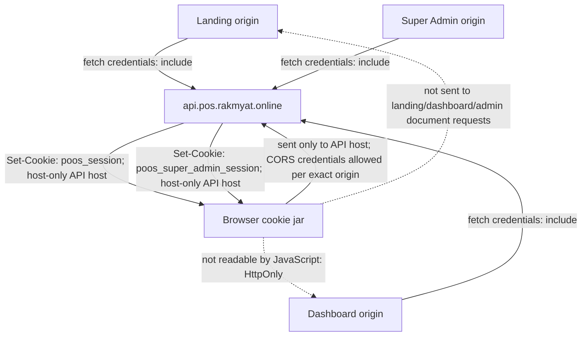

# SERVIO Current Architecture Audit

**Audit date:** 2026-11-17 UTC
**Source checkout:** `18ac7a4d8fcb918ad14a15930e4718fc30fca0e9` (`feat/marketing-navigation-mega-menu`)
**Observed `origin/main`:** `c052c817e114df4d060d8428e6e236f6011876f8`
**Live staging receipt:** `96773ef22b818113327fb65ad044fdf7624c5656`, status `verified`, CI run `43717861737`
**Scope:** Source and read-only staging audit. No authentication, schema, infrastructure, or deployment changes were made.

## Finding labels

- **VERIFIED CURRENT BEHAVIOR** — directly observed in checked-out code, live response, or host state at the timestamp above.
- **OBSERVED DEFECT** — source or live behavior contradicts the stated integrated-platform experience or a security/performance invariant.
- **PROPOSED DESIGN** — recommendation; not implemented.
- **UNVERIFIED ASSUMPTION** — not established by available source/runtime evidence.
- **REQUIRED BUSINESS DECISION** — product policy that engineering cannot infer safely.

## Executive finding

**VERIFIED CURRENT BEHAVIOR:** The browser-facing applications call one Go API at `api.pos.rakmyat.online`. Staff login establishes a host-only `poos_session` cookie on that API host, backed by a Redis key and an access JWT. The landing app performs login and redirects the browser to the dashboard callback, which checks `/auth/session`. Dashboard and Super Admin restore their own client state from their separate app origins by calling the API with credentials. These portals do not share a browser cookie across app origins; they share the API's identity/session store.

**OBSERVED DEFECT:** Landing's `Navbar` always renders Login and Trial actions and contains no session check, profile state, or logout action. Landing cannot read the API host-only cookie, and its auth store is in-memory only. Thus a user who is authenticated in Dashboard does not get an authenticated Landing header. In the repository’s staging contract, the dashboard host is `pos.app.rakmyat.online`; the historical alias `app.pos.rakmyat.online` resolves to the same public IP but fails TLS negotiation when checked. Do not use that alias as an accepted URL until DNS/TLS routing is corrected and verified.

**OBSERVED LIVE STATE:** At 2026-11-17 17:51 UTC, the public landing root redirected to `/ar`; `/ar` and `/en` returned 200, cache headers allowed shared caching for five minutes, and `X-Robots-Tag: noindex, nofollow` was present. API health returned 200 at `/api/v1/health`; `/_ops/release` reported the older SHA above. Eight staging containers were healthy. Host root had 16 GiB available, 909 MiB available RAM, and 2 GiB swap with 584 MiB used. This staging snapshot is not production capacity evidence.

## Current architecture diagram



## Domain and application inventory

| Application | Repository path / framework | Internal service | Local URL | Observed staging origin | Intended production origin | Authentication / boundary |
|---|---|---|---|---|---|---|
| Marketing landing | `frontend/apps/landing`, Next.js | `landing:3000` | `localhost:3001` per config | `https://pos.rakmyat.online` | **UNVERIFIED ASSUMPTION:** likely same public host; owner decision needed | Public pages; login calls API cross-origin with `credentials: include`; API cookie is host-only to API. No landing session bootstrap today. |
| Restaurant dashboard | `frontend/apps/dashboard`, Next.js | `dashboard:3000` | `localhost:3002` | `https://pos.app.rakmyat.online` | **UNVERIFIED ASSUMPTION:** same origin as staging unless production topology differs | API cookie session plus client `cookie-session` marker; protected requests use credentialed fetch. |
| Super Admin | `frontend/apps/super-admin`, Next.js | `super-admin:3000` | **UNVERIFIED ASSUMPTION:** repo config/tests imply local app port, not verified from runtime here | `https://admin.pos.rakmyat.online` | **UNVERIFIED ASSUMPTION** | Separate `poos_super_admin_session`, separate token validator and privileged API middleware. Same-site API requests, but separate host-only cookie. |
| Restaurant storefront | `frontend/apps/restaurant-website`, Next.js | `restaurant-website:3000` | `localhost:3003` per app defaults | `https://restaurant-1.pos.rakmyat.online` | **UNVERIFIED ASSUMPTION:** per-tenant host naming policy not finalized | Public browsing/order APIs. No verified unified customer identity; order-access tokens are separate capability credentials. |
| Shared API | `backend/cmd/api`, Go `net/http` handlers and middleware | `backend:8080` | `localhost:8080/api/v1` | `https://api.pos.rakmyat.online` | **UNVERIFIED ASSUMPTION** | Cookie resolution and bearer compatibility; Redis session store, PostgreSQL identity/data. |
| Session KV | `backend/internal/service`, Redis adapter | `redis:6379` | local compose-dependent | Private Docker network | Production topology unknown | Stores hashed opaque session IDs as Redis keys and JWT credentials as values. |
| Database | PostgreSQL migrations in `backend/migrations` | `postgres:5432` | compose-dependent | Private Docker network | Production topology unknown | `users` are tenant-scoped rows; no browser session table found in migrations. |

**VERIFIED CURRENT BEHAVIOR:** The current staging Caddyfile routes exactly four UI hosts and the API host. It removes incoming `Authorization` at the UI reverse proxies. API CORS origins are exact strings for landing, dashboard, admin, and one storefront. Compose/runtime config names `pos.app`, while the runbook lists those same five approved hosts. `app.pos` is an historical example and is not configured in Caddy. DNS for the checked aliases resolved to `16.192.159.205`; live HTTPS at `app.pos` failed with a TLS internal alert while `pos.app` returned a staging response.

**OBSERVED DEFECT:** The UI host aliases have been inconsistent in historical instructions and one resolves without a working TLS endpoint. Tenant wildcard domains are not provisioned merely by DNS; the runbook says to validate app scope, subscription status, CORS, proxy route, and certificate for each tenant. No blanket wildcard is an accepted production contract.

**OBSERVED DEFECT:** The staging RUNBOOK says the preserved root `Caddyfile` provides Basic Auth for frontends and that `Caddyfile.public` is activated only after an accepted promotion (`ops/aws/RUNBOOK.md:219-222`). Read-only `docker inspect` showed the active Caddy config mounted from the deployed release's `ops/aws/Caddyfile.public`; anonymous GETs to landing, dashboard and Super Admin login pages returned application responses without `WWW-Authenticate`. The active `Caddyfile.public` has no Basic Auth. `noindex` is present, but search-engine directives are not access control. This may be intentional staging policy, but it contradicts the runbook and needs an owner decision/security review.

## Current login request sequence

```mermaid
sequenceDiagram
  actor U as User
  participant L as Landing
  participant A as Go API
  participant R as Redis
  participant D as Dashboard
  U->>L: POST /api/v1/auth/login (email, password)
  L->>A: HTTPS + Origin + credentials: include
  A->>A: Verify password; issue signed access JWT
  A->>R: Store credential at hash(opaque session ID), TTL
  A-->>L: 200 {user}; Set-Cookie poos_session (HttpOnly, Secure, SameSite=Lax; no Domain)
  L->>L: Set in-memory Zustand user; no token
  L-->>U: Navigate to pos.app.../{locale}/auth/callback
  D->>A: GET /api/v1/auth/session, credentials: include, no-store
  A->>R: Resolve opaque cookie; validate JWT
  A-->>D: 200 identity and tenant claims
  D->>D: Set cookie-session marker and render dashboard
```

## Current logout sequence

```mermaid
sequenceDiagram
  actor U as User
  participant D as Dashboard or Admin UI
  participant A as Go API
  participant R as Redis
  U->>D: Select logout
  D->>A: POST /api/v1/auth/logout with Origin and cookie
  A->>A: Check exact trusted Origin for session cookie request
  A->>R: Delete key for opaque session ID
  A-->>D: 204; expire poos_session / impersonation cookie
  D->>D: Clear local UI state and navigate to login
  Note over L,D: No cross-origin/tab event is broadcast to the other apps
```

## Cookie propagation today



## Current request and response evidence

| Observation | Evidence | Result |
|---|---|---|
| Staging release | `GET https://api.pos.rakmyat.online/_ops/release` | `96773ef22b818113327fb65ad044fdf7624c5656`, status `verified`, environment `staging`, CI `43717861737` |
| API health | `GET https://api.pos.rakmyat.online/api/v1/health` | HTTP 200 |
| Landing root | `GET https://pos.rakmyat.online` | HTTP 307 to `/ar` |
| Landing locales | `/ar`, `/en` | HTTP 200; shared cache headers and staging noindex header |
| Dashboard canonical host | `https://pos.app.rakmyat.online/ar/dashboard` | HTTP 200; private/no-store; staging and noindex headers |
| Historical alias | `https://app.pos.rakmyat.online` | TLS handshake failure; not approved as usable origin |
| API session without cookie | `GET /api/v1/auth/session` | HTTP 401, `Cache-Control: private, no-cache, no-store, max-age=0, must-revalidate` |
| Containers | `docker ps` on staging | Eight healthy services: proxy, super-admin, restaurant-website, dashboard, landing, backend, Redis, PostgreSQL |

## Data and tenant model

**VERIFIED CURRENT BEHAVIOR:** `backend/migrations/003_create_users.sql` defines `users.tenant_id` and `restaurant_id`, with uniqueness on `(tenant_id,email)`. Login repository code finds same-email users across tenants and returns a selection list. `AuthUseCase.LoginConfirm` validates a signed proof scoped to email and allowed tenant and consumes it once in an in-memory process map before issuing the selected tenant's JWT. This is multiple tenant-scoped user records, not a distinct `user_tenant_memberships` table. `user_roles` is tenant/user/role association, but does not replace the tenant-scoped `users` login model.

**VERIFIED CURRENT BEHAVIOR:** Authenticated request tenant is taken from validated JWT claims. `X-Tenant-ID` mismatches are ignored/logged; `X-Restaurant-ID` is considered only when JWT has no restaurant and is checked against tenant ownership. Anonymous public storefront requests must provide both IDs and pass restaurant ownership verification. Endpoint-level resource authorization still matters.

**OBSERVED DEFECT:** Login tenant labels currently use `Tenant <id>` with a TODO to load actual tenant names. Selection proof consumption is process-local, so a multi-replica API deployment would not guarantee exactly-once consumption across replicas unless the proof store becomes shared/atomic. Current login only covers tenant selection; no separate tenant-switch API was found.

## Source map

| Concern | Main source locations |
|---|---|
| Login, registration, session, logout, refresh | `backend/internal/handler/http/auth_handler.go:45-335`; route wiring `backend/cmd/api/main.go:528-540` |
| Opaque session store and cookie names | `backend/internal/service/auth_session.go:18-124` |
| Cookie/bearer authentication | `backend/internal/middleware/auth.go:27-127` |
| CORS and trusted Origin | `backend/internal/middleware/cors.go:17-139` |
| Tenant membership selection | `backend/internal/usecase/auth_usecase.go:151-290` |
| Tenant context | `backend/internal/middleware/tenant.go:18-137` |
| Landing header | `frontend/apps/landing/src/components/Navbar.tsx:16-88` |
| Dashboard session bootstrap | `frontend/apps/dashboard/src/components/providers/DashboardAuthProvider.tsx:28-90` |
| Super Admin session bootstrap | `frontend/apps/super-admin/src/components/providers/SuperAdminAuthProvider.tsx:15-60` |
| Caddy and frontend host routes | `ops/aws/Caddyfile.public:1-67`; `ops/aws/compose.json:128-155` |
| Staging DNS/recovery contract | `ops/aws/RUNBOOK.md:210-224` |

**UNVERIFIED ASSUMPTION:** Production domains, customer-account policy, production Redis topology, CDN/cache policy, and the business meaning of “one account across multiple restaurants” are not established by the checked-in staging configuration.

**REQUIRED BUSINESS DECISION:** Approve the canonical dashboard origin (`pos.app` vs other); define whether one human identity should own multiple tenant memberships versus the current tenant-scoped duplicate user rows; define browser persistent-login duration and Super Admin step-up/MFA policy; define which production domains and storefront customer identity are in scope.

See [forensic authentication audit](SERVIO_AUTHENTICATION_SESSION_FORENSIC_AUDIT.md), [session design](SERVIO_MULTI_PORTAL_SESSION_DESIGN.md), and [roadmap](SERVIO_IMPLEMENTATION_ROADMAP.md).

## Implementation update — 2026-11-17

This report was reconciled against `origin/main` at `c052c817e114df4d060d8428e6e236f6011876f8`. The current implementation slice, P0/P1 traceability, test evidence, and outstanding work are recorded in [IMPLEMENTATION_STATUS.md](IMPLEMENTATION_STATUS.md); the refreshed repository/CI baseline is in [BASELINE.md](BASELINE.md). Historical audit conclusions remain intact. This update does not mark unimplemented Redis replay/rate-limit work, the full E2E matrix, Super Admin/storefront acceptance, cache-boundary testing, or 10K measurements as complete.
