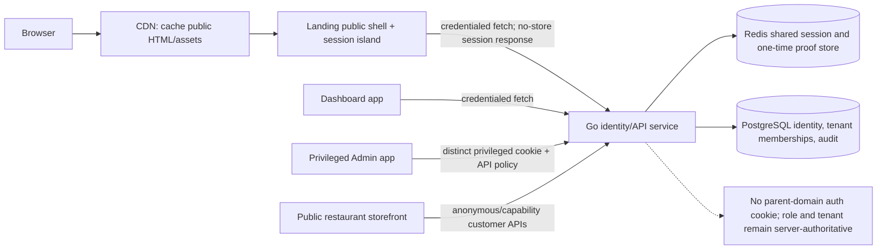
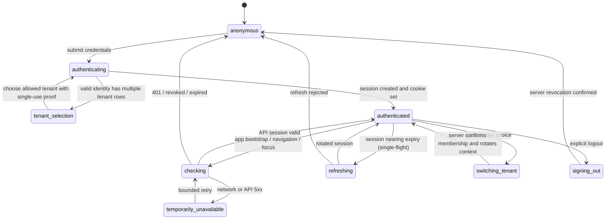

# SERVIO Multi-Portal Session Design

**Status:** Target proposal based on current code audit; not implemented.
**Source/live baseline:** checkout `18ac7a4d8fcb918ad14a15930e4718fc30fca0e9`; staging receipt `96773ef22b818113327fb65ad044fdf7624c5656` at 2026-11-17 17:51 UTC.

The audit found a workable starting point: a central Go API already issues opaque host-only cookies, stores revocable sessions in Redis, and accepts credentialed requests from exact configured origins. The target should preserve narrow cookie scope and add consistent session discovery and identity policy. This is a proposal, not current behavior.

**VERIFIED CURRENT BEHAVIOR:** Existing staff login creates an API-host-only cookie session; Dashboard and Super Admin bootstrap through the central API. **OBSERVED DEFECT:** Landing does not bootstrap or show that session, and tenant-proof consumption is process-local. **PROPOSED DESIGN:** The target architecture below keeps the API cookie host-only and adds app-specific session discovery. **UNVERIFIED ASSUMPTION:** Current production CORS and Redis topology match staging. **REQUIRED BUSINESS DECISION:** Confirm canonical domains, human membership semantics, session lifetime, admin MFA and customer identity scope.

## Options reviewed

| Architecture | Security | UX | Go/Next fit | Scale/operations | Cost and migration risk |
|---|---|---|---|---|---|
| **A. Parent-domain cookie** (`Domain=.rakmyat.online`) | Browser sends one credential to every sibling host. Broad blast radius, cookie tossing, subdomain takeover and tenant-host risks; HttpOnly/Secure/SameSite do not fix broad scope. Requires robust CSRF. | Easy apparent SSO; no redirect needed. | Simple initially, but all apps become mutually trusted cookie surfaces. | Central Redis lookup still needed; cookie is sent to every eligible subdomain, including tenant hosts. | Low initial work, highest security and rollback risk. **Reject.** |
| **B. Central OIDC service** | Mature protocol boundary with Authorization Code + PKCE, audience-specific clients, short-lived codes and per-app sessions; supports distinct admin client/policy. Requires careful issuer/redirect/client governance. | Redirect-based SSO; normally seamless after first login, central login/logout. | Go can be issuer or integrate an identity provider; Next apps are OIDC clients. | Standardized federation; introduces provider uptime, key rotation, metadata and operational complexity. | Medium/high cost and migration risk, strongest long-term identity federation if external SSO becomes a requirement. |
| **C. Shared Go identity + per-app/BFF sessions** | Keep API-host-only cookie or issue distinct host-only app cookies via BFF, no parent-domain credential. Backend is source of truth. CSRF and exact redirects required. | Session discovery requires one small API call or redirect exchange; same-site sibling APIs remain seamless. | Best immediate fit: existing Go session store and Next apps. | Redis-backed shared state; app replicas scale horizontally; BFF adds app-side work and operational memory. | Moderate incremental work, lowest near-term migration risk. **Recommended for current product.** |

### Recommendation

**PROPOSED DESIGN:** Short term, retain the current API host-only opaque cookie, with shared Redis session state and credentialed exact-origin API requests. Add landing's session-aware header through a small no-store BFF or a client island calling `GET /auth/session`; the endpoint returns only safe user display, current tenant and role summaries. Do not make the browser read the cookie or expand cookie Domain. Keep Super Admin cookie and credential validator separate, and preferably isolate the privileged portal on a separate registrable domain if the business can support the DNS and deployment cost.

Longer term, adopt OIDC only if customer, workforce or partner federation becomes a product need. It can preserve separate app sessions and strong privileged clients while providing protocol-based SSO. Do not start an OIDC migration before the current tenant/user identity semantics are agreed.

## Target architecture diagram



## Recommended cross-portal login sequence

```mermaid
sequenceDiagram
  actor U as User
  participant L as Landing
  participant API as Go API
  participant R as Redis
  participant D as Dashboard
  U->>L: Submit login form
  L->>API: POST /auth/login; Origin allowlisted; include credentials
  API->>API: Verify password, account status and tenant choice proof
  API->>R: Store hashed opaque session ID -> credential + metadata
  API-->>L: 200 safe identity; Set-Cookie poos_session (HttpOnly, Secure, host-only API)
  L->>L: Update local view model only; do not store credential
  L-->>U: Navigate to safe same-site dashboard URL
  D->>API: GET /auth/session; credentials include; Cache-Control no-store
  API->>R: Resolve and validate session
  API->>D: 200 minimal identity/tenant choices
  D->>D: Render role-appropriate UI after bootstrap
```

## Recommended logout sequence

```mermaid
sequenceDiagram
  actor U as User
  participant UI as Active portal
  participant API as Go API
  participant R as Redis
  participant Other as Other app/tab
  U->>UI: Sign out
  UI->>API: POST /auth/logout, cookie + Origin + CSRF signal
  API->>R: Atomically revoke current session (or explicit all-device operation)
  API-->>UI: 204; clear cookie with matching path/attributes; no-store
  UI->>UI: Clear local user/tenant state
  UI-->>Other: Same-origin BroadcastChannel logout hint if same origin only
  Other->>API: On focus/navigation, revalidate session
  API-->>Other: 401; clear local state and navigate safely
```

The broadcast is a UI latency optimization, never authority. Different origins cannot use one BroadcastChannel. A shared API cookie is sent to the API when each app checks; the API decides whether it remains valid.

## Tenant-switch flow

```mermaid
sequenceDiagram
  actor U as User
  participant UI as Dashboard
  participant API as Go API
  participant DB as PostgreSQL
  participant R as Redis
  U->>UI: Choose another restaurant/tenant
  UI->>API: POST /auth/switch-tenant {target_id}, Origin + CSRF
  API->>DB: Verify active identity has current membership and target is enabled
  DB-->>API: Membership and allowed role summary
  API->>R: Atomically rotate session to a credential for target tenant; revoke old ID
  API-->>UI: 204, new HttpOnly cookie; no bearer token in body
  UI->>API: GET /auth/session no-store
  API-->>UI: New authoritative tenant/role summary
```

**REQUIRED BUSINESS DECISION:** This endpoint should not be implemented until product decides if a person has one global identity with multiple memberships, or multiple tenant-specific accounts that happen to share email/password. Current schema implements tenant-scoped rows; switching within one identity is therefore not yet a simple UI operation.

## Authentication state machine



## Session and API contract proposal

Keep existing paths where possible. All personalized endpoints return `Cache-Control: no-store, private`; CDN and framework caches must bypass them. Errors must be stable and non-enumerating.

| Endpoint | Contract / response | Status behavior | Cookie and security |
|---|---|---|---|
| `POST /api/v1/auth/login` | Existing `{email,password}`; response `{user: safe summary}` or `{multiple_tenants:true, tenants:[safe options], selection_token}` | 200; 400 invalid payload; 401 generic credentials; 429; 503 dependency outage | Exact allowed Origin; rate limit by IP and normalized account; set host-only session only when final tenant is established; never return access JWT to browser. |
| `POST /api/v1/auth/login/confirm` | Existing `{email,tenant_id,selection_token}` | 200; 400/401 invalid, expired, consumed or disallowed proof; 429; 503 | Atomic one-time shared proof consumption; Origin; set session cookie. |
| `GET /api/v1/auth/session` | `{user:{id,name,email}, active_tenant:{id,name,role}, memberships:[...minimal options], expires_at}` | 200; 401 absent/invalid; 503 session dependency outage | Credentialed CORS; `no-store`; do not disclose JWT; no cache; response schema versioning. |
| `POST /api/v1/auth/refresh` | Empty body; 204 | 204; 401 expired/revoked; 409/401 rotation race (clients revalidate); 503 | Origin + CSRF; single-flight server rotation; old opaque ID consumed atomically; bounded client retry. |
| `POST /api/v1/auth/logout` | Empty body; 204 | 204 idempotent; 403 invalid Origin/CSRF; 503 uncertain revoke | Always attempt server revoke; expire correct cookie; only clear client state after success or explicitly show retry/offline state. |
| `POST /api/v1/auth/logout-all` | Explicit account-wide action; optionally reauthenticate | 204; 401/403/429 | Separate from ordinary logout; version bump/revoke all sessions; audit event. |
| `POST /api/v1/auth/switch-tenant` | `{tenant_id}`; no trusted identity fields from client | 204; 403 not member/tenant disabled; 409 stale membership; 503 | Origin + CSRF; recheck DB membership, role, subscription and resource scope; rotate session context. |
| `GET /api/v1/super-admin/auth/session` | Minimal privileged identity, grants and policy expiry | 200; 401/403 | Separate cookie/client, no shared session visibility; privileged API checks on every action. |

The proposed session record should include session ID hash, user/global subject, tenant context, role/membership version, issued/absolute/idle expiry, device label, created/last-seen/revoked timestamps, and authentication strength. Store only a hash of the secret session ID and a server-side identity reference where practical; avoid storing a reusable bearer token. Use idle + absolute expiry with policy selected by the owner. Consider signed JWT internally only if it improves service-to-service validation; browser code receives only opaque cookie.

## Session synchronization and performance

- Bootstrap one session check per app document, not per component render. Cache in memory with a short bounded freshness interval; never persist it as proof of auth.
- Revalidate after sign-in return, navigation requiring protected data, browser focus after a long idle, and before a sensitive action when claims can change.
- In same-origin tabs use `BroadcastChannel` to tell other tabs to clear UI after logout/tenant change. Send event name and non-sensitive event ID only.
- Across app origins, do not widen cookie scope. Each app calls the API when a document loads/focuses. A central SSO redirect can be added later for independent sites.
- Coalesce refresh in each tab with a single-flight promise; coordinate same-origin tabs using BroadcastChannel/lock if needed. Server atomic rotation handles races authoritatively.
- `GET /auth/session` must never enter static or shared cache. Landing anonymous HTML remains cacheable; only the profile island is personalized.
- Account disable/password change/role change should revoke all appropriate session IDs or increment a session version. Define whether changes apply immediately or within a bounded claim lifetime.

## Proposed frontend responsibilities

| App | Owns | Must not own |
|---|---|---|
| Landing | Public pages, SEO, guest header, bounded authenticated header island, login/register entry and safe portal links | Authorization decisions, long-lived bearer token, public-page personalization in CDN HTML |
| Dashboard | Staff session bootstrap, tenant chooser, role-aware navigation, POS/KDS calls and bounded recovery | Trusting localStorage for authentication or caller-selected tenant headers as identity |
| Super Admin | Separate privileged login/session, MFA/step-up UX, clear privileged audit display | Reusing restaurant staff credential or treating staff cookie as admin proof |
| Storefront | Public menu and order flow; separate customer account only if product decides; order capability token | Staff token or super-admin identity; leaking order capability tokens into logs/referrers |
| Shared packages | Versioned API/session contracts, safe session DTO, test fixtures, accessible menu primitives | One all-app auth store coupled to browser storage or broad domain cookie assumptions |

**PROPOSED DESIGN:** Introduce shared TypeScript contracts first, then a small app-specific auth client. Do not create a cross-app giant UI package before at least two consumers and route-specific behavior are known. A shared backend API client should have explicit credentials mode and no browser token persistence.

## Migration/rollback approach

1. Record current cookie/session semantics and add observability for session check, refresh, revoke and Redis failures without logging credentials.
2. Land shared auth contract + atomic one-time proof store behind existing endpoint shapes.
3. Add session header island in landing; retain guest paths and current API session.
4. Release by app incrementally. If header island fails, revert that app component; cookie/session remains backward compatible.
5. After measured browser acceptance, retire legacy bearer/localStorage paths by endpoint family, not global search-and-delete.
6. Add tenant switching only after identity schema/semantics decided; use expand-migrate-contract if schema changes.
7. Do not change cookie name or session backing store in the same release as frontend UX unless migration dual-read/revoke semantics are proven.

**UNVERIFIED ASSUMPTION:** API CORS at live production matches staging's exact origin list. **REQUIRED BUSINESS DECISION:** canonical origins, login lifetime, account-wide logout policy, human identity model, customer login model, MFA and admin network-access policy.

See [current architecture](SERVIO_CURRENT_ARCHITECTURE_AUDIT.md), [security model](SERVIO_AUTH_SECURITY_THREAT_MODEL.md), and [implementation roadmap](SERVIO_IMPLEMENTATION_ROADMAP.md).

## Implementation update — 2026-11-17

This report was reconciled against `origin/main` at `c052c817e114df4d060d8428e6e236f6011876f8`. The current implementation slice, P0/P1 traceability, test evidence, and outstanding work are recorded in [IMPLEMENTATION_STATUS.md](IMPLEMENTATION_STATUS.md); the refreshed repository/CI baseline is in [BASELINE.md](BASELINE.md). Historical audit conclusions remain intact. This update does not mark unimplemented Redis replay/rate-limit work, the full E2E matrix, Super Admin/storefront acceptance, cache-boundary testing, or 10K measurements as complete.
