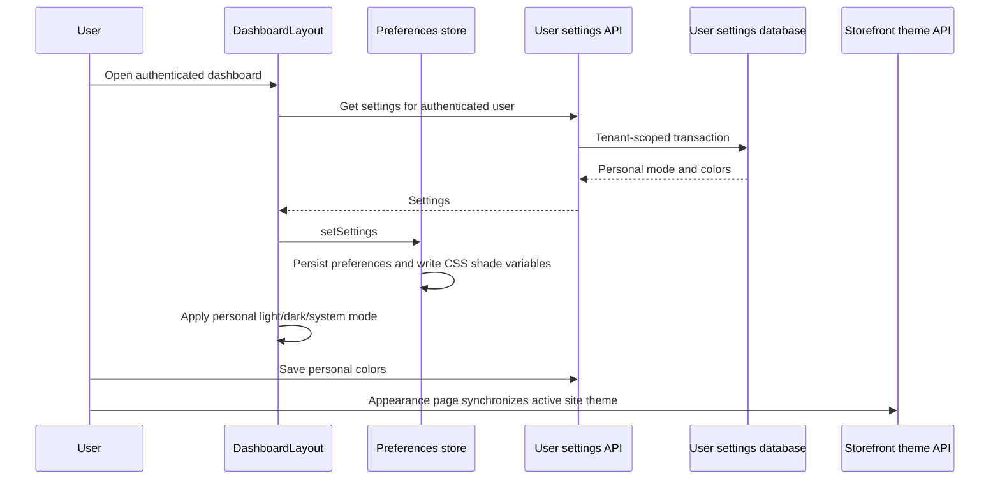

# Current appearance lifecycle

`src/stores/authStore.ts` contains authenticated user/tenant context and a cookie-session marker. `DashboardLayout.tsx` obtains current settings and delegates CSS writes to `preferencesStore.ts`. The latter derives shades and writes `--primary-*`, `--secondary-*`, and `--accent-*` on `document.documentElement`; Tailwind token consumers see them, while hardcoded colors do not. `next-themes` in the locale layout owns the class-based mode. The personal settings endpoints are registered in `backend/cmd/api/main.go`; `backend/internal/handler/http/user_settings_handler.go` and `backend/internal/repository/user_settings_repo.go` implement the requests and tenant-scoped transactions. Website synchronization is initiated by the appearance page, not implicit database inheritance. Cross-tab updates, tenant switching, cache behavior and backend-failure recovery need live verification.
