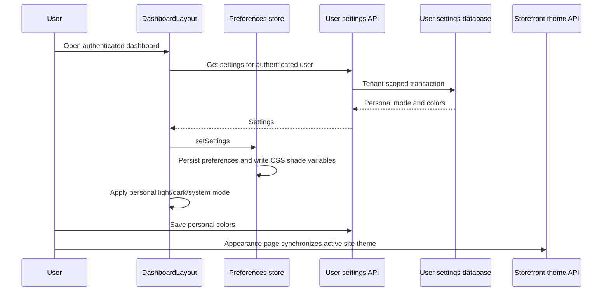

# Current appearance lifecycle

`src/stores/authStore.ts` contains authenticated user/tenant context and a cookie-session marker. `DashboardLayout.tsx` obtains current settings and delegates CSS writes to `preferencesStore.ts`. The latter derives shades and writes `--primary-*`, `--secondary-*`, and `--accent-*` on `document.documentElement`; Tailwind token consumers see them, while hardcoded colors do not. `next-themes` in the locale layout owns the class-based mode. The personal settings endpoints are registered in `backend/cmd/api/main.go`; `backend/internal/handler/http/user_settings_handler.go` and `backend/internal/repository/user_settings_repo.go` implement the requests and tenant-scoped transactions. Website synchronization is initiated by the appearance page, not implicit database inheritance. Cross-tab updates, tenant switching, cache behavior and backend-failure recovery need live verification.

The startup effect skips the request when the cached settings already carry the same user ID. `preferencesStore.ts` persists settings under `preferences-storage`; `setSettings` applies the generated CSS variables and emits `preferencesUpdated`. The effect falls back to declared colors when response fields are absent, but a non-OK response does not call `setSettings`; the error and initial-render behavior must be observed under failed requests rather than assumed.

On logout, `authStore.ts` calls `clearAuthScopedClientState`, which removes `preferences-storage` and resets the preferences store and color variables; authentication scope changes also invoke cleanup and request IndexedDB cleanup. The collapse preference uses a different localStorage key and is not listed in that cleanup. Verify actual next-themes persistence, timing and cross-tab behavior separately. The effect's request is a native `fetch` with an Authorization value derived from the session marker; test cookie, CORS and credential behavior in each deployment topology before relying on appearance restoration.
