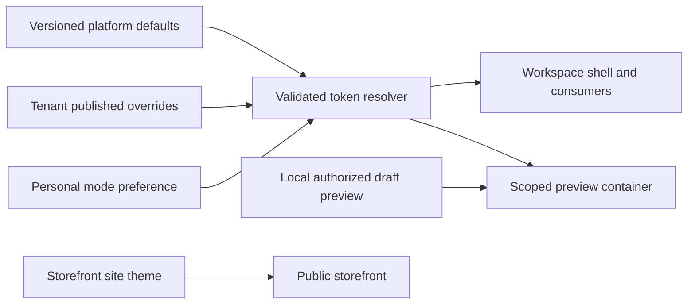

# Proposed appearance architecture (future; not implemented)

Use four distinct layers: platform defaults, published tenant workspace overrides, authorized temporary preview, and personal color-mode selection. Store tenant overrides with a version and revision; merge missing validated keys with the current built-in Coral preset. Storefront themes remain independent. The legacy per-user colors require an explicit decision: preserve as personal overrides, offer opt-in migration, or retain temporarily behind a compatibility policy. Do not treat all legacy blue defaults as deliberate tenant choices.

Alternatives: extend `user_settings` (rejected as authoritative tenant ownership because rows belong to users), reuse restaurant theme records (rejected as implicit workspace ownership because those records drive storefront output), or introduce a tenant-scoped workspace appearance resource (recommended, subject to RBAC and existing settings review). Apply values via an allowlisted token resolver, never tenant-supplied CSS text. User light/dark/system preference stays independent. Scope preview locally; clear tenant-specific resolved values on logout and tenant switch, and verify failure fallback does not leak prior tenant state.

Resolution should be deterministic and explicitly keyed by tenant, schema version and published revision. Validate the resolved light and dark combinations after inheritance, not just individual override fields. Prevent drafts from mutating root variables used by unrelated surfaces; portals and fullscreen POS/KDS need explicit scoping tests. A safe failure state may use platform defaults in memory, but must not persist them over an unavailable tenant record or reuse the previous tenant's values. Whether a tenant can configure density, focus or individual mode-specific overrides is unresolved and should be decided before defining storage and migrations.

Canonical defaults: light paper `#F8F2E8`, surface `#EFE4D5`, raised `#E6D6C3`, ink `#2B201C`, secondary text `#5A4941`, muted `#6E5A4E`, border `#D8C8B6`, accent `#A13224`, hover `#8D291C`; dark background `#211B18`, surface `#2D2520`, text `#F2E9DC`, accent `#E17861`. Contrast for all proposed combinations must be measured before implementation. Preserve independent success, warning, danger, information and chart semantics. Operational sizes, typography bounds, focus colors and alternate fonts remain decisions rather than verified defaults.
