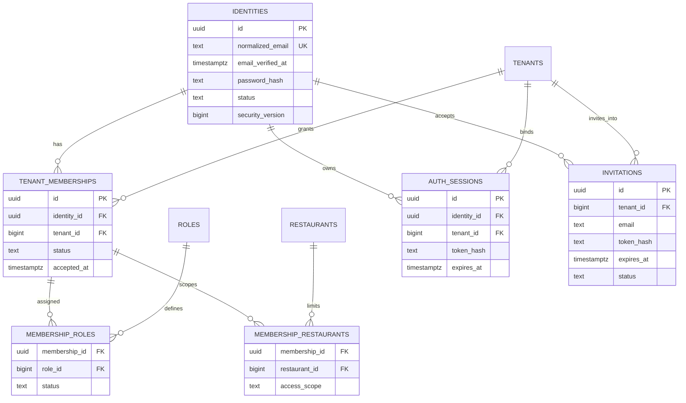

# SERVIO Authentication and Identity Handoff — 2026-11-21

> **Evidence time:** 2026-11-21 18:17 UTC. Repository: [`Yousef-Abdallah-1711/pos`](https://github.com/Yousef-Abdallah-1711/pos). This document records the state inspected from `origin/main` at `031971c80ba0eb2f7bcffd08c2cba979780aa325` and live staging. Do not treat code presence as runtime proof. Secrets and customer data are intentionally excluded.

## 1. Executive Summary

SERVIO is a multi-tenant restaurant SaaS with Landing/login, Dashboard, restaurant storefront, Super Admin, Go API, PostgreSQL and Redis. The current browser staff authentication path is a server-managed opaque cookie mapped to a server-side JWT credential. Existing login, tenant selection, session expiration/rotation, logout, origin checks and portal handoff have meaningful automated coverage. The owner approved a **session-only cookie, 30-minute server-enforced idle timeout, eight-hour absolute lifetime**; implementation constants and tests exist.

**Current release status: PARTIAL / staging behind main.** `origin/main` is `031971c80ba0eb2f7bcffd08c2cba979780aa325` (PR #101). Live staging receipt is verified at `b1db5ddd8793f049436b1ab371f21946224da929`, so it does not include merged PRs #100 and #101. Exact-main workflow `44934323375` is still running: backend, all four frontends, security/config and financial PostgreSQL jobs passed; `application-images` was in progress; `auth-browser-acceptance` was skipped. The currently running release has no signed image bundle yet. Do not claim `main` deployed.

The last staging release has a signature and immutable images (workflow `44926586319`), all eight containers were healthy during this inspection, and the public Landing/API answered. This is staging evidence only and is not a production readiness claim. Available host memory was about 416 MiB with 1 GiB swap free; resource preflight must be repeated before rollout.

The larger owner-approved redesign is **not implemented**: durable persistent login across browser restarts, canonical global identity/memberships, verified-email onboarding OTP, invitations, complete recovery email, MFA/device controls and production-scale SLO validation. Approved release 1 defers multi-membership and in-session tenant switching. No production deployment was made.

## 2. Repository and Infrastructure Inventory

| Item | Verified state |
|---|---|
| Repository | `https://github.com/Yousef-Abdallah-1711/pos` |
| Current `origin/main` | `031971c80ba0eb2f7bcffd08c2cba979780aa325`, PR #101 merge commit, 2026-11-21 18:13:20 +02 |
| Previous staging SHA | `b1db5ddd8793f049436b1ab371f21946224da929`, PR #99 merge, signed staging release |
| Main CI | Run [44934323375](https://github.com/Yousef-Abdallah-1711/pos/actions/runs/44934323375): in progress at evidence time; details in §13 |
| Other exact-main checks | Runtime Localhost Guardrail [44934323302](https://github.com/Yousef-Abdallah-1711/pos/actions/runs/44934323302) PASS; URL/Domain Config Smoke [44934323270](https://github.com/Yousef-Abdallah-1711/pos/actions/runs/44934323270) PASS |
| Current signed release | Tag `staging-sha-b1db5ddd8793f049436b1ab371f21946224da929`; release publisher [44926586319](https://github.com/Yousef-Abdallah-1711/pos/actions/runs/44926586319) PASS; [manifest and signature](https://github.com/Yousef-Abdallah-1711/pos/releases/tag/staging-sha-b1db5ddd8793f049436b1ab371f21946224da929) |
| Staging receipt | `https://api.pos.rakmyat.online/_ops/release` returned `status=verified`, SHA `b1db5ddd8793f049436b1ab371f21946224da929`, CI run `44921126989` |
| Staging host | `/opt/servio`; Docker Compose project `servio-staging`; release directory `/opt/servio/releases/<sha>`; deploy agent `/usr/local/sbin/servio-pull-agent` (historically inspected; recheck before use) |
| Staging services | `postgres`, `redis`, `backend`, `landing`, `dashboard`, `restaurant-website`, `super-admin`, `proxy`; all reported healthy during this inspection. Backend OCI revision was `b1db5ddd…`; receipt also said `b1db5ddd…` |
| Live endpoints | `https://pos.rakmyat.online/en` returned 200; `https://api.pos.rakmyat.online/api/v1/auth/session` returned expected unauthenticated 401 and `Cache-Control: private, no-store`; `https://pos.app.rakmyat.online/en/auth/login` returned 404 at inspection time |
| Host resource sample | Root filesystem 36 GiB free of 96 GiB; RAM 1.9 GiB total / 416 MiB available; swap 1 GiB free. Re-measure before deploy; do not infer safety from disk alone |
| Database / cache | PostgreSQL and Redis containers healthy; staging receipt and prior backup/restore evidence are for previous release only, not a fresh backup for `031971c8` |
| Application layout | `backend/` Go API and migrations; `frontend/apps/{landing,dashboard,restaurant-website,super-admin}` Next.js apps; shared `frontend/packages` and `frontend/layers`; `ops/aws/` staging release setup |
| Important workflows | `.github/workflows/` includes SERVIO verified CI, staging image publication, URL/domain smoke and runtime localhost guardrail. Inspect current workflow files before any release |
| Runtime config | Examples in `backend/.env.example` and `ops/aws`; actual values are secret-bearing and must never be copied into this document/logs |

### Relevant merged pull requests

| PR | Merge SHA | Scope / result |
|---|---|---|
| #87 | `6ac7538c533c5fc85b203eeaa949b1b4dccadc0e` | Authentication release integration |
| #83 | `cabbbd057f41f941841afa7741d8a88bfe5834ca` | Shared proof replay and IP rate limits |
| #84 | `3503cb2ac6ae24bfad04d10754e9d8dbc0c5d09a` | Remove legacy staff bearer forwarding to storefront |
| #85 | `8713de7414b2ffe7113b39dbba5eecb6234d271f` | Safe/evidence-based load suite; not a 10K readiness certification |
| #86 | `ddbbf6d143c54ed278fa954887103ef30ad7daef` | Remove watcher from production dependency graph; no advisory suppression |
| #90 | `2593b2719ad426c3e50c79d3717b78c60875ffe4` | Safe staging acceptance workflow separation |
| #99 | `b1db5ddd8793f049436b1ab371f21946224da929` | Landing guest account navigation login-only fix |
| #100 | `b189e46931e2c9ac30f114285344223b4fee03a4` | Financial acceptance documentation; unrelated to auth |
| #101 | `031971c80ba0eb2f7bcffd08c2cba979780aa325` | Wait for tenant selector controls in Landing integration test |

Open PRs at inspection: #19 (draft security closure preservation snapshot) and #20 (draft production deployment preparation). Neither is approved for merge or deployment here. Production work in #20 is explicitly out of scope.

## 3. Current Authentication Architecture

### Browser staff flow

1. Landing login posts email/password to `/api/v1/auth/login` with credentials included. The Go use case normalizes/validates and checks password hashes with bcrypt. If a user has multiple tenant-specific rows, it returns tenant choices and a short-lived signed `selection_token`; choosing one posts to `/auth/login/confirm` with email, tenant ID and proof.
2. Confirm validates proof email/tenant, re-reads the user and consumes proof once in shared storage where supported. It issues a JWT credential, but the browser receives the opaque `poos_session` cookie instead of storing that JWT as browser bearer auth.
3. The session store creates a 32-byte random base64url ID, hashes the ID with SHA-256 for Redis key `auth-session:v1:<digest>`, and stores a versioned record containing the signed credential, 30-minute idle timeout and absolute expiry. Redis access is required in production; local in-memory fallback is explicitly non-production.
4. Cookie authentication resolves the opaque value server-side and injects the stored credential into the existing JWT authorization middleware. Redis failure produces 503/fail-closed behavior; missing/expired/revoked sessions return 401.
5. Refresh rotates the session ID atomically and preserves the absolute deadline. Logout revokes server-side state and clears the browser cookie.
6. `GET /api/v1/auth/session` returns the minimal currently authorized profile; Landing and Dashboard use credentialed, no-store requests to discover/revalidate it. Landing shares session changes between tabs; Dashboard's Zustand persistence stores user display/scope data and a `cookie-session` marker, not the bearer JWT.

### Portals and boundaries

- Landing: `frontend/apps/landing/src/app/[locale]/auth/login/page.tsx`, `src/lib/auth-session.ts`, `src/lib/useLandingSession.ts`, and `src/components/AccountEntryLinks.tsx`.
- Dashboard: `frontend/apps/dashboard/src/components/providers/DashboardAuthProvider.tsx`, `src/lib/authSession.ts`, `src/stores/authStore.ts`, `src/lib/api.ts`; the server cookie remains authoritative.
- Storefront: public anonymous ordering is a separate capability path; PR #84 removed legacy forwarding of staff bearer credentials. The storefront must not inherit a restaurant staff session for public ordering.
- Super Admin: separate `poos_super_admin_session` cookie and separate Super Admin middleware/authorization. Unsafe cookie requests require trusted Origin; this is not a substitute for role checks.
- CORS controls cross-origin browser access. Cookie unsafe methods additionally enforce configured trusted Origin. `backend/internal/middleware/csrf.go` defines a double-submit token helper, but no active middleware callsite was found in `backend/cmd/api/main.go`; do not claim it is globally wired. Active cookie protection is Origin validation plus SameSite policy.
- Registration creates tenant/restaurant/user and returns auth; it does not currently perform an email verification challenge.
- `ForgotPassword` currently returns a generic success response but contains `TODO: Generate reset token and send email`; no public reset completion route was found in Landing. See `frontend/apps/landing/PRODUCT.md:27-32`.

```mermaid
sequenceDiagram
    actor U as User
    participant L as Landing / Dashboard
    participant API as Go API
    participant DB as PostgreSQL
    participant R as Redis session store
    U->>L: Submit email + password
    L->>API: POST /auth/login (Origin, credentials)
    API->>DB: Find tenant-scoped user rows
    DB-->>API: bcrypt hashes and tenant contexts
    API-->>L: One account OR choices + short-lived selection_token
    U->>L: Select tenant if needed
    L->>API: POST /auth/login/confirm (selection_token, tenant)
    API->>DB: Revalidate selected user / tenant
    API->>R: Consume proof; store JWT credential under hash(session ID)
    API-->>L: Set-Cookie poos_session (HttpOnly, Secure, SameSite=Lax)
    L->>API: GET /auth/session (cookie, no-store)
    API->>R: Resolve and slide idle TTL, capped at absolute expiry
    API->>DB: Validate JWT claims / profile context
    API-->>L: Minimal tenant-bound profile
    L-->>U: Authenticated account/profile
    U->>API: POST /auth/logout (trusted Origin)
    API->>R: Revoke session key
    API-->>L: Expire cookie; guest state
```

## 4. Exact Current Functionality

| Feature | Status | Evidence / boundary |
|---|---|---|
| Password login and bcrypt | IMPLEMENTED AND VERIFIED | `auth_usecase.go`; backend and staging tests; live session smoke evidence from previous staging run |
| Multi-tenant login selection | IMPLEMENTED AND VERIFIED | selection proof + tenant confirm, Landing tests; tenants are currently tenant-scoped user rows, not global identity memberships |
| Staff opaque cookie / server-side JWT | IMPLEMENTED AND VERIFIED | `service/auth_session.go`, `middleware/auth.go`, HTTP integration tests |
| Approved session-only / 30m idle / 8h absolute policy | IMPLEMENTED AND VERIFIED | User approval in conversation; constants `auth_session.go:17-19`; service tests |
| Cookie revocation, refresh rotation, absolute cap | IMPLEMENTED AND VERIFIED | session service tests, staging logout check reported for b1db release |
| Redis fail-closed production configuration | IMPLEMENTED AND VERIFIED | `cmd/api/main.go:132-149`; error handling in session middleware |
| Landing/Dashboard session discovery and shared state | IMPLEMENTED AND VERIFIED | unit/integration/browser tests and prior live Chromium evidence; latest main only adds a test race wait |
| Guest Login-only header; CTA remains registration route | IMPLEMENTED AND VERIFIED | PR #99 merged and prior live Chromium across EN/AR/mobile/responsive widths |
| Tenant data isolation and tenant-bound session | IMPLEMENTED AND VERIFIED | backend integration tests and auth cookie flow; no global membership model |
| Super Admin separate cookie/middleware | IMPLEMENTED AND VERIFIED | dedicated code and unsafe-Origin test; separate browser lifecycle should be re-tested on current staging SHA |
| Unsafe cookie CSRF protection | IMPLEMENTED AND VERIFIED (Origin defense) | active `SessionAuthMiddleware` unsafe Origin check and route wrapping; double-submit `CSRFMiddleware` itself not wired in API route registration |
| Registration without owner email verification | IMPLEMENTED — NOT VERIFIED as desired OTP flow | tenant/user creation code exists; OTP verification is NOT IMPLEMENTED — NEXT AGENT REQUIRED |
| Forgot-password request endpoint | PARTIAL | generic response exists; reset token/email TODO; no public completion route verified |
| Persistent browser login across restarts | NOT IMPLEMENTED — NEXT AGENT REQUIRED | cookie intentionally session-only, 8-hour server cap |
| Same global person identity across tenant memberships | NOT IMPLEMENTED — NEXT AGENT REQUIRED | `users` has `UNIQUE(tenant_id,email)`; individual tenant user IDs/password hashes |
| Role/restaurant-scoped email invitation lifecycle | NOT IMPLEMENTED — NEXT AGENT REQUIRED | no invite-accept/token/email flow found in auth routes or migrations searched |
| MFA / recovery codes / step-up authentication | NOT IMPLEMENTED — NEXT AGENT REQUIRED | no end-to-end MFA flow identified |
| Device registry, revoke one/all devices | NOT IMPLEMENTED — NEXT AGENT REQUIRED | no durable device session registry |
| Full reusable bilingual SMTP email system | NOT IMPLEMENTED — NEXT AGENT REQUIRED | `.env.example` mentions SendGrid variables, but no active production email sender/template integration was found in searched auth path |
| 10K users / production-scale load | UNKNOWN — REQUIRES INVESTIGATION | safe k6 assets exist; no authorized production-like high-load result; 10 RPS smoke is not 10K capacity proof |
| Current main deployed to staging | BLOCKED | live receipt b1db differs from current main 031971c; exact-main images workflow was in progress |

## 5. Complete Authentication and Security Findings

Severity is scoped to the stated next-release requirements, not a claim that the current staging release is exploitable. Source references use current baseline `031971c8`.

| ID / severity | Affected component; source | Current behavior and impact | Reproduction / proposed fix / tests / dependency | Status |
|---|---|---|---|---|
| AUTH-01 — High (requirement gap) | Identity schema; `backend/migrations/003_create_users.sql:4-20`, `103_create_user_roles_table.sql:5-16`; registration check `backend/internal/repository/auth_repo.go:362-369` | One `users` row is tenant-bound and unique on `(tenant_id,email)`. Public registration currently rejects an email already present anywhere in `users` (case-insensitive), but this is not a canonical global identity or explicit invitation-accepted membership model. Login searches rows by email and assumes duplicate rows share a password (`auth_usecase.go:178-195`); tenant names in choices are placeholders (`:219-250`). Historical/import/manual duplicate rows can exist despite the registration check. | Repro: inspect duplicate normalized emails and password divergence using privacy-safe aggregates; exercise divergent credentials only in an isolated synthetic DB. Propose global identity + explicit membership/role/restaurant grants, verified-account linking and migration/backfill. Add duplicate, cross-tenant, role isolation and rollback integration tests. Depends on Phase 1. | CONFIRMED GAP; redesign pending |
| AUTH-02 — High (requirement gap) | Persistent login/session lifecycle; `backend/internal/service/auth_session.go:17-19,47-73,121-163` | 30m idle / 8h absolute with session-only browser cookie means browser restart loses cookie and user must authenticate again; it is revocable but has no durable refresh/device registry. | Repro: login, close browser, reopen; cookie is absent; active server record still expires at cap. Design explicit owner/staff/Super Admin policies, durable rotating renewal token, device registry, replay detection and deployment-compatible versions. Redis/DB durability and revocation tests. Phase 3. | CONFIRMED PRODUCT GAP |
| AUTH-03 — High (requirement gap) | Owner email verification; `backend/internal/usecase/auth_usecase.go:92-167` | Registration commits tenant/user and returns an auth response without email OTP verification. The requested 10-minute OTP, attempt/cooldown and atomic consume do not exist in this flow. | Repro: register without any mailbox interaction. Add idempotent pending-registration state and hashed one-time OTP after owner approves creation/activation policy; test expiration, resend, concurrency, brute-force bounds and delivery retry. Phase 2. | CONFIRMED GAP |
| AUTH-04 — High (requirement gap) | Password recovery; `backend/internal/usecase/auth_usecase.go:426-443`; Landing `PRODUCT.md:32` | Endpoint intentionally returns generic success but reset generation/sending are TODO; no public reset completion UI/API was verified. Users cannot rely on self-service recovery. | Repro: submit forgot request and observe no reset token/mail; search route inventory. Build generic response, one-time hashed token/OTP, rate-limit, revoke sessions and notification; test enumeration, expiry and account classes. Phase 2. | CONFIRMED GAP |
| AUTH-05 — High (requirement gap) | Invitations; API routes in `backend/cmd/api/main.go:544-552`; migrations inventory | No authentication invitation lifecycle was identified in the current code path. Email alone must never create membership. | Repro: route search for invitation create/accept; none identified. Implement inviter authorization, tenant/restaurant/role binding, verified recipient identity, expiry/revoke/replay/audit and multi-tenant preservation. Phase 2; depends on Phase 1. | NOT IMPLEMENTED |
| AUTH-06 — Medium (control coverage) | CSRF wiring; `backend/internal/middleware/csrf.go:18-59`, `middleware/auth.go:28-47`, `cmd/api/main.go:544-552` | A double-submit helper is present but not routed through main API. Cookie-authenticated unsafe requests currently depend on trusted-Origin checks plus SameSite. Misconfiguration or missing Origin behavior is a residual review target; don't state that double-submit is active. | Trace every cookie-authenticated mutation including Super Admin. Existing code rejects unsafe staff cookie requests with untrusted/missing Origin. Add full route matrix with cross-site, missing, null, trusted Origin, and bearer-only cases; decide whether double-submit is needed. | CONFIRMED wiring fact; residual risk needs full matrix |
| AUTH-07 — Medium (architecture clarity) | Auth handler packages; `backend/internal/handlers/auth_api.go` vs `backend/internal/handler/http/auth_handler.go`; `cmd/api/main.go:381,544-552` | A legacy `internal/handlers` API file contains a different bearer-token login implementation while main wires the singular `internal/handler/http` auth handler. Confusing duplicate code can lead maintainers to inspect or change the wrong path. No exploit is inferred from its existence. | Reproduce via route registration and constructor call graph; maintain a route-to-handler map, mark/remove legacy only after full-reference/dependency proof and review. Regression compile + auth route tests. | CONFIRMED ambiguity; cleanup requires review |
| AUTH-08 — Medium (assurance gap) | Super Admin and MFA; `backend/internal/middleware/super_admin_auth.go`, `super_admin` auth routes | Separate cookie and active-account checks exist; no end-to-end MFA/step-up/device recovery was identified. Super Admin is a high-impact account class. | Confirm actual deployed settings and existing second factors; define approved MFA/session policy. Add enrollment, challenge, recovery, replay and privileged-action step-up tests before claiming complete. | MFA NOT IMPLEMENTED; lifetime decision open |
| AUTH-09 — Medium (email operations) | Email config/sender; `backend/.env.example:56-59`, `backend/internal/service/legacy/notification_service.go:333` | Example config names SendGrid but inspected auth code only contains TODO; a legacy notification comment says production delivery would be implemented. Config presence does not demonstrate provider, SPF/DKIM/DMARC, queue, retries or delivery. | Verify secret manager/provider/account/DNS and send only to controlled synthetic mailbox after authorization. Add fake SMTP/provider contract and EN/AR rendering tests. Phase 2. | Active production mail path UNKNOWN; requires investigation |
| AUTH-10 — Medium (availability) | Staging deploy gate; run 44934323375, host sample | Current main is newer than live signed release; current main image workflow was still running and host available RAM sample was 416 MiB. Deploying without exact-main provenance and fresh capacity/backup checks risks service interruption. | Wait for exact run and signer, inspect current receipt, repeat health/resources, fresh backup+restore evidence, migration/rollback. No deployment until all gates. | CONFIRMED release blocker at evidence time |
| AUTH-11 — High (conditional tenant-boundary risk) | Multi-tenant login; `backend/internal/usecase/auth_usecase.go:188-195,235-249,285-329`; `backend/internal/repository/auth_repo.go:251-277` | Login verifies the password only against the first same-email row, creates a selection proof covering every returned tenant, then confirm selects the requested tenant row without verifying that row’s password. If active duplicate-email rows have different password hashes (possible through legacy/import/manual paths), a password for the first row can obtain a session for another tenant. This is a confirmed code-path flaw conditional on such data. | Repro only in isolated synthetic PostgreSQL: two active rows with same normalized email, different passwords; login with the first-ordered row password, then confirm the other tenant. Proposed fix: Phase 1 canonical identity; before that, restrict choices to accounts whose password was verified or re-check selected-row credentials without leaking tenant existence. Add exact regression and cross-tenant isolation tests. | CODE PATH CONFIRMED; live staging precondition absent at 18:42 (zero duplicate active email groups / zero groups with distinct hashes); production data UNKNOWN — REQUIRES INVESTIGATION; block enabling global multi-tenant identity until fixed/reviewed |

No additional unproven source concerns are elevated to confirmed vulnerabilities. Hypotheses to validate include identity collision during email linking, privilege changes not invalidating old session claims, login user-row ordering/password divergence, transient client 401 handling, session loss across Redis failover, and legacy RBAC fallbacks.

## 6. Identity and Multi-Tenant Data Model

### Current facts

- `backend/migrations/003_create_users.sql:4-20`: `users.id` is a primary key; each row requires `tenant_id`, optionally references `restaurant_id`, and stores email, password hash, name, a single role string, JSON permissions, status; unique `(tenant_id,email)`.
- `backend/migrations/103_create_user_roles_table.sql:5-16`: `user_roles` maps tenant/user/role with uniqueness for each role assignment. `user_id` references tenant-scoped `users`, so this does not create a global human identity.
- `backend/migrations/020_create_employees_table.sql:66` also constrains employee email per tenant. `backend/migrations/179_index_users_email_lower.sql` adds case-insensitive lookup index, not a global unique identity.
- Login finds all users by email and proof-binds tenant choices. It does not prove that duplicate tenant rows are the same human beyond matching email and the password on the first returned row. Restaurant scope is represented by the user row's optional/current restaurant and role system; validate every route's scope before assuming all role mappings enforce it.
- Super Admin identities and sessions are separate and should remain separate from restaurant staff identities.

### Proposed target (not implemented)

Use canonical `identities(id, normalized_email, email_verified_at, password_hash, status, security_version, created_at, updated_at)`; `tenant_memberships(id, identity_id, tenant_id, status, accepted_at, invited_by, created_at)`; `membership_roles(membership_id, role_id, granted_by, status)`; `membership_restaurants(membership_id, restaurant_id, access_scope)`; independent `invitations` with hash-only token, email, tenant, restaurant scope, role, inviter, expiration, state, accepted identity; and identity-level verification/recovery factors. Enforce unique normalized email on canonical identities only after account linking has verified ownership.



### Migration/backfill safety

1. Inventory duplicate normalized emails, tenants, user IDs, password hash divergence, employee associations, foreign keys, audit records, role/restaurant permissions and active sessions. Produce a privacy-safe conflict report.
2. Add nullable identity/membership tables and backfill one identity per existing user row initially; do **not** merge equal email strings automatically. Verify email ownership before linking duplicates; require explicit secure account-link flow for ambiguous hashes or owners.
3. Backfill membership/role/scope transactionally with counts and referential checks. Dual-read only behind a disabled feature flag; compare authorization outcomes on synthetic data.
4. Canary-read then cut over authentication, preserving legacy user IDs and audit references. Keep old columns until rollback window exits. Never drop tenant scope or cascade-delete legacy records during first rollout.
5. Roll back by disabling new auth reads and returning to old row mapping only while schema remains additive. If a user has merged identity memberships, rollback requires a deterministic split/compatibility mapping; rehearse this in staging and document operator commands.

## 7. Email and SMTP Inventory

| Area | Current evidence | Status |
|---|---|---|
| Example config | `backend/.env.example:56-59` names `SENDGRID_API_KEY`, `FROM_EMAIL`, `FROM_NAME` | Example only; no secret value included |
| Auth sender | `auth_usecase.go:426-443` reset TODO | NOT IMPLEMENTED |
| Legacy notification | `backend/internal/service/legacy/notification_service.go:333` says real SMTP/provider would be production work | Not evidence of delivery |
| Email templates | No reusable registration/invite/recovery mail template system identified in inspected paths | NOT IMPLEMENTED — NEXT AGENT REQUIRED |
| Queue/retry/idempotency | No auth email outbox/queue found in inspected path | UNKNOWN — REQUIRES INVESTIGATION |
| Localization / RTL | Product UI has EN/AR; email rendering parity not verified | UNKNOWN |
| SPF/DKIM/DMARC/bounces | Not verified from repository/runtime evidence | UNKNOWN — REQUIRES INVESTIGATION |
| Logo/theme fallbacks | Official assets exist in product, but no email-safe template implementation verified | NOT IMPLEMENTED |

Before any delivery test, configure a provider sandbox or allowlisted synthetic inbox. Never send an OTP to an unintended address, log OTP/token values, or paste credentials into the repo. Verify TLS, secret storage/rotation, sender domain authentication, bounce handling, retry/idempotency, limits, templates and provider outage recovery.

## 8. Complete User Journey Matrix

`Current` means state in inspected source plus stated live evidence; target is owner requirement. Every target test runs in synthetic isolated tenants/accounts, never with real customer mail/data.

| Journey | Current support | Expected target | Phase / required acceptance |
|---|---|---|---|
| New tenant owner registration | Tenant/user creation, direct session; no email proof | Pending/verified onboarding per owner-approved activation rule | 2: duplicate/concurrent registration, no orphan tenant |
| Owner email OTP | NOT IMPLEMENTED | 10-minute, unpredictable, hashed, single-use OTP | 2: expiry, resend invalidation, attempts, cooldown, concurrency |
| OTP expired | No OTP flow | Reject and safely request resend | 2: boundary-clock tests |
| OTP resend | No OTP flow | Supersede previous code, rate-limit | 2: old code rejected; delivery idempotency |
| Invalid OTP | No OTP flow | Generic rejection and bounded attempts | 2: lock/rate-limit, no account enumeration |
| Duplicate registration | Email check + DB uniqueness behavior; race needs validation | Idempotent and no duplicate tenant/user | 1/2: concurrent inserts, rollback |
| Invitation creation/resend/revoke | No complete auth invite flow found | Authorized inviter selects tenant, branch, role; single-use expiring invitation | 2: authority, scope, revoke, replay, audit |
| Invitation accept by new user | NOT IMPLEMENTED | Verify email identity, set credential, accept invited scope | 1/2: wrong email/tenant/role tampering blocked |
| Invitation accept by existing user | NOT IMPLEMENTED | Add membership without overwriting prior tenant role/data | 1/2: two tenant isolation assertions |
| Same email in two tenants | Separate rows can be selected; password equality assumption exists | One verified identity with independent memberships | 1: unequal legacy credentials and linking conflict cases |
| Tenant selection at login | Implemented with signed short-lived proof | List only active accepted memberships; session binds chosen membership | 1: tampered tenant, expired/replayed proof |
| Different roles across tenants | User row role + tenant user roles exist | Independent roles per membership; no role bleed | 1: tenant A manager vs tenant B cashier |
| Restaurant-specific access | User restaurant scope and RBAC exist | Explicit branch membership scope | 1: branch A cannot read/write branch B |
| Password reset by email OTP | NOT IMPLEMENTED | One-time expiring reset proof, generic response | 2: enumeration, replay, rate-limit, session revocation |
| Password reset by secure link | NOT IMPLEMENTED | Owner/security decides OTP vs link or support both | 2: token hash, expiry, one use, safe URL |
| MFA recovery | NOT IMPLEMENTED | Recovery codes and verified recovery procedure | 3: one-use, no bypass, supervised recovery |
| Browser restart | Session-only cookie is lost | Trusted-device persistence only under approved policies | 3: restart browser; explicit remember-device choice |
| Session idle/absolute expiry | 30m idle / 8h max implemented | Owner-approved staff policy retained until changed | 1/3: idle boundary, hard cap, browser recovery |
| Session renewal | Atomic rotation with absolute cap | Rotating durable renewal credential with replay detection | 3: concurrent refresh/reuse/replay tests |
| Session revoke one/all devices | Logout current session; no durable device list | Per-device list/revoke and revoke all | 3: immediate session invalidation |
| Logout | Revokes current session and clears cookie | Preserve current behavior, audit safely | 1/3: cookie removal and replay fails |
| Deploy while logged in | Redis sessions should outlive API process; prior staging reload persisted | Compatible token/session versions across rolling deploy | 3/4: deploy while synthetic user active; no random logout |
| Redis outage/recovery | Prod config requires Redis; middleware fails closed; tests exist | Fail closed, recover without privilege loss or unsafe token fallback | 1/4: outage, reconnection, Redis failover |
| API restart | Redis record external to process; runtime continuity not asserted as universal | Session remains valid through healthy compatible restart | 3/4: restart/redeploy staging verification |
| Super Admin login | Separate cookie/middleware and rate limiting | Separate short lifetime, MFA/step-up and auditable recovery | 3: RBAC boundary, inactivity/revocation, MFA |
| Account suspension | Tenant/user status middleware exists; fresh-session behavior must be tested | Invalidate active sessions promptly on suspension/security event | 3: existing session becomes denied; restore flow audited |

## 9. Email Template Specification

Implement a reusable template renderer and sender abstraction after confirming the active provider. Required templates: owner registration OTP; registration verified; tenant invitation; invitation accepted; invitation expired/revoked where policy calls for notice; password recovery OTP/link; password changed; new-device/suspicious-login/security alert; email-change verification if enabled.

- Use the official SERVIO logo asset already in the repository, centered and with meaningful alt text; do not redraw/fabricate a mark.
- Responsive, conservative table-based HTML with inline CSS and a tested plain-text alternative.
- English LTR and Arabic RTL with language preference; Arabic direction must be explicit and tested in actual mail clients/renderers.
- Light design must remain legible when clients ignore CSS. Dark mode may use `prefers-color-scheme` enhancements, never as sole contrast strategy. Test fallback rendering in Gmail/Outlook/Apple Mail equivalents or maintained screenshot renderer.
- Accessible hierarchy, readable type, strong contrast, keyboard-friendly links and concise expiry/security wording.
- Escape tenant, role, inviter and recipient-provided text; validate links against configured trusted origins; avoid open redirects.
- OTP/reset links must not appear in application logs, analytics, referrers, error traces or screenshots. Never place passwords or full bearer tokens in email.
- Include SERVIO support/security footer and “if you did not request this” guidance. Add template IDs/locale, provider message IDs and delivery state to audit records without sensitive token data.

## 10. Session Persistence and Deployment Continuity

The currently approved browser cookie is intentionally session-only: it has no persistent expiry, so closing the browser may remove the browser credential. Server state slides at 30 minutes idle but cannot pass the 8-hour absolute deadline. This is secure/revocable but does not satisfy “stay signed in after browser restart.” API restarts should not erase a healthy Redis record by process memory design; Redis loss, flush, eviction, restore or incompatible secret/JWT changes can still invalidate sessions. Prior staging live receipt and browser evidence were on `b1db5ddd`; repeat against a new candidate before claiming continuity.

Current cookie name `poos_session` is host-only (no `Domain` attribute), HttpOnly, Secure, SameSite=Lax; host-only scope means different portal hosts rely on API session calls, not shared cookie-domain storage. Dashboard persisted state is presentation metadata, not authentication. `poos_super_admin_session` is separate. The signed JWT credential is server-side in Redis, not directly in the staff browser cookie.

Proposed Phase 3: short-lived access/session plus a separately scoped opaque, rotating, durable renewal credential (hash at rest, device identifier, issued/last-used/expiry/revoked metadata, token family and session/security version). Atomic rotation must detect reuse and revoke the family. Keep signing keys stable/versioned during rolling deploys, support dual validation during rotation, and protect persistent records with DB durability plus Redis coordination. Define policy per owner, manager, cashier/POS, KDS and Super Admin; add explicit “remember this device” consent, max lifetime, idle policy, MFA/step-up, per-device revoke, revoke-all on password/security changes, suspicious replay controls and recovery. No browser localStorage bearer token.

## 11. Four-Phase Implementation Roadmap

Effort estimates are planning ranges, not commitments; one engineer-day means a focused engineering day and excludes approval/provider delays.

### Phase 1 — Canonical identity, memberships and tenant authorization (roughly 8–15 engineer-days)

**Dependencies:** identity-linking policy, approved migration and rollback plan, synthetic duplicate records, independent security review. **Tasks:** inventory FKs/RLS and duplicate normalized emails; design global identity + tenant membership + role/restaurant grants; additive migrations; verification-gated account linking; adapt registration/login/tenant selector/session claims/RBAC; tenant-bound queries and audit; maintain Super Admin separation; feature flag and metrics. **Acceptance:** same verified identity selects multiple active memberships; distinct role/branch contexts are isolated; pending/revoked memberships cannot select; forged tenant/restaurant claims rejected; all legacy IDs/audit rows remain; conflict backfill report reviewed. **Tests:** unit, PostgreSQL migration/backfill, concurrent registration/linking, RBAC/RLS, browser tenant switch (only if approved), rollback rehearsal. **DoD:** independent review, exact-head CI, migration compatibility, canary comparison, operator runbook. **Rollback:** flag back to legacy reads while additive schema remains; split identity mappings safely; do not drop old columns until rollback horizon closes.

### Phase 2 — SMTP, verification, invitations and recovery (roughly 6–12 engineer-days plus provider/DNS work)

**Dependencies:** Phase 1 identity API (or carefully isolated compatibility adapter), chosen provider, sandbox account/secrets, sender-domain SPF/DKIM/DMARC, owner decisions on pending tenant activation and OTP vs reset link. **Tasks:** provider interface, durable outbox/queue, retries/idempotency and bounce state; localized reusable templates; 10-minute registration OTP with hashed storage/atomic consume/rate limits; invitation create/resend/revoke/accept bound to verified identity and authorized scope; password recovery for staff/owners and separate Super Admin policy; security notices. **Acceptance:** no membership access before invite acceptance; OTP/invite/reset one-use and expiry; unknown email responses do not enumerate; EN/AR, HTML/plain text and dark-mode fallbacks render; provider outage/retry safe; credentials never logged. **Tests:** provider fake, queue retry, concurrency, route authorization, email rendering, accessibility, synthetic sandbox E2E. **DoD:** independent security approval, deliverability and rate controls, audit trail, support/recovery runbooks. **Rollback:** disable issue/accept endpoints and preserve pending states; never silently fall back to unverified account activation.

### Phase 3 — Persistent sessions, device trust and recovery (roughly 8–14 engineer-days)

**Dependencies:** approved per-role lifetime/MFA policy, durable Redis/DB design, stable key rotation plan, session migration strategy. **Tasks:** device registry, opaque renewal credential, atomic rotation/replay detection, session family invalidation, deployment-compatible schema/versioning, per-device/revoke-all UI, step-up/MFA, security-version invalidation on password/role/suspension. **Acceptance:** opted-in trusted device survives browser restart and compatible deployment within approved bounds; nontrusted session remains session-only; stolen old token replay revokes family; device/session revocation is immediate; transient service errors do not falsely log out; no sensitive browser storage. **Tests:** multi-replica/concurrent rotation, replay, Redis outage/recovery, key rotation, rolling deployment, browser restart, account suspension, MFA recovery and rollback. **DoD:** security review, observability/alerts, support runbook, session-policy copy and owner approval. **Rollback:** feature flag to current 30m/8h session-only flow; revoke persistent renewal families safely.

### Phase 4 — Scale, reliability and final release (roughly 5–10 engineer-days plus environment time)

**Dependencies:** separately authorized production-like isolated environment and explicit load profile/SLO; signed immutable release path; backup and rollback drills. **Tasks:** profile auth DB/Redis/email hotspots; define availability, p95/p99 latency, error and concurrency targets; controlled k6 ramp with synthetic account pool; multi-zone/failover and queue recovery; full EN/AR browser matrix and accessibility; dashboards/alerts; migration/deploy continuity; staged canary and rollback. **Acceptance:** only claim load capacity for measured profile and target; no tenant leakage, auth bypass or unbounded queue; alarms and rollback exercised; exact SHA/image provenance verified. **Tests:** soak, spikes, failover, deploy while logged in, CSRF/redirect matrix, browser/device matrix, backup restore, chaos only in authorized environment. **DoD:** all required CI/security reviews green, signed artifact, release approval, staging receipt and live E2E; production release requires a separate owner decision and is outside this handoff. **Rollback:** revert traffic to previous signed image, rollback compatible migration/feature flags, preserve session validation compatibility.

## 12. Test and Quality Strategy

- **Go unit:** auth use case, password/reset/OTP, invitation state machine, identity linking, token validation, rate limits, claim and authorization boundaries.
- **PostgreSQL integration:** migration up/down or forward-compatible rollback; duplicates and concurrent registration; account linking; membership/role/restaurant scope; RLS; backfill preservation and row counts.
- **Redis:** shared multi-process proof replay, session idle/absolute expiry, atomic rotation, revoke, Redis unavailable/recovery, eviction/failover and version compatibility.
- **Email:** fake provider, outbox retry/idempotency, no-send-to-unapproved recipients, token nonlogging, locale/render screenshots for EN/AR, LTR/RTL, light/dark fallback, escaping and accessibility.
- **Browser E2E (real Chromium):** registration/verification, login and multi-tenant selection, session callback and persistence, logout, invite/recovery, role/suspension change, cross-portal navigation, guest/public storefront boundaries, CSRF, redirects and cache isolation.
- **UI/accessibility:** keyboard and screen reader review, focus order/announcements, mobile widths, RTL, contrast, no guest flash/hydration mismatch.
- **Security:** threat model, route inventory, origin/CSRF, open redirects, account enumeration, rate limits, replay, session fixation, cookie attributes, secret/dependency scans, Super Admin separation. Avoid suppressing advisories.
- **Concurrency/load:** isolated synthetic session pools and authorized environment only. Report offered/achieved RPS, p50/p95/p99, errors, DB/Redis saturation and profile. Never extrapolate 10 RPS to 10K users.
- **Release:** exact-head CI, immutable signed image provenance, migration compatibility, fresh backup restore, resource checks, health/release receipt, smoke tests and rollback rehearsal.

## 13. Release and Deployment Status

### Current evidence snapshot

| Gate | Result at 2026-11-21 18:17 UTC | Evidence |
|---|---|---|
| Exact latest main | PASS | `031971c80ba0eb2f7bcffd08c2cba979780aa325` |
| Current main required CI | BLOCKED / RUNNING | Run `44934323375`; Go, frontend apps, financial PostgreSQL and security/config passed. `application-images` in progress. `auth-browser-acceptance` skipped (NOT PASS). |
| Main guardrails | PASS | Runs `44934323302`, `44934323270` success for exact SHA |
| Signed images for current main | NOT RUN / NOT AVAILABLE | Latest release manifest/signature is for previous SHA `b1db5ddd…`; must not reuse for 031971c8 |
| Staging signed receipt | PASS for old SHA only | `/_ops/release`: verified `b1db5ddd…`, CI `44921126989` |
| Staging matches main | FAIL | staging `b1db5ddd…` != main `031971c8…` |
| Staging containers | PASS at sample | Eight containers healthy; do fresh check immediately before/after release |
| Public Landing/TLS response | PASS limited | `/en` HTTP 200; not a complete TLS/DNS/reverse-proxy SLO audit |
| API anonymous session | PASS expected | `/api/v1/auth/session` returned 401 and `private, no-store` |
| Staging backup for current candidate | NOT RUN | Prior backup/restore was for previous release; new rollout requires fresh backup/checksum/restore plan |
| Migration compatibility for 031971c8 | NOT RUN | Merged PR #100/#101 do not appear to add auth schema migrations; still verify workflow release bundle/migration receipt |
| Browser auth on current main | NOT RUN | Prior real Chromium checks were against previous staging release; do not transpose SHA |
| Production | NOT DEPLOYED | No production deployment authorized or performed |

### Previous signed staging image digests (not current-main artifact)

From signed release `staging-sha-b1db5ddd8793f049436b1ab371f21946224da929`:

- backend `ghcr.io/yousef-abdallah-1711/pos/backend@sha256:5cc9135b96d1c965f7ed40fcf8bd69f8b6e1b1ddb2f6ed141331494d340babf5`
- dashboard `ghcr.io/yousef-abdallah-1711/pos/dashboard@sha256:27d4d34c9c4504b4414db5d7e4e3f139f60f4934156768567928bf80d5b0f7ee`
- landing `ghcr.io/yousef-abdallah-1711/pos/landing@sha256:85a6aa16ba76ad5cfaa50e7eb935f0b608d7148bb309fa45ead62efd722aac72`
- restaurant website `ghcr.io/yousef-abdallah-1711/pos/restaurant-website@sha256:7d1e52b41d39a6969e7c24ebb1bc5ebf334d70622a31dbfb9113e2a71d5fe0fd`
- Super Admin `ghcr.io/yousef-abdallah-1711/pos/super-admin@sha256:d88f97eb7871350c7df38bdc563abe06c6933c996766962c3c501f94b6409ad4`

These are historical/current-old staging digests; never attribute them to `031971c8`. Previous release had signed manifest/signature and successful backup checksum/restore evidence, but those do not satisfy the next deployment's fresh backup gate.

## 14. Work Preservation Register

Root checkout `/opt/servio` is on `feat/marketing-navigation-mega-menu` at `18ac7a4d8fcb918ad14a15930e4718fc30fca0e9` and has user-owned unrelated work: modified `backend/internal/repository/kds_repo.go`, `backend/internal/usecase/kds_usecase.go`, `frontend/apps/dashboard/src/hooks/useKDS.ts`; untracked `backend/scripts/seed-yoseabdallah866-egyptian-menu.sql`, `backend/scripts/seed-yoseabdallah866-kds-orders.sql`, and `docs/audits/authentication-session-2026-11-17/`. These were not changed, staged, cleaned, or merged. Stash list was empty. Preserve them exactly.

### Authentication/release branches and worktrees inspected

| Worktree / branch | SHA | Disposition |
|---|---|---|
| `/tmp/servio-header-1430` `fix/landing-auth-actions-1430` | `ba0fd23103bbb6888918a31cbc8b4e7513e4fd05` | PR #99 merged; preserve worktree until owner no longer needs it |
| `/tmp/servio-rsc-input-stream` `main` | `72ef0ce8d9116d88d72b8c66d83f3ac1903976ab` | Historical detached main snapshot; behind current main |
| `/tmp/servio-main-102c` detached | `102c804df820e4e047853eb3d3ea51c0ce11472e` | Historical release snapshot; not current |
| `/tmp/servio-main-2593` detached; `/tmp/servio-staging-safe-acceptance` detached | `2593b2719ad426c3e50c79d3717b78c60875ffe4` | PR #90 merged; preserve for evidence, no cleanup |
| `/tmp/servio-release-c052` `bugfix/staging-load-verified-image-tag` | `a91f1ad123fb0936f92c69de2ee9c113e8ea81f1` | Related staging release branch; behind main; no open PR observed |
| `/tmp/servio-release-deployment-remediation` `codex/servio-release-deployment-remediation` | `d6f36c67d3d404f033c0150c17d6461873392df4` | Release remediation history; merged release publisher change is #88; verify any branch-only delta before pruning |
| `/tmp/servio-release-frontend-config` `fix/staging-release-production-frontend-config` | `d7e1582b7044aa58b29922f9f84c1fc3a90bdab6` | PR #95 merged; branch retained |
| `/tmp/servio-release-publisher-fix` `codex/fix-release-image-publisher-skip` | `5afb83a98644d1d09dc92cc49b94861cb507e2fc` | PR #88 merged; branch retained |
| `/tmp/servio-security-picomatch` `codex/security-next-intl-watcher-removal-20261118` | `1dae431d15008e7c62d6703280e38058e9684f62` | PR #86 merged; no advisory suppression; preserve branch |
| `/tmp/servio-auth-session` `codex/auth-release-integration-20261118` | `9d068f32f84f085ce9c0245765acf2aaba317fce` | PR #87 merged; preserve pending owner need |
| `/tmp/servio-auth-pr83` `codex/auth-release-pr83-integration-20261119` | `8e2f7b95b1a74f950d0f2c0638d5bd9b14fc66b5` | PR #83 merged; preserve |
| `/tmp/servio-auth-boundary-review` `codex/auth-boundary-review-20261117` | `a2f010827ae1074464b11e76071b4756e700abbc` | PR #84 merged; preserve |
| `/tmp/servio-auth-load-suite` `codex/auth-load-suite-20261117` | `954138f7e788220cea2b100da84860798ebd5f6f` | PR #85 merged; load claims bounded; preserve |
| `/tmp/servio-auth-pr82-cache` `codex/pr82-cache-isolation-fix-20261119` | `cc6232e69871af7b1985163d08e7b274637e0b6d` | PR #82 work incorporated/closed through later auth integration; verify branch-only diff before any cleanup |
| `/tmp/servio-auth-session-evidence-fix` `codex/auth-session-evidence-fix-20261119` | `89c59a6ffe6eaae9e4999b45cc87bb2c03dd8a36` | Evidence worktree; compare to main before disposition |
| `/tmp/servio-auth-controls` `codex/auth-distributed-controls-20261117` | `09ac107926e1a0ec79f02b7e9fd07bf529b15124` | PR #83 merged; preserve |
| `/tmp/servio-admin-ci-fix` `fix/admin-ci-session-reuse` | `e7b6745be24f489721cb3c94889b940f22f7b93b` | Test/CI branch; no open PR observed; inspect unique diff before closure |
| `/tmp/servio-ci-chunk-error-fix` `fix/ci-chunk-error-diagnostics` | `ed9755bc2e679136da2b39d29d9d0f4449394e8f` | PR #91 merged; preserve |
| `/tmp/servio-marketing-acceptance-fix` `fix/marketing-acceptance-navigation-diagnostics` | `f5d58aabd9056e3675d1efbf0575db7c0f8bb7b5` | PR #92 closed unmerged; review unique commits before abandoning |
| `/tmp/servio-staging-acceptance-fix` `fix/staging-acceptance-targets-20261120` | `cf6ab38a3e3a3c226493b7e7d826f89ac0cdf16f` | PR #89 closed unmerged; inspect unique change history; no cleanup |
| `/tmp/servio-staging-resource-aware` `codex/install-staging-image-size-verifier` | `f448eae68973869c51c02a07f6b83f20b3c75feb` | Staging verifier work; compare to main and determine if superseded |
| `/tmp/servio-responsive-refresh` `codex/fix-chromium-responsive-overflow-refresh` | `0a23528205c9d8d96ffaef0dd1ea33331a925777` | Responsive verification branch; compare unique delta before disposition |
| `/tmp/servio-pr81-fix` `codex/pr81-dark-theme-contrast` | `cfdd6307b9a6c6e2cde4063204e9e138cc4b4a91` | PR #81 work reported integrated through later auth/UX stream; verify branch-only delta |
| `/tmp/servio-pr82-fix` `codex/pr82-marketing-api-origin` | `bda23b8fd21f06e2ce92ccb9d3f4d0913a54fc30` | PR #82 work reported integrated/closed; verify unique delta |
| `/tmp/servio-landing-capture-fix` `fix/landing-capture-image-cropping` | `340183b034b516c9a14030727d5bffcca07e98bd` | Separate visual branch; no open PR observed; preserve pending review |
| `/tmp/servio-ui-audit` `feat/full-platform-ui-ux` | `a10aa6c505809a6052a7d60c4cf51ced15cc2781` | Broad UI work; unrelated/unfinished; do not merge as auth release |
| `/tmp/servio-release-frontend-config` etc. | See entries above | Several worktrees marked `prunable` by Git had missing gitdir targets; do not prune or delete without owner direction and evidence copy |
| `/tmp/servio-ci-timeout` `chore/extend-browser-ci-timeout` | `ec689d4e8799b27d24a102c24ac1d5872aeec5d8` | Worktree reported prunable; compare remote branch and keep branch reference |

Git reported prunable missing gitdir locations for `/tmp/servio-admin-ci-fix`, `/tmp/servio-ci-timeout`, `/tmp/servio-release-deployment-remediation`, `/tmp/servio-responsive-refresh`, `/tmp/servio-staging-resource-aware`, `/tmp/servio-ui-audit`. This is metadata, not permission to delete branches/files. Remote refs include many additional historical financial/UI/WIP branches; do not bulk-delete. Inspect open PRs and unique commits before any pruning.

### Open PR disposition

| PR | Branch / head | Status | Action |
|---|---|---|---|
| #19 | `codex/wip-ws02-local-snapshot-2026-11-12` / `9bf9a7bce3aa6567a11b0882aa88baff99fef742` | Draft, open | Preserve snapshot; not an auth release candidate |
| #20 | `codex/production-deployment` / `33b91430cd9c010b4f1e7c194f2456cc7efafc2d` | Draft, open | Production deployment preparation only; do not merge/deploy as part of this staging task |

No stash entries were present at inspection.

### Complete worktree inventory (captured after creating this handoff branch)

The table below is the complete `git worktree list --porcelain` output, including detached snapshots. “Prunable” means Git recorded a stale/missing worktree gitdir; it is not authorization to delete the branch or filesystem path.

| Path | Branch / state | HEAD | Note |
|---|---|---|---|
| `/opt/servio` | `feat/marketing-navigation-mega-menu` | `18ac7a4d8fcb918ad14a15930e4718fc30fca0e9` | User-owned dirty checkout; preserve all listed files |
| `/tmp/servio-admin-ci-fix` | `fix/admin-ci-session-reuse` | `e7b6745be24f489721cb3c94889b940f22f7b93b` | stale worktree metadata; do not prune |
| `/tmp/servio-auth-boundary-review` | `codex/auth-boundary-review-20261117` | `a2f010827ae1074464b11e76071b4756e700abbc` | preserve; compare branch-only commits before disposition |
| `/tmp/servio-auth-controls` | `codex/auth-distributed-controls-20261117` | `09ac107926e1a0ec79f02b7e9fd07bf529b15124` | preserve; compare branch-only commits before disposition |
| `/tmp/servio-auth-handoff-2026-11-21` | `docs/auth-handoff-2026-11-21` | `a7149504904119fc0b54dac03566a6f6a1da71c5` | PR #102 documentation branch |
| `/tmp/servio-auth-load-suite` | `codex/auth-load-suite-20261117` | `954138f7e788220cea2b100da84860798ebd5f6f` | preserve; compare branch-only commits before disposition |
| `/tmp/servio-auth-pr82-cache` | `codex/pr82-cache-isolation-fix-20261119` | `cc6232e69871af7b1985163d08e7b274637e0b6d` | preserve; compare branch-only commits before disposition |
| `/tmp/servio-auth-pr83` | `codex/auth-release-pr83-integration-20261119` | `8e2f7b95b1a74f950d0f2c0638d5bd9b14fc66b5` | preserve; compare branch-only commits before disposition |
| `/tmp/servio-auth-session` | `codex/auth-release-integration-20261118` | `9d068f32f84f085ce9c0245765acf2aaba317fce` | preserve; compare branch-only commits before disposition |
| `/tmp/servio-auth-session-evidence-fix` | `codex/auth-session-evidence-fix-20261119` | `89c59a6ffe6eaae9e4999b45cc87bb2c03dd8a36` | preserve; compare branch-only commits before disposition |
| `/tmp/servio-ci-chunk-error-fix` | `fix/ci-chunk-error-diagnostics` | `ed9755bc2e679136da2b39d29d9d0f4449394e8f` | preserve; compare branch-only commits before disposition |
| `/tmp/servio-ci-timeout` | `chore/extend-browser-ci-timeout` | `ec689d4e8799b27d24a102c24ac1d5872aeec5d8` | stale worktree metadata; do not prune |
| `/tmp/servio-header-1430` | `fix/landing-auth-actions-1430` | `ba0fd23103bbb6888918a31cbc8b4e7513e4fd05` | preserve; compare branch-only commits before disposition |
| `/tmp/servio-landing-capture-fix` | `fix/landing-capture-image-cropping` | `340183b034b516c9a14030727d5bffcca07e98bd` | preserve; compare branch-only commits before disposition |
| `/tmp/servio-main-102c` | `detached` (detached) | `102c804df820e4e047853eb3d3ea51c0ce11472e` | detached snapshot; preserve |
| `/tmp/servio-main-2593` | `detached` (detached) | `2593b2719ad426c3e50c79d3717b78c60875ffe4` | detached snapshot; preserve |
| `/tmp/servio-marketing-acceptance-fix` | `fix/marketing-acceptance-navigation-diagnostics` | `f5d58aabd9056e3675d1efbf0575db7c0f8bb7b5` | preserve; compare branch-only commits before disposition |
| `/tmp/servio-pr81-fix` | `codex/pr81-dark-theme-contrast` | `cfdd6307b9a6c6e2cde4063204e9e138cc4b4a91` | preserve; compare branch-only commits before disposition |
| `/tmp/servio-pr82-fix` | `codex/pr82-marketing-api-origin` | `bda23b8fd21f06e2ce92ccb9d3f4d0913a54fc30` | preserve; compare branch-only commits before disposition |
| `/tmp/servio-release-c052` | `bugfix/staging-load-verified-image-tag` | `a91f1ad123fb0936f92c69de2ee9c113e8ea81f1` | preserve; compare branch-only commits before disposition |
| `/tmp/servio-release-deployment-remediation` | `codex/servio-release-deployment-remediation` | `d6f36c67d3d404f033c0150c17d6461873392df4` | stale worktree metadata; do not prune |
| `/tmp/servio-release-frontend-config` | `fix/staging-release-production-frontend-config` | `d7e1582b7044aa58b29922f9f84c1fc3a90bdab6` | preserve; compare branch-only commits before disposition |
| `/tmp/servio-release-publisher-fix` | `codex/fix-release-image-publisher-skip` | `5afb83a98644d1d09dc92cc49b94861cb507e2fc` | preserve; compare branch-only commits before disposition |
| `/tmp/servio-responsive-refresh` | `codex/fix-chromium-responsive-overflow-refresh` | `0a23528205c9d8d96ffaef0dd1ea33331a925777` | stale worktree metadata; do not prune |
| `/tmp/servio-rsc-input-stream` | `main` | `72ef0ce8d9116d88d72b8c66d83f3ac1903976ab` | preserve; compare branch-only commits before disposition |
| `/tmp/servio-security-picomatch` | `codex/security-next-intl-watcher-removal-20261118` | `1dae431d15008e7c62d6703280e38058e9684f62` | preserve; compare branch-only commits before disposition |
| `/tmp/servio-staging-acceptance-fix` | `fix/staging-acceptance-targets-20261120` | `cf6ab38a3e3a3c226493b7e7d826f89ac0cdf16f` | preserve; compare branch-only commits before disposition |
| `/tmp/servio-staging-resource-aware` | `codex/install-staging-image-size-verifier` | `f448eae68973869c51c02a07f6b83f20b3c75feb` | stale worktree metadata; do not prune |
| `/tmp/servio-staging-safe-acceptance` | `detached` (detached) | `2593b2719ad426c3e50c79d3717b78c60875ffe4` | detached snapshot; preserve |
| `/tmp/servio-ui-audit` | `feat/full-platform-ui-ux` | `a10aa6c505809a6052a7d60c4cf51ced15cc2781` | stale worktree metadata; do not prune |

### All fetched remote branches not contained in current main at capture

These refs existed after `git fetch origin --prune`, but their tip commits were not ancestors of `origin/main` (`031971c8`). This mechanical result does not mean each branch has unique live work: compare the merge base and commits, PR state, and repository owner intent before merging or deleting. All refs remain remotely preserved.

| Remote ref | Tip SHA | Tip subject | Disposition at capture |
|---|---|---|---|
| `origin/codex/auth-session-island-20261117` | `89c59a6ffe6eaae9e4999b45cc87bb2c03dd8a36` | test(landing): allow hosted screenshot capture to finish | preserved; unique delta / PR disposition requires review |
| `origin/codex/canonical-image-size-manifest` | `d2cccd7f75972604a43754c0c520a47e14a60088` | fix(staging): use canonical image layer size budgets | preserved; unique delta / PR disposition requires review |
| `origin/codex/financial-benchmark-current-20261120` | `9b59605d630e27f46d18f044161f18f53290c025` | ci(finance): expose sanitized benchmark percentiles | preserved; unique delta / PR disposition requires review |
| `origin/codex/financial-closure-tracker-20261121` | `1f9c8c2aa9ee1a3471ec0238f4fe722872cf4a48` | docs(finance): clean closure formatting | preserved; unique delta / PR disposition requires review |
| `origin/codex/financial-gl-integrity-refresh` | `eaed61b5603557aab70f1c10800348bda703b4ee` | fix(accounting): reconcile backdated ledger balances | preserved; unique delta / PR disposition requires review |
| `origin/codex/financial-performance-benchmarking` | `37d3c9be855f85ba84878828f0b0533dc8ed1f7f` | Merge remote-tracking branch 'origin/main' into codex/financial-performance-benchmarking | preserved; unique delta / PR disposition requires review |
| `origin/codex/financial-security-gl-integrity` | `01ebb99f7d4468dfb5352b25c01a25b2fbc84eae` | Merge remote-tracking branch 'origin/main' into codex/financial-gl-integrity-close | preserved; unique delta / PR disposition requires review |
| `origin/codex/fix-landing-login-test-race` | `ba7566e6e552c51237084404035174d219396a16` | test(landing): wait for tenant selector controls | preserved; unique delta / PR disposition requires review |
| `origin/codex/install-staging-image-size-verifier` | `f448eae68973869c51c02a07f6b83f20b3c75feb` | fix(staging): install archive size verifier | preserved; unique delta / PR disposition requires review |
| `origin/codex/phase2a-continuation` | `50380eaa1b95768ec40b1cb695035a601d26ab7c` | chore(wip): preserve phase2a continuation work | preserved; unique delta / PR disposition requires review |
| `origin/codex/phase2a-final-consolidation` | `36f553c8445c623b702df3cd242c630b79d67dc9` | docs(phase2a): refresh post-push review status | preserved; unique delta / PR disposition requires review |
| `origin/codex/phase2c-final` | `6ff3ea304ee5c8d524ad01d073de71fb637c2811` | docs(perf): record final candidate CI status | preserved; unique delta / PR disposition requires review |
| `origin/codex/phase2c-storefront-final` | `396b9e35ebe0afe1d77c62067a5aeccde68f5bd3` | perf(storefront): coalesce concurrent theme reads | preserved; unique delta / PR disposition requires review |
| `origin/codex/production-deployment` | `33b91430cd9c010b4f1e7c194f2456cc7efafc2d` | feat(deploy): gate DNS and restore apps on release failure | open draft PR #20; production-only, do not deploy |
| `origin/codex/staging-resource-aware-preflight` | `5c46dfc743b8dacd8bb8fe2ac381905d541fe776` | ci(backend): serialize shared database integration tests | preserved; unique delta / PR disposition requires review |
| `origin/codex/wip-financial-worktree-preservation-2026-11-13` | `49a2903d0154418da93d2ab987db2b2079ba6bcc` | chore(wip): preserve financial worktree records | preserved; unique delta / PR disposition requires review |
| `origin/codex/wip-phase2c-performance-tools-2026-11-13` | `c4b62218f869a002b0f72496d18e5cbb8a43fef4` | chore(wip): preserve local performance harness | preserved; unique delta / PR disposition requires review |
| `origin/codex/wip-session-preservation-2026-11-12` | `ecfcc2aa3e7739c9b5d0a0c343ae0dcdfe41f508` | chore(wip): retain existing audit evidence baseline | preserved; unique delta / PR disposition requires review |
| `origin/codex/wip-ws02-local-snapshot-2026-11-12` | `9bf9a7bce3aa6567a11b0882aa88baff99fef742` | chore(wip): preserve WS02 security closure snapshot | open draft PR #19; preserve WIP snapshot |
| `origin/codex/wip-ws02-local-updates-2026-11-13` | `113c80a4643d64cfba2e588aaa262cc9bb7491b7` | chore(wip): preserve WS02 local security updates | preserved; unique delta / PR disposition requires review |
| `origin/codex/ws02-final-security-closure` | `9cb9a288ff3538c68e11caa2be9f50dd79cf8ee2` | fix(accounting): scope recurring templates to restaurants | preserved; unique delta / PR disposition requires review |
| `origin/docs/auth-handoff-2026-11-21` | `a7149504904119fc0b54dac03566a6f6a1da71c5` | docs(auth): add authentication identity handoff | PR #102; awaiting checks/review |
| `origin/feat/unified-platform-ui-i18n-theme-release` | `c7427512017094cd359af086b5ca053f3d6efbf3` | fix(landing): make theme contrast deterministic | preserved; unique delta / PR disposition requires review |
| `origin/fix/dashboard-test-typecheck-baseline` | `5528c6f4bac5c6575c3a185a45ad81eaffa36e6e` | test(dashboard): repair baseline test typecheck failures | preserved; unique delta / PR disposition requires review |
| `origin/fix/financial-phase00-safety` | `5064daa89a27715c3eeacb8becc9f3f48de1853a` | fix(finance): add Phase 00 reporting integrity guardrails | preserved; unique delta / PR disposition requires review |
| `origin/fix/marketing-acceptance-navigation-diagnostics` | `f5d58aabd9056e3675d1efbf0575db7c0f8bb7b5` | fix(ci): classify interrupted chunk diagnostics on navigation | preserved; unique delta / PR disposition requires review |
| `origin/fix/staging-acceptance-targets-20261120` | `cf6ab38a3e3a3c226493b7e7d826f89ac0cdf16f` | fix(staging): enable verified live acceptance | preserved; unique delta / PR disposition requires review |
| `pr/82` | `89c59a6ffe6eaae9e4999b45cc87bb2c03dd8a36` | test(landing): allow hosted screenshot capture to finish | preserved; unique delta / PR disposition requires review |

## 15. Risk and Decision Register

| Decision | Current state | Approval needed |
|---|---|---|
| Staff session-only cookie, 30m idle, 8h absolute | Owner approved; current constants/tests match | Reapproval only if changing policy |
| Persistent login duration / trusted device | Owner asked for persistence; exact periods and device trust rules unspecified | Owner + security approval before implementation |
| Owner/manager/staff/POS/KDS/Super Admin distinct session/MFA policy | Not established | Owner + independent security reviewer |
| Multi-tenant memberships and account linking | Mandatory future feature; equal email does not prove identity | Owner approves linking/recovery semantics; security review |
| Release 1 multi-membership / active tenant switching | User previously deferred both for release 1 | Keep disabled; document limitation unless owner changes scope |
| Tenant activation before verification | Not decided | Owner decision before Phase 2 schema/flow |
| OTP vs secure recovery link; durations/attempts/cooldowns | Registration OTP target 10m specified; recovery choice open | Owner/security decision; no invented OTP policy beyond specified registration TTL |
| Invitation expiration, resend, approver roles | Not decided | Product/security approval |
| SMTP provider and sender identity | Example mentions SendGrid; actual active provider unknown | Owner/DevOps; verify secret manager and DNS auth |
| Redis HA/durable session metadata | Redis is current shared session dependency; HA objective unspecified | SRE/owner SLO approval |
| 10K concurrency / production load targets | Not validated; no production-like environment authorized | Separate explicit environment authorization and SLO approval |
| Production deployment | Not authorized; prohibited in this task | Separate release authorization required |

## 16. Exact Next-Agent Starting Instructions

1. Start in `/opt/servio`; read the repository's `CODING_STANDARDS.md` and `AGENTS.md` before implementation. Do not assume `/opt/servio` is clean: preserve the KDS changes and untracked seed/audit files listed in §14.
2. Fetch before relying on this handoff: `git fetch origin --prune`; verify current `origin/main`, current staging `/_ops/release`, latest exact-SHA CI and release signature. This handoff itself may be merged later; use its merge SHA only as documentation baseline, not automatically as deployment candidate.
3. Inspect first: `backend/migrations/003_create_users.sql`, `020_create_employees_table.sql`, `103_create_user_roles_table.sql`, `179_index_users_email_lower.sql`; `backend/internal/usecase/auth_usecase.go`; `backend/internal/service/auth_session.go`; `backend/internal/middleware/auth.go`, `cors.go`, `super_admin_auth.go`; `backend/internal/handler/http/auth_handler.go`; `backend/cmd/api/main.go`; Landing login/session files and Dashboard auth provider/store.
4. Establish schema inventory and conflict counts on a disposable sanitized DB, not staging/production. Map every auth route to its real handler; distinguish legacy `internal/handlers` package from registered `internal/handler/http` routes.
5. Run targeted existing tests first: `go test ./internal/usecase ./internal/service ./internal/handler/http ./internal/middleware` from `backend/` with isolated dependencies as needed; frontend targeted Landing tenant-selector/session and Dashboard auth-session tests via current package scripts. Do not point tests at live customer data.
6. **First milestone = Phase 1 design and additive schema migration proposal**, not global account merging. Write a duplicate-email/conflict report using synthetic/sanitized data, threat model, role/restaurant mapping, backfill/rollback plan, independent review request, then feature-flagged implementation after approval.
7. Preserve the approved 30m idle / 8h absolute session-only behavior until a separately approved policy change. Keep release 1 multi-membership/tenant switching disabled per prior deferral. Do not send real email before provider sandbox/allowlist approval.
8. Do not deploy to production. For staging, require exact-main green CI, signed immutable artifacts for that exact SHA, fresh verified backup, migration compatibility, resource/rollback preflight, normal release approval and live receipt equality.

**Phase 1 acceptance gate:** (a) one verified global identity can have separate accepted memberships; (b) tenant selection enumerates only eligible memberships; (c) a session is bound to one tenant/membership/restaurant scope; (d) cross-tenant reads/writes fail in API, repository/RLS and browser E2E; (e) pending/revoked invitations grant nothing; (f) legacy IDs/audit links are preserved; (g) migration/backfill is repeatable and rollback rehearsed; (h) independent security approval and exact-head CI green; (i) feature remains disabled until staging acceptance and owner signoff.

## 17. Final Closure Checklist

Statuses reflect evidence time, not intended work.

| Item | Status |
|---|---|
| Actual `origin/main` refreshed and SHA recorded | PASS |
| Root KDS/unrelated changes preserved untouched | PASS |
| Current main exact CI fully green | BLOCKED (image job still running at capture; refresh run 44934323375) |
| Main guardrail checks | PASS |
| Current-main immutable signed images | NOT RUN |
| Current-main staging deployment | BLOCKED (staging still b1db; exact-main release gates incomplete) |
| Staging old release receipt verifiable | PASS |
| All staging containers healthy at inspection | PASS |
| Fresh backup/restore for next main deployment | NOT RUN |
| Migration compatibility for current candidate | NOT RUN |
| Current-main live Chromium/E2E | NOT RUN |
| Previous-release live EN/AR header/auth evidence | PASS (historical evidence applies to b1db only) |
| 10K-user capacity | NOT RUN / NOT AUTHORIZED |
| Production deployment | NOT APPLICABLE (explicitly prohibited) |
| Independent reviewer approval for future identity redesign | BLOCKED (reviewer account/approval not supplied) |
| Authentication redesign phases 1–4 | NOT IMPLEMENTED — NEXT AGENT REQUIRED |
| Zero lost work | BLOCKED until branch-only deltas in §14 are reconciled; current dirty root work preserved |
| Handoff content reviewed for secret strings | NOT RUN (run before commit/push) |
| Handoff pushed/merged | NOT RUN (this is the candidate document on a dedicated branch) |

---

**Evidence boundary:** historical staging screenshots and backup receipts relate to `b1db5ddd8793f049436b1ab371f21946224da929`; they are not evidence for `031971c80ba0eb2f7bcffd08c2cba979780aa325`. Skipped CI jobs remain NOT RUN. Recheck all mutable release and infrastructure facts before acting.

## Evidence Addendum — refreshed 2026-11-21 18:42 UTC

This addendum supersedes mutable release facts in the 18:17 UTC snapshot above. It does not change the earlier historical observations or claim the current main SHA is live on staging.

### GitHub and staging refresh

- Current `origin/main`: `a678f16168458886ca47c818bf769f4159d1110c`, merge commit for PR #102. PR #102 is merged at 2026-11-21 18:25:45Z. Its changed content is this handoff document only. GitHub reported its protected checks `backend`, `runtime-localhost-guardrail`, and `url-domain-config-smoke` successful; GitHub branch protection reports **zero required approving reviews**. No reviewer approval was recorded. This was a docs-only merge. An independent reviewer is still required before identity/auth redesign implementation.
- The exact-main run for preceding SHA `031971c80ba0eb2f7bcffd08c2cba979780aa325` (`44934323375`) was interrupted by the subsequent main merge; its `application-images` Chromium smoke was cancelled. Do not call that run green.
- Current exact-main run for `a678f16168458886ca47c818bf769f4159d1110c`: [44935479257](https://github.com/Yousef-Abdallah-1711/pos/actions/runs/44935479257). At 18:42 UTC, backend, Landing, Dashboard, storefront, Super Admin, security/config and financial PostgreSQL jobs were successful; `auth-browser-acceptance` was skipped; `application-images` was still running its Chromium smoke. Overall CI was therefore **IN PROGRESS**, with no complete release bundle/signature available yet.
- Main guardrails for `a678f161…`: runtime localhost [44935479149](https://github.com/Yousef-Abdallah-1711/pos/actions/runs/44935479149) PASS; URL/domain [44935479147](https://github.com/Yousef-Abdallah-1711/pos/actions/runs/44935479147) PASS.
- Staging release receipt remained verified at `b1db5ddd8793f049436b1ab371f21946224da929`, workflow run `44921126989`. It does **not** match main `a678f161…`. The previous signed release/tag and five image digests in §13 are for `b1db…` only.
- Eight staging containers remained healthy at 18:42 UTC. Root disk had 36 GiB available; host reported 809 MiB available RAM and 494 MiB available swap. These are a point sample; recheck immediately before any deployment. No new candidate backup, image signature or deployment occurred after PR #102.
- GitHub API branch protection for `main` showed required checks `backend`, `runtime-localhost-guardrail`, `url-domain-config-smoke`, strict main ancestry, force push disabled, deletion disabled, and **0** required approvals. This differs from `ops/aws/RUNBOOK.md:260-266`, which says one approval and a `required` context. This discrepancy needs owner/repository-admin review. Do not weaken protection or treat an unconfigured approval requirement as independent review.

### Fresh live Chromium evidence for staging SHA `b1db5ddd…`

Executed against the real public staging hosts using the host's preinstalled Playwright 1.64.1 / Chromium 156.0.8078.4. Synthetic test account values were read locally from the staging acceptance fixture and were not printed or included in evidence. The live browser run was read-only except for one temporary synthetic category, which was verified inaccessible across tenants and then deleted.

| Check | Result |
|---|---|
| Guest header responsive matrix | PASS — EN and AR at 320, 360, 390, 430, 768, 1024, 1199, 1200, 1280, 1350, 1430, 1536 and 1920 px (26 combinations) |
| Horizontal overflow | PASS — none at tested widths |
| Guest account navigation | PASS — localized Login only; no standalone Register/Sign up action; free-trial CTA remains a registration route |
| 1430 px header | PASS — Login and free-trial CTA do not overlap in EN or AR |
| Arabic direction/mobile menu | PASS — RTL; localized Login shown in mobile menu |
| Registration CTA | PASS — free-trial link opened `/en/auth/register?billing=monthly` |
| Synthetic user login | PASS — reached Dashboard; session endpoint returned 200 |
| Session cookie | PASS — `poos_session`, HttpOnly, Secure, SameSite=Lax |
| Session reload persistence | PASS — same browser session remained authenticated after reload |
| Landing account state | PASS — authenticated account menu replaces guest Login; menu contains Dashboard and Account settings |
| Arabic mobile account | PASS — Dashboard and account-settings links visible; Login hidden |
| Logout and revocation | PASS — UI sign-out cleared the server session; guest Login returned in EN; Arabic mobile logout returned session 401 |
| Tenant isolation | PASS — two different synthetic tenant sessions; forged tenant headers did not change tenant A session; tenant B received 403/404 for a temporary tenant A category; owner still read it; test category deleted |
| Super Admin isolation | PASS — staff session denied `/api/v1/super-admin/tenants` with 401/403 |
| Old API host | PASS — no request to `api.servio.test` observed |
| Browser runtime/hydration | PASS — no page exceptions or hydration mismatch; expected anonymous session 401 probe excluded from console-error count |

Screenshots were retained locally during this run: `/tmp/servio-current-staging-guest-en-1430.png`, `/tmp/servio-current-staging-guest-ar-1430.png`, `/tmp/servio-current-staging-auth-en.png`, `/tmp/servio-current-staging-auth-ar-mobile.png`. They show synthetic test state and are not committed; regenerate if they are needed after this machine is recycled. This browser evidence is for staging SHA `b1db…`, not `a678f161…`.

### Remaining release gates after this refresh

- **Current-main CI:** still running application-image Chromium smoke at 18:42 UTC; wait for run `44935479257` to finish successfully on exact SHA `a678f161…`.
- **Current-main signing/publication:** not run; do not reuse `b1db…` signatures or image digests.
- **Staging deployment:** not run; staging remains `b1db…`. Require exact-main success, signed immutable artifacts, fresh backup/checksum/restore validation, migration compatibility, resource/rollback preflight and deployment agent receipt equality.
- **Current-main real browser E2E:** NOT RUN. The fresh live browser above targets the staging release SHA, not `a678f161…`; CI's `auth-browser-acceptance` job was skipped.
- **Full CSRF unsafe-route and malicious redirect matrix, TTL expiry simulation, session restart/deploy continuity, CDN cross-user cache test, screen-reader test, and load test:** NOT RUN in this refreshed browser pass. Existing automated tests may cover subsets; do not mark those scenario-level gates PASS without exact test evidence.
- **Production:** not deployed and remains out of scope.

### Privacy-safe staging duplicate-identity aggregate

At 18:42 UTC on the deployed staging database, a read-only aggregate query returned `duplicate_active_email_groups=0` and `duplicate_active_email_groups_with_distinct_password_hashes=0`. It emitted no email addresses or hashes. This lowers the immediate staging exposure for AUTH-11 but does not establish production data state and does not make the code path safe for future duplicate identities. No synthetic duplicate identity was inserted in staging.

### Branch-protection discrepancy finding

**OPS-01 — Medium / confirmed configuration-documentation mismatch:** `ops/aws/RUNBOOK.md:260-266` describes a one-approval requirement and a `required` status context; GitHub's live `main` protection API at this refresh reports zero required approvals and exactly `backend`, `runtime-localhost-guardrail`, `url-domain-config-smoke`. This does not prove a bypass occurred; PR #102 was docs-only and merged under the actual configured checks. Repository owner/admin should decide whether to configure the intended independent-review requirement and update the runbook to match. Keep all currently required checks and force-push/deletion restrictions intact.

**OPS-02 — Medium / confirmed capacity-documentation mismatch:** `ops/aws/RUNBOOK.md:237-241,268-280` describes a roughly 29–30 GiB root volume and says the then-current approximately 4 GiB free space was insufficient; live `df -h /` at 18:42 UTC reported a 96 GiB filesystem with 36 GiB available. The current observation provides disk headroom but does not prove the AWS volume metadata or reserved deployment capacity. Reconcile the runbook with AWS volume/partition state and the deployer's archive-plus-4-GiB check before the next release. Do not resize or prune resources as part of this handoff.

### Additional worktree created for this addendum

`/tmp/servio-auth-evidence-update-2026-11-21` is the isolated documentation-update worktree, branch `docs/auth-evidence-update-2026-11-21`, based on `a678f16168458886ca47c818bf769f4159d1110c`. It changes only this handoff file and is preserved pending PR review/checks. The original `/opt/servio` KDS/untracked state remains unchanged; the stash list remained empty.

## Refreshed Final Checklist — 2026-11-21 18:42 UTC

| Gate | Status | Evidence |
|---|---|---|
| Handoff pushed and on main | PASS | PR #102 merged at `a678f16168458886ca47c818bf769f4159d1110c`; remote file SHA-256 matched `90481c3459d179070ecb32c5679a7d4ac8aa4e53607d9e21df588487942c8192` before merge |
| Latest main SHA recorded | PASS | `a678f16168458886ca47c818bf769f4159d1110c` |
| Required main checks | IN PROGRESS | Run `44935479257`; required backend complete, image smoke pending; guardrails passed |
| Security/config job | PASS | Run `44935479257` job `security-and-config`; whole run not complete |
| Current-main signed artifacts | NOT RUN | Exact-main CI bundle not complete |
| Staging exact SHA equals latest main | FAIL | Staging `b1db5ddd…`, main `a678f161…` |
| Staging services healthy | PASS | Eight containers healthy at refreshed sample |
| Fresh backup for latest main rollout | NOT RUN | Must be generated and restore-validated before rollout |
| Live real Chromium on currently deployed SHA | PASS | Fresh b1db guest/auth/tenant smoke evidence above |
| Live Chromium on current main SHA | NOT RUN | Current main is not deployed |
| Independent security review for redesign | BLOCKED | No reviewer approval/account supplied; future auth redesign is not being implemented here |
| Persistent login/global identity/OTP/invitations/MFA redesign | NOT IMPLEMENTED — NEXT AGENT REQUIRED | Four-phase roadmap §11 |
| Production deployment | NOT APPLICABLE | Explicitly prohibited in this task |
| User-owned KDS changes | PRESERVED | Root worktree remains untouched |

## Evidence Addendum — continuation review, 2026-11-21

This addendum records a fresh repository and staging check after the 18:42 UTC addendum above. It does not authorize a release or change staging.

### Repository, staging, PRs, and workflows

- Fetched `origin/main` is `c527e08bb47ec54e4d2f6fd14ecbd9b30e7cadc7`, matching the SHA reported in the continuation request.
- Live `https://api.pos.rakmyat.online/_ops/release` returned `status=verified`, environment `staging`, SHA `b1db5ddd8793f049436b1ab371f21946224da929`, CI run `44921126989`.
- Exact-main verified CI run `44946974348` completed successfully on `c527e08…`. Backend, four frontend jobs, security/config, financial PostgreSQL acceptance, `application-images`, required gate, and `publish-release-images` succeeded. `auth-browser-acceptance` was skipped and is not a pass.
- The run has an unexpired `release-bundle` artifact, but no signed release/tag for `c527e08…` was found. The latest successful signed staging publication remains run `44926586319` for `b1db5ddd…`.
- `production-release.yml` is active as **Publish verified SERVIO staging release**. It accepts only manual dispatch on `main`, requires the repository owner, exact main SHA, the successful exact-SHA CI run, the explicit `PUBLISH-STAGING` confirmation, and the signing secret. It publishes a signed immutable staging release; it is not the old automatic `workflow_run` deployment-verification workflow. Automatic staging deployment verification remains disabled.
- Open preservation/deployment drafts remain PR #19 and #20. PR #105 is the new auth-boundary fix described below. No PR was merged and no staging release was dispatched in this continuation.
- Live branch protection still reports required checks `backend`, `runtime-localhost-guardrail`, and `url-domain-config-smoke`, with zero required approving reviews, force push disabled, and branch deletion disabled. The runbook still describes one approval. Only the repository owner was returned as a write-capable collaborator; no independent reviewer account or approval is recorded.

### Does `c527e08` require staging redeployment?

A comparison of `b1db5ddd…..c527e08…` contains four changed paths: two documentation/financial-closure documents, this handoff, and the Landing multi-tenant login integration test. There are no runtime backend or frontend source changes in that delta. The staging receipt SHA therefore differs from main, but this main delta alone does not require a runtime redeploy. Do not publish or deploy solely to make the receipt SHA match.

### Release lockdown cause and disposition

- Commit `80f419b295eb19d34beac2f17ff2e25b63a54691` changed `production-release.yml` to a manual lockdown workflow with no deployment request and disabled the prior automatic staging verification trigger.
- The security finding was CI acceptance-target isolation, documented in `audit-reports/financial-acceptance-phase3-2026-11-15/PHASE3C_CI_SAFETY_2026-11-15.md`. CI run `43728374754` reached a public API acceptance target. The incident record says two synthetic chart-of-account records were created and a balanced 1.00 journal was posted and reversed; cleanup of the chart records was not established. No cleanup request or mutation was made in this continuation.
- The merged isolation controls use explicit `.servio.test` acceptance targets, reject public/unknown targets and redirects, rewrite built origins, use a loopback-bound proxy and internal-only CI networks, mock payment services, and test the runner boundary. The exact-main `c527e08` CI run passed `security-and-config` and `application-images`, including its Chromium smoke. This is evidence that the code-level controls currently pass their CI checks.
- The historical external-write disposition is still unresolved and no independent isolation review is recorded. Therefore the incident risk is **mitigated in current CI code, but not independently closed**. Do not restore automatic deployment verification or weaken publication checks yet.
- The current signed publisher is already available as an owner-dispatched exact-SHA gate. Safely resuming any downstream staging verification requires an independent reviewer to inspect the incident and target/network boundaries, an owner/repository-admin resolution of the review-rule discrepancy, exact-head green CI, fresh backup/resource/rollback preflight, and receipt equality. The owner must dispatch the signed publisher for a runtime change; no current runtime redeploy is needed for `c527e08`.

### Separate auth isolation finding and remediation PR

`AUTH-11` remains a separate tenant-boundary code-path finding: legacy same-email rows with divergent credentials could receive a proof for every row after only the first password hash was checked. The staging duplicate aggregate recorded in the earlier addendum does not establish production state and does not clear this code path.

PR [#105](https://github.com/Yousef-Abdallah-1711/pos/pull/105), branch `fix/auth-tenant-password-isolation-20261121`, now matches passwords across active same-email rows, binds the signed selection proof to exact legacy user/tenant pairs, and requires confirmation to re-read that exact row. It fails closed on multiple password-matching rows in one tenant and on replacement rows. Synthetic regression tests cover divergent credentials, shared-password cross-tenant selection, same-tenant collisions, and replacement rows. Latest head is `d645b4fadc602dbf5c2c0d4b2beec28e40071b83`; CI run `44957353401` has backend (unit/integration/race/vulnerability), frontend, security/config, and disposable PostgreSQL acceptance green. `application-images` Chromium smoke is still running; the `auth-browser-acceptance` check is skipped and is not a pass. The owner instructed the continuation agent to self-review and merge these PRs; that review is not independent, and no GitHub approving review is recorded. The local targeted Go command did not complete because Go is unavailable on the host and container dependency downloads stalled; CI provides the backend tests. No database was touched.

This fix does not create canonical identities and does not prove that equal email/password values represent the same human. It is not a substitute for Phase 1 account-linking controls or the independent review.

### Phase 1 progress and review gate

A design proposal is available at [`docs/security/AUTH_PHASE1_IDENTITY_DESIGN_2026-11-21.md`](../security/AUTH_PHASE1_IDENTITY_DESIGN_2026-11-21.md). It defines additive identity/membership tables, verified-email and no-email-only-linking rules, membership-specific role and restaurant grants, preservation of legacy user IDs, deny-by-default RLS, idempotent backfill, rollback, and unit/PostgreSQL/browser/security acceptance. The companion [`AUTH_PHASE1_CONFLICT_REPORT_2026-11-21.md`](../security/AUTH_PHASE1_CONFLICT_REPORT_2026-11-21.md) gives an explicit eight-row synthetic fixture and expected aggregate results; those are not production/staging counts. Both are review-only: no migration or runtime identity cutover has been implemented.

The latest user instructions authorize multiple memberships, login-time tenant selection, and a minimal verified-email path in Phase 1. In-session tenant switching remains excluded; invitations, account recovery, and MFA stay in later phases. Use a fake provider for tests and do not send real messages until an owner-approved sandbox and recipient allowlist exist. Keep new identity/membership state pending until email verification, per-account proof, and explicit membership confirmation. The Phase 1 proposal now includes a one-time email challenge, with token-hash storage, expiry, replay prevention, and rate limits.

The user directed the continuation agent to review and merge PRs #105 and #106. `CODING_STANDARDS.md` permits an owner override for approving reviews. The continuation agent is the author of #105, so its review is a transparent self-review, not an independent security approval. This instruction does not restore the automatic staging verification workflow or waive the separate review gate for identity migration/cutover and the historical CI isolation incident.

Safe defaults before migration/cutover:

1. Whether each existing legacy account must be proven separately before linking (proposal: yes; never merge by email alone).
2. What a null legacy `users.restaurant_id` means (proposal: unresolved until verified; no implicit all-branch grant).
3. New identities/memberships remain pending until mailbox verification and per-account proof; email delivery requires an approved sandbox/allowlist.
4. Use the existing lower(trim(email)) normalization rule and reserve a verified address uniquely.
5. The identity migration/cutover and any restoration of automatic staging verification still require an independent security review; repository admin must reconcile the approval-rule documentation mismatch.

Do not implement the identity schema/cutover or claim independent approval until these decisions and review are complete. Keep the root `/opt/servio` KDS, seed, and audit work untouched; the continuation work is isolated in dedicated worktrees.

## Evidence Addendum — continuation, 2026-11-22 08:44 UTC

This addendum supersedes earlier repository/staging snapshots where they conflict. Historical entries above remain as dated evidence.

### Repository, staging, and release state

- `origin/main` and the GitHub `main` branch both report `32f79c55f1e1643aafe09b6d9d93be8e62fb4b96` (PR #104). Exact-main verified CI run [44975341079](https://github.com/Yousef-Abdallah-1711/pos/actions/runs/44975341079) completed successfully, including backend, all four frontend jobs, financial PostgreSQL acceptance, security/config, application-images, `required`, and release-image publication. `auth-browser-acceptance` was skipped; it is not a pass.
- The live staging receipt at `https://api.pos.rakmyat.online/_ops/release` reports that exact SHA as `verified` in `staging`, with CI run `44975341079`. No redeployment is needed for current main. The owner-only manual publisher run [45001491603](https://github.com/Yousef-Abdallah-1711/pos/actions/runs/45001491603) succeeded on this SHA and publishes a signed artifact; it does not deploy. No release was dispatched by this continuation.
- Active workflows include `SERVIO verified CI`, the two pinned guardrails, and `Publish verified SERVIO staging release`. The publisher remains manual on `main`, repository-owner-only, bound to exact current main and successful exact-SHA CI, requires `PUBLISH-STAGING` and the protected signing key, and publishes immutable signed artifacts without deploying. The old automatic `workflow_run` staging-verification trigger remains disabled.
- PRs #19 and #20 remain open drafts and untouched. PRs #105 and #106 remain open. Their existing heads (`d645b4f…` and `87cae0d…`) passed their previous full CI runs, but those checks predate the latest main. Both dedicated branches now include normal merge commits from `32f79c5…`, without force-pushing: #105 worktree head `2bf465f191d639242cc1187c2291612f713088ee`; #106 worktree head `a272ab17eec30a68cf35f0db20c8ece7b5600ce8`. Those refreshed heads must be pushed and CI rerun before any merge.
- Main protection still requires `backend`, `runtime-localhost-guardrail`, and `url-domain-config-smoke`, with zero approving reviews; force-push and deletion are disabled. The owner directed the continuation agent to review and merge #105/#106. Any author review is owner-directed self-review, not independent approval. The identity migration/cutover and any restoration of automatic verification remain behind an independent security review.

### Release lockdown finding and safe disposition

- Commit `80f419b295eb19d34beac2f17ff2e25b63a54691` locked down CI acceptance targets and release triggers after the isolation incident. CI run [43728374754](https://github.com/Yousef-Abdallah-1711/pos/actions/runs/43728374754) reached the public acceptance API. The retained incident report says two synthetic chart-of-account records were created and a balanced 1.00 journal was posted and reversed. It does not establish cleanup of the chart records; that external-write cleanup/reconciliation item remains unresolved.
- The remediation report records explicit `.servio.test` target allowlists, rejection of public/unknown targets and redirects, rewritten browser/API origins, no published application ports, internal-only CI networks, mocked payments, disposable database/runtime identity checks, and tests for the runner boundary. Current main's security/config and application-image CI passed these gates. This is code-level mitigation evidence; it does not resolve the historical external-write item or substitute for independent review.
- No safe PR should re-enable the automatic `workflow_run` verifier yet. The signed manual publisher is already active and exact-SHA gated. Keep that path intact. The smallest safe route to reconsider automatic verification is: independent security review of the incident and current CI target/network boundaries; documented owner/admin disposition of the historical chart records and the branch-rule/runbook mismatch; exact-head green CI; and confirmed no-write staging acceptance/backup/rollback gates. No isolation-trigger change, historical cleanup, or release dispatch was made here.

### Phase 1 and remediation PR status

- PR #105 addresses `AUTH-11`: selection proof now binds to exact password-matching legacy user/tenant pairs; confirmation re-reads that account and rejects same-tenant ambiguity or a replacement row. Its synthetic tests cover divergent credentials, shared-password tenant choice, same-tenant collisions, and replacement accounts. Prior exact-head CI passed, including backend, frontend, security/config, disposable PostgreSQL, application-image Chromium smoke, and `required`; the dedicated `auth-browser-acceptance` check was skipped. Fresh checks on `2bf465f…` are pending after the base update. This is an interim login-proof guard, not canonical identity linking.
- PR #106 contains only the Phase 1 identity/membership design, synthetic conflict matrix/report, and this evidence update. The proposal includes one verified global email, separate tenant membership and scoped roles, server-validated tenant selection, restaurant-scoped authorization, deny-by-default RBAC/RLS, existing-user backfill and rollback, compatibility constraints, and the minimum one-time verified-email challenge. No schema/runtime migration or production/staging identity data access was performed. Fresh checks on `a272ab1…` are pending after the base update.
- User-directed review/merge may satisfy the live repository rule, but it is not a second-person security review. Do not claim otherwise. Keep Phase 1 implementation limited to an additive, default-off schema-and-tests milestone only after the independent design review and owner decisions in §10; do not combine schema, login cutover, invitations, recovery, or MFA into one phase.

The original request SHAs `c527e08…` (main) and `b1db5ddd…` (staging) are historical checkpoints. Current main and staging are aligned at `32f79c5…`. The root `/opt/servio` worktree still contains the user's KDS, seed, and audit changes; no files there were edited.

## Evidence Addendum — main advanced during refreshed PR checks, 2026-11-22 08:53 UTC

- PR #111 merged as `4f76e32351ef00821f74a5506b6e049715693a6f` while refreshed #105/#106 workflows were running. Both PR branches now include `4f76e32…` through regular merge commits; no force-push was used. The earlier checks `45004235188` and `45004235615` were canceled because their PR heads were behind the new base.
- The live staging receipt remains `32f79c55f1e1643aafe09b6d9d93be8e62fb4b96`, status `verified`, CI run `44975341079`. The only main/staging file difference is `ops/aws/Caddyfile.public`, adding versioned/fallback cache headers and Zstandard/gzip for the `got.rakmyat.online` static site. PR #111 does not change the SERVIO backend, auth, frontend, or database. The GOT caching/compression change needs the normal signed release/deployment path if it is to be activated; it does not block the AUTH-11 fix or Phase 1 design work. No release was published or deployed here.
- Exact-main CI run [45004600557](https://github.com/Yousef-Abdallah-1711/pos/actions/runs/45004600557) is running on `4f76e32…`; pinned guardrail runs [45004600493](https://github.com/Yousef-Abdallah-1711/pos/actions/runs/45004600493) and [45004600515](https://github.com/Yousef-Abdallah-1711/pos/actions/runs/45004600515) passed. The exact-main release bundle/signing gate is not complete, so no deployment action is permitted yet.
- Fresh CI on #105 and #106 must complete against their new merge commits from `4f76e32…`. Main remains protected by exact-head checks; no bypass was used. The automatic `workflow_run` verifier remains disabled, and the historical isolation incident and independent-review gate remain open.

## Evidence Addendum — PR #105 merge and staging receipt check, 2026-11-22 09:57 UTC

- PR #105 merged by squash at 2026-11-22 09:55:03 UTC as `4a630b35f90f9d475d3d0ba3472877058a0e2952`. Exact-head CI run [45005431901](https://github.com/Yousef-Abdallah-1711/pos/actions/runs/45005431901) passed backend, all frontends, security/config, financial PostgreSQL acceptance, the dedicated disposable auth-browser acceptance, application-image Chromium smoke, and `required`; both pinned guardrails passed. The author/owner-directed review was a self-review, not independent approval.
- Current GitHub `main` is `4a630b3…`. Exact-main CI run [45009853534](https://github.com/Yousef-Abdallah-1711/pos/actions/runs/45009853534) is in progress; the auth-browser job is skipped on ordinary main pushes. The prior exact-main `4f76e32…` run [45004600557](https://github.com/Yousef-Abdallah-1711/pos/actions/runs/45004600557) completed, including application-image Chromium smoke, `required`, and release-image publication. Owner-dispatched publisher run [45009556220](https://github.com/Yousef-Abdallah-1711/pos/actions/runs/45009556220) succeeded for `4f76e32…`; the publisher signs/publishes and does not itself deploy.
- During this check, the public staging receipt briefly reported `sha=4f76e32…`, `status=candidate`, `ci_run_id=45004600557`; API health was good. About 30 seconds later, the receipt returned to `sha=32f79c5…`, `status=verified`, `ci_run_id=44975341079`; API health remained good and Landing returned HTTP 200. The transient candidate's cause and disposition were not confirmed. The continuation agent did not dispatch the publisher or deployment agent, and did not modify staging. Do not claim `4f76e32…` or `4a630b3…` is deployed; current receipt is again verified on `32f79c5…`.
- PR #106's previous full CI run [45004908664](https://github.com/Yousef-Abdallah-1711/pos/actions/runs/45004908664) passed on `d96b0fe…`, including application-image Chromium smoke and `required`; auth-browser acceptance was skipped for this docs-only PR. Because #105 has now advanced main, #106 was merged normally with `4a630b3…` in its worktree and needs a fresh push/check run before merge. No force-push or branch-protection bypass was used.
- The staging/main delta now includes the AUTH-11 runtime fix, the `production-ci.yml` condition requiring auth-browser acceptance for #105, and PR #111's GOT Caddy cache/compression config. The fix is on main but not in the current verified staging receipt. No exact-main signed publisher or deploy for `4a630b3…` was dispatched. Keep automatic `workflow_run` verification disabled; the historical external-write item and independent isolation review remain open.

## Evidence Addendum — Phase 1 continuation, 2026-11-22 12:18 UTC

This addendum supersedes earlier mutable repository, PR, and staging status above.

### Current repository, PRs, and staging

- GitHub `main` and `origin/main` are `c9a57c1db92ce24acdd3ced0c55650a3ad031d90`, merged from PR #106. PR #105 merged as `4a630b35f90f9d475d3d0ba3472877058a0e2952`; PR #106 merged as `c9a57c1db92ce24acdd3ced0c55650a3ad031d90`. PRs #19 and #20 remain open drafts and untouched.
- PR #105 exact-head run [45005431901](https://github.com/Yousef-Abdallah-1711/pos/actions/runs/45005431901) passed all required jobs, including disposable auth-browser acceptance. PR #106 exact-head run [45010709702](https://github.com/Yousef-Abdallah-1711/pos/actions/runs/45010709702) passed backend, frontends, security/config, financial PostgreSQL, application-image Chromium, and `required`; the dedicated auth-browser job was skipped because #106 is docs-only. Both guardrails passed on #106. The owner-directed reviews were not second-person approvals.
- The post-merge exact-main run [45016192779](https://github.com/Yousef-Abdallah-1711/pos/actions/runs/45016192779) on `c9a57c1…` passed backend, all frontends, security/config, and financial PostgreSQL. Its first `application-images` attempt failed during `marketing-acceptance.mjs` because Playwright timed out taking a screenshot after 60 seconds; the job's subsequent landing diagnostics reported zero failed locales. `required` therefore failed. The auth-browser job was skipped, not passed. Failed gates were rerun on the same SHA at 12:04 UTC and remain in progress as of this addendum.
- Staging receipt at `https://api.pos.rakmyat.online/_ops/release` reports `4a630b35f90f9d475d3d0ba3472877058a0e2952`, `verified`, CI `45009853534`. The main/staging file delta is only the three documentation paths from #106. API readiness is healthy and the Landing route returned HTTP 200. No staging redeployment is needed for this docs-only main advance.
- Owner-dispatched signed publication run [45014518749](https://github.com/Yousef-Abdallah-1711/pos/actions/runs/45014518749) succeeded on runtime SHA `4a630b3…`; the immutable release has its manifest and signature assets. The live staging receipt verifies that runtime SHA. This continuation did not dispatch publication or deployment.
- A read-only live Chromium smoke checked EN and AR login at 390 px: both returned HTTP 200, the forms were visible, EN was LTR, AR was RTL, content width matched the viewport, and there was no JavaScript page error or non-GET/HEAD request. The sole console error was the expected unauthenticated session probe returning 401. No login, credentials, user creation, or database write was performed.

### Release-lockdown review

- The lockdown originated in commit `80f419b295eb19d34beac2f17ff2e25b63a54691` after CI run `43728374754` reached the public acceptance API and created two synthetic chart-of-account records; it posted and reversed a balanced 1.00 journal. The retained incident report does not establish cleanup of the two chart records.
- Current `production-release.yml` is the guarded owner-only manual signer, restored by merged PR #76 (`10014cf…`). It checks exact current-main SHA, exact successful push CI run, typed `PUBLISH-STAGING`, the protected signing key, immutable artifact identities, and rechecks that main has not advanced. It publishes a signed staging artifact and does not deploy. The automatic `workflow_run` staging verifier remains disabled. Do not describe the current manual signer as disabled or dispatch it for the documentation-only main SHA.
- Static review of current target/network controls found explicit `.servio.test` targets, rewritten built origins, internal-only CI networks, no host-published app ports, mocked payment integration, disposable database identity checks, and `pos_app` runtime-boundary checks. No new target-bypass path was identified in this review. The original code risk is mitigated by current controls; the historical external-write disposition is still unresolved, so the incident is not independently closed. Do not restore automatic verification or alter release triggers until the record disposition and required security review are documented.
- GitHub main protection still reports zero approving reviews and required checks `backend`, `runtime-localhost-guardrail`, and `url-domain-config-smoke`; the runbook describes one approval. Owner/repository-admin reconciliation remains required. This continuation review does not fabricate a GitHub approval.

### Phase 1 review and implementation milestone

- The merged design remains review-only at this point: there is no identity backfill, auth runtime path, migration deployed, or staging/production identity data access. The continuation design review found the architecture consistent with one verified identity, explicit per-tenant memberships, scoped role/restaurant grants, preserved legacy IDs, and default-off reads. It identified a missing explicit email-enumeration acceptance requirement. The design now requires indistinguishable challenge responses for known/unknown identities and at least 256 bits of random challenge material with only the SHA-256 digest stored.
- The first implementation milestone is on dedicated branch `feat/auth-phase1-schema-2026-11-22`: migration `191_auth_identity_membership_schema.sql`, a rollback script that refuses to drop populated identity data, and a disposable PostgreSQL integration test. It adds identity, challenge, membership, restaurant-grant, and role-grant tables only; no backfill or runtime code is included. `pos_app` has no privileges, all five tables force RLS, and only `pos_migrator` receives the migration policy. Composite keys constrain tenant, legacy user, restaurant, and role relationships. Tenant-wide access is not implied by a null legacy restaurant value.
- The focused integration test passed against a disposable PostgreSQL instance using synthetic identities. It verifies duplicate-unverified versus unique-verified email behavior, challenge binding, cross-tenant composite-FK rejection, forced RLS/privilege boundaries, and rollback refusal when data exists. `git diff --check` passed. Full backend unit tests were still running at the time of this addendum; exact-head CI and browser acceptance have not yet run for the schema branch. Do not merge or deploy it based only on the local test.
- Safe migration defaults used here: prove every linked legacy account; treat null restaurant scope as unresolved and deny new-path access; keep all new membership/grant rows pending; use current lower/trim email normalization; use only synthetic/fake verification until an owner-approved sandbox and recipient allowlist exist. Owner confirmation of these defaults and an independent implementation review remain necessary before linking identities, granting runtime access, or enabling cutover.
- The root `/opt/servio` KDS modifications and untracked seeds/audit directory remain untouched. No production data was modified; disposable tests use synthetic identities only.

## Evidence Addendum — PR #113 rollback safety review, 2026-11-22 16:59 UTC

- Owner directed the continuation agent to review and merge PR #113. The review found a data-loss risk in its original manual rollback guard: `psql` continues after a SQL exception by default, so subsequent standalone `DROP` statements could still execute after the guard raised. This was a blocking defect; no migration or rollback had been run against staging or production.
- The rollback now wraps its guard and every `DROP` in one explicit transaction. The integration test executes the failed rollback on a dedicated connection, recovers the aborted transaction, and verifies the synthetic identity row still exists before cleaning the disposable schema.
- The focused `go test -tags=integration ./internal/repository -run TestAuthIdentityMembershipSchemaIsDefaultOffAndTenantConsistent -count=1` passed against a newly created, isolated PostgreSQL 15 container using synthetic roles and identities. A direct `psql` run with default error handling also raised the guard, continued through the script in the aborted transaction, and ended in `ROLLBACK`; the identity row and supporting index remained. The disposable container and network were removed. `git diff --check` passed.
- The original PR head `fce95585…` had all exact-head checks pass, including application-image Chromium smoke. Those checks do not cover this new correction; fresh exact-head CI is required before merge. PR #113 remains open and no staging deployment is planned for this default-off schema milestone.
- Current `main` remains `c9a57c1db92ce24acdd3ced0c55650a3ad031d90`; staging still reports `4a630b35f90f9d475d3d0ba3472877058a0e2952`, `verified`, run `45009853534`. This documentation/schema branch is not live, so no redeployment is needed. No staging or production data was touched. The owner-directed review is recorded as such; it is not a second-person approval.
- The root `/opt/servio` KDS modifications, untracked seeds/audit directory, and draft PRs #19/#20 remain untouched.

## Evidence Addendum — Phase 1 schema milestone merged, 2026-11-22 17:58 UTC

- PR #113 merged by squash at 2026-11-22 17:56:29 UTC as `966a5004fc594d67f8ef1850909bd7f8e963ecf5`. Its reviewed head was `7bc01ed1a68b8c29fe5f5dd1a5dadb08de0ae429`.
- Exact-head PR CI run [45046900398](https://github.com/Yousef-Abdallah-1711/pos/actions/runs/45046900398) completed successfully. Backend, all frontend jobs, security/config, financial PostgreSQL acceptance, required, guardrails, and application-image Chromium passed. Benchmark run [45046900389](https://github.com/Yousef-Abdallah-1711/pos/actions/runs/45046900389) passed. `auth-browser-acceptance` was skipped because no runtime auth code changed. The isolated PostgreSQL integration and default-`psql` rollback refusal probe also passed; no production or staging database was touched.
- The rollback safety defect discovered in review is fixed: the populated-data guard and all drops now run in one explicit transaction, and the regression verifies data survives a failed rollback. The owner-directed review was performed as requested; no second-person GitHub approval is claimed. Main protection still requires `backend`, `runtime-localhost-guardrail`, and `url-domain-config-smoke`, with zero required approving reviews.
- GitHub `main` is now `966a5004fc594d67f8ef1850909bd7f8e963ecf5`. Exact-main CI run [45052232904](https://github.com/Yousef-Abdallah-1711/pos/actions/runs/45052232904) began at merge and remained in progress at this addendum. Its post-merge required checks must complete before reporting the main milestone fully verified.
- Staging still reports `4a630b35f90f9d475d3d0ba3472877058a0e2952`, `verified`, CI `45009853534`. No deployment or migration was run. The merged change only adds unused/default-off schema and documentation; there is no identity backfill or runtime auth path, so staging remains stable and no redeployment is requested.
- Release lockdown is unchanged: the signed manual publisher remains available, automatic `workflow_run` staging verification remains disabled, and independent closure of the historical public-API write incident is still outstanding. PR #113 changed no release workflow or signing control.
- Phase 1 next boundary: code inspection confirmed legacy email-across-tenants login currently queries through `pos_app`. The next runtime milestone should use a separate read-only `pos_auth_lookup` role and connection pool limited to identity/membership lookup; do not grant global identity reads to `pos_app`. This boundary is planned only—no auth role, new credentials, runtime read path, backfill, or cutover has been added. Keep the new path off until its migration/verification and browser acceptance are separately reviewed.
- The root `/opt/servio` KDS modifications, untracked seeds/audit directory, and open draft PRs #19/#20 remain untouched.

## Evidence Addendum — Phase 1 runtime-role provisioning correction merged, 2026-11-22 20:42 UTC

- Post-merge security review of PR #113's additive schema found that re-running `backend/scripts/db/create_runtime_roles.sql` broadly grants `pos_app` access to every public table. That could undo migration 191's denial on the five identity and membership tables. No staging or production provisioning run had occurred.
- PR [#116](https://github.com/Yousef-Abdallah-1711/pos/pull/116) fixes this by reapplying the identity-table revocation after broad grants. Review also found that an unqualified helper lookup followed the caller's `search_path` and could revoke a shadow relation instead of the public identity table. The final helper uses safely quoted schema-qualified names, while the provisioning script explicitly sets `search_path` to `public` before including it. The regression test checks that ordering and simulates the re-provisioning grant.
- The focused PostgreSQL 15 integration test passed using a disposable database and synthetic identities. A second isolated PostgreSQL 15 probe ran the actual role-provisioning script before and after migration 191, with a synthetic `postgres.auth_identities` shadow relation: the public identity-table runtime privileges were denied after re-provisioning, direct `SELECT` as `pos_app` failed, and the shadow relation was left untouched. `gofmt` and `git diff --check` passed. Temporary test containers and networks were removed; no staging or production database was used.
- PR #116 reviewed head `d7e4f70626ed8c089234707596abd655ae097fe9` merged by squash at 2026-11-22 20:41:09 UTC as `afda1f91c67922a92f66507adc208e6e1943d631`. Exact-head CI run [45057230133](https://github.com/Yousef-Abdallah-1711/pos/actions/runs/45057230133) passed after rerunning failed jobs on the same SHA. The first attempt failed only because `marketing-acceptance.mjs` hit a 60-second Playwright screenshot timeout after font readiness; the landing capture diagnostics reported 60 pages, zero capture failures, and zero browser errors. The same-head rerun passed the application-image Chromium smoke and the required gate. Backend, all frontends, security/config, financial PostgreSQL acceptance and both guardrails passed. Dedicated `auth-browser-acceptance` was skipped because this change adds no runtime auth behavior. The owner-directed agent review was performed as requested; it is not a second-person approval. Main protection still reports zero required approving reviews and requires `backend`, `runtime-localhost-guardrail`, and `url-domain-config-smoke`.
- Post-merge exact-main CI run [45067827523](https://github.com/Yousef-Abdallah-1711/pos/actions/runs/45067827523) is running on `afda1f91…` as of this addendum; its backend, financial PostgreSQL and frontend jobs must complete before the main milestone is fully verified.
- Live staging receipt remains `verified` on `4a630b35f90f9d475d3d0ba3472877058a0e2952`; all eight staging containers reported healthy at 20:41 UTC. No release was published, no migration or role-provisioning script was applied to staging, and no deployment is needed for this default-off schema/provisioning correction. The auth schema remains unused and there is no runtime identity read path or backfill.
- Release lockdown is unchanged. The signed manual staging publisher remains active and publishes an immutable signed artifact without deploying. Automatic `workflow_run` staging verification remains disabled pending an independent isolation review and a documented disposition for the two chart-of-account records written during CI run `43728374754`; the incident report does not establish their cleanup. Current CI target/network controls mitigate the code path, but do not close the historical external-write incident. Do not restore automatic verification or dispatch a release from this work.
- Phase 1 remains at the default-off schema and its provisioning boundary: no auth lookup role or credential, runtime auth path, backfill, identity linking, or cutover is implemented. The next runtime milestone must use a separate read-only `pos_auth_lookup` role/pool and keep global identity reads out of `pos_app`. The handoff's owner confirmation and independent review gates still apply before granting runtime access or linking identities; the owner's direction for agent review does not create an independent review. Keep the existing safe migration defaults: prove each linked legacy account, deny unresolved restaurant scope, leave memberships/grants pending, and use synthetic/fake verification until an approved sandbox and recipient allowlist exist.
- Draft PRs #19 and #20 remain open and unchanged. Root KDS edits, seed scripts and authentication audit files remain untouched.

## Evidence Addendum — Phase 1 read-only lookup boundary PR, 2026-11-22 21:17 UTC

- Main remains `afda1f91c67922a92f66507adc208e6e1943d631` (PR #116). Exact-main CI [45067827523](https://github.com/Yousef-Abdallah-1711/pos/actions/runs/45067827523) has backend, frontend, security/config, and financial PostgreSQL jobs successful; the application-image build is complete and Chromium smoke is still running. Do not report the exact-main gate fully green until that smoke and the required gate finish.
- Staging remains verified on `4a630b35f90f9d475d3d0ba3472877058a0e2952`, receipt CI `45009853534`; all eight Compose services reported healthy at 21:17 UTC. No staging or production data was accessed for this milestone. No migration, role provisioning, signed release, or deployment was run, and no redeployment is needed for the default-off main changes.
- PR [#118](https://github.com/Yousef-Abdallah-1711/pos/pull/118), branch `feat/auth-readonly-lookup-pool-20261122`, is open at `272136219036ac221c7d1b476c18f8b7863bb637`. Migration 192 adds a private schema with narrow SECURITY DEFINER functions for verified identity credentials and eligible, explicitly scoped memberships. A separate `pos_auth_lookup` role is NOLOGIN unless independently provisioned with a secret, defaults to read-only, receives no direct table or sequence privileges, and is never substituted with `pos_app`. The optional bounded pool fails closed on unexpected role, schema, function, table, sequence, or read-only state. Repository methods are present, but no authentication route calls them.
- On the PR #118 head, `go test ./cmd/api ./internal/repository` passed with Go 1.27. The focused integration test `go test -tags=integration ./internal/repository -run TestAuthLookupBoundaryIsReadOnlyAndReturnsOnlyEligibleMemberships -count=1` passed against disposable PostgreSQL 15 with synthetic roles/identities. It applies and reapplies migration 192 without a pre-provisioned lookup role, then verifies two active memberships, exclusion of a pending membership, pinned migration-owned functions, direct table read/write denial, and rollback preservation. The role bootstrap script also passed in the disposable DB and produced a NOLOGIN, unprivileged role with `default_transaction_read_only=on`; the database container was removed. `gofmt`, `git diff --check`, and shell syntax checks passed.
- Fresh exact-head CI for PR #118 is running; its auth-browser acceptance is skipped because no login route or auth behavior is wired to the new repository. This is not browser acceptance for the Phase 1 login cutover. No backfill, account linking, verification issuance, tenant-session cutover, or identity read from `pos_app` has been added.
- The PR is not merged. The handoff requires an independent security review before runtime access is granted or identity linking/cutover is enabled. The owner's direction for this agent to review is recorded as owner-directed review, not independent approval. Branch protection still requires zero approvals while the runbook says one; this discrepancy and the historical isolation incident remain open.
- Release lockdown is unchanged. The signed manual publisher remains exact-SHA gated and publishes without deploying; automatic `workflow_run` staging verification remains disabled. The two synthetic chart-of-account records from CI run `43728374754` still lack a documented disposition. Current target/network isolation mitigations do not close that historical incident. Do not restore automatic staging verification from this work.
- Draft PRs #19 and #20 and the root KDS edits, untracked seed scripts, and authentication audit directory remain preserved and untouched.
