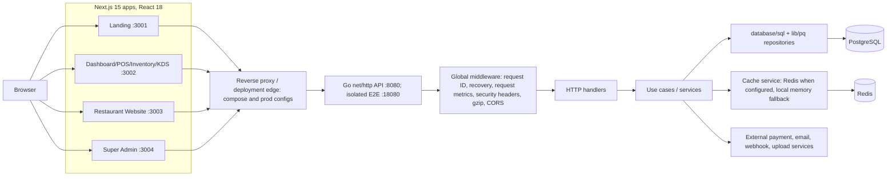

# POOS System Architecture and Runtime Baseline

**Scope:** static source inspection of the dirty `H:\Projects\pos` checkout on branch `codex/phase2a-continuation`, with read-only comparison against dirty `H:\ws02` (`codex/ws02-final-security-closure`); limited runtime sampling only against the verified isolated WS05 E2E stack.

## System map

## Verified source facts

- Four Next.js applications exist under `frontend/apps`: dashboard, landing, restaurant-website, super-admin. Packages and lockfiles declare pnpm/Turbo workspaces. All app declarations use Next `^15.1.0` and React `^18.3.1`; these are declared ranges, not resolved runtime versions.
- Backend uses Go `net/http`, `database/sql`, `lib/pq`; route registrations are primarily in `backend/cmd/api/main.go` and health routes in `backend/cmd/api/health_routes.go`.
- The active global middleware chain is request ID → recovery → request metrics → security headers → gzip → CORS (`backend/cmd/api/main.go`, around lines 1874–1880). Protected route wrapper variants are defined around lines 588–669.
- Database pool settings default in config to max-open 75, max-idle 25, idle lifetime 2m, max lifetime 5m (`backend/internal/config/config.go:56–61`). Connector fallback values are 25/10 when configured values are non-positive (`backend/internal/pkg/database/postgres.go:35–53`).
- Redis integration is an optional Go cache service. It falls back to process-local memory when the Redis URL is absent or initialization fails. Current consumers found: tenant-status middleware and financial-report caching; theme and other legacy caches are in-process.
- Authentication / tenant / permission middleware is route-dependent. Typical protected flow is JWT auth → tenant context → optional tenant-status → optional RBAC. Public restaurant paths and selected health/public order paths are alternate flows. Do not infer a single chain for all endpoints.
- Restaurant Website uses a tenant slug from host middleware; the home server page fetches theme, products, and homepage data in parallel. Super Admin auth uses a separate provider and local storage token mechanism (static code evidence).
- Compose files define separate dev, production, test, and Phase 2A E2E stacks. Runtime inspection confirmed the named WS05 E2E project is separate from `pos-dev`, explicitly labeled disposable, and uses tmpfs for PostgreSQL. `pos-dev` was not contacted.

## Runtime and environment distinction

The sampled WS05 stack is `pos-p2a-ws05-e2e-20261103`, sourced from `H:\Projects\pos\docker-compose.phase2a-e2e.yml`, with `POS_TEST_SEED=true`, PostgreSQL `pos_phase2a_e2e`, Redis, and loopback-only published ports. It is development mode. PostgreSQL contained small synthetic fixtures (91 public tables; about 18.4 MB); Redis had zero keys at inspection. Measurements from it do not represent production data scale. A separate `pos-dev` stack was seen running and left untouched.

## Unverified / assumptions

- No production or staging deployment, reverse proxy behavior, CDN configuration, resolved package lock versions per app, production build output, deployed API settings, or customer data were inspected as live runtime facts.
- The architecture diagram compresses service/domain layers because not every endpoint was traced individually.
- Worktrees were already dirty at start and are both on different branches. Report references the current checkout state and must not be treated as a clean commit baseline.
