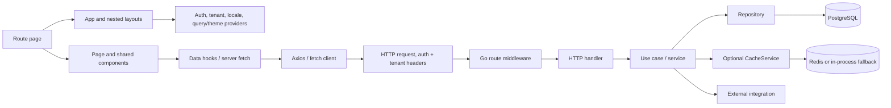

# Frontend-to-Backend Dependency Graph

## Confirmed shared requests / triggers (static source evidence)

- Dashboard authentication bootstrap and impersonation validation can occur before route content is available. Preferences load from shared layout; route preloading may request pages/chunks before user navigation.
- Dashboard KDS, reports, and notification hooks poll/refetch. Notifications are visibility-aware; KDS and reports polling require page-specific inspection for hidden-tab behavior. Tenant status provider has periodic/focus revalidation but was not found wired into the global layout.
- Restaurant tenant-status middleware performs a server request for tenant-hosted navigation. Public homepage requests theme/products/homepage; theme is also requested for metadata. Query hooks use per-feature stale/refetch settings. Tracking queries poll at 10–15 seconds.
- Super Admin auth is global; individual dashboard features fetch via Axios.

These are statically identified trigger families, not an observed browser request waterfall. Detailed per-page request bodies, cache hit evidence, response contracts, backend data tables and retries have not been exhaustively linked.
